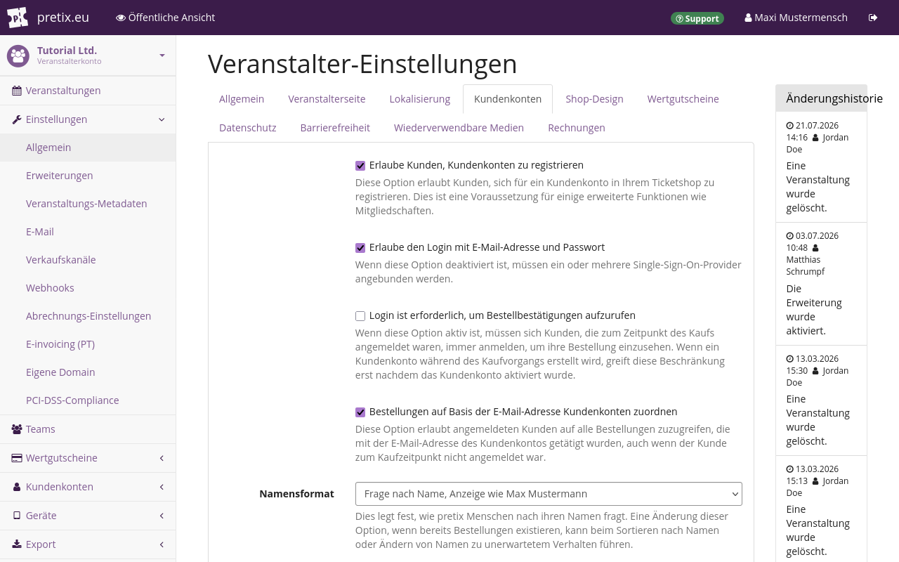
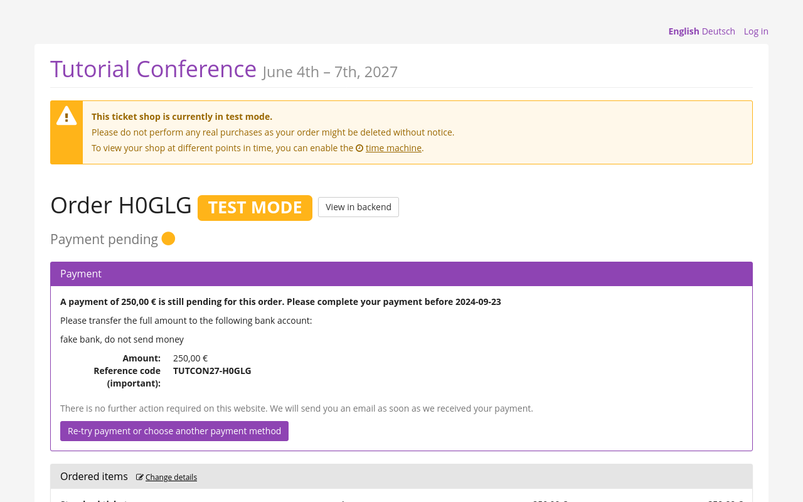
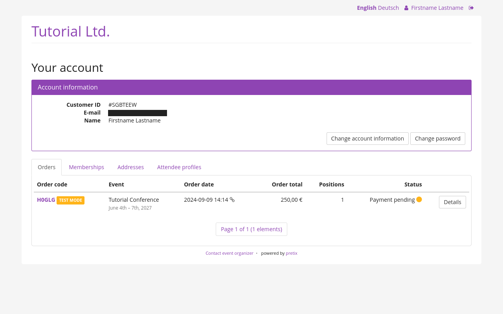

# Kund\*innenkonten

Mit pretix können Ihre Kund\*innen im Shop einkaufen, ohne ein Konto anzulegen.
pretix gibt Ihnen aber auch die Möglichkeit, Kund\*innenkonten zu aktivieren.
Kund\*innenkonten haben drei Vorteile:

Erstens können Ihre Kund\*innen auf diese Weise ihre persönlichen Daten hinterlegen, sodass sie nicht mehr bei jedem Kauf Adressen und Teilnehmendendaten eingeben müssen.
Zweitens können Sie Ihre Kund\*innen dann auch über ihr persönliches Konto erreichen, nicht nur im Rahmen einzelner Bestellungen.
Drittens haben Sie mit Kund\*innenkonten die Möglichkeit, Mitgliedschaften zu vergeben, die Sie dann für Dauerkarten, Exklusivangebote für Mitglieder und wiederverwendbare Medien benutzen können.

!!! Hinweis
    Kund\*innenkonten und Mitgliedschaften sind nicht dasselbe.
    Kund\*innenkonten werden in der Regel von den Kund\*innen selbst angelegt.
    Die Aktivierung von Kund\*innenkonten ist eine Voraussetzung für die Nutzung der Mitgliedschaftsfunktion.
    Der Zugang zu einem Kund\*innenkonto ist eine Voraussetzung für den Erhalt einer Mitgliedschaft.

    Mitgliedschaften werden in der Regel beim Kauf eines Produkts mit einem Kund\*innenkonto verknüpft und dienen anschließend zur Nutzung exklusiver Rabatte und zum Zugriff auf Produkte.

Dieser Artikel erklärt, wie Sie Kund\*innenkonten aktivieren und verwalten.

## Voraussetzungen

Kund\*innenkonten werden auf Veranstalterebene verwaltet.
Wenn Sie Kund\*innenkonten aktivieren möchten, benötigen Sie Zugriff auf ein Veranstalterkonto.

## Allgemeine Verwendung

Kund\*innenkonten sind immer einem Veranstalterkonto zugeordnet.
Kund\*innen, die bei einer Bestellung für eine Ihrer Veranstaltungen ein Konto angelegt haben, können sich anschließend bei diesem Konto anmelden und darüber Bestellungen für alle vom selben Veranstalterkonto verwalteten Veranstaltungen tätigen.
Das Anlegen eines Kund\*innenkontos für einen Kauf bei einem Veranstalter erstellt kein Kund\*innenkonto für Transaktionen mit anderen Veranstaltern.

Es ist nicht möglich, ein Kund\*innenkonto für einzelne Veranstaltungen zu aktivieren oder deaktivieren.
Es ist auch nicht möglich, Kund\*innen zum Anlegen eines Kontos zu zwingen.
Die Option, einen Kauf als Gast zu tätigen, steht immer zur Verfügung.

Wenn Sie möchten, dass Ihre Kund\*innen Konten anlegen können, navigieren Sie zu :navpath:Ihr Veranstalter → Einstellungen → Allgemein:, rufen Sie den Reiter :btn:Kundenkonten: auf und markieren Sie das Kontrollkästchen bei "Erlaube Kunden, Kundenkonten zu registrieren".

Wenn dieses Kontrollkästchen markiert ist, wird ein weiteres Kontrollkästchen angezeigt, das standardmäßig markiert ist: "Erlaube den Login mit E-Mail-Adresse und Passwort".
Lassen Sie dieses Kontrollkästchen markiert, wenn Ihre Kund\*innen die Möglichkeit haben sollen, sich direkt bei Ihrem pretix-Shop anzumelden.
Entfernen Sie die Markierung, wenn Sie möchten, dass die Anmeldung ausschließlich über einen externen Single-Sign-on-Dienst möglich ist.

Standardmäßig können Kund\*innen alle Bestellungen ansehen und bearbeiten, die über ein bestimmtes Kund\*innenkonto getätigt wurden.
Wenn Sie das Kontrollkästchen bei "Bestellungen auf Basis der E-Mail-Adresse Kundenkonten zuordnen" markieren, können Ihre eingeloggten Kund\*innen auch alle Bestellungen einsehen und bearbeiten, die über die gleiche E-Mail-Adresse getätigt wurden.
Das trifft auch auf Bestellungen zu, die ohne Login aufgegeben wurden.

### Kund\*innenkonten aus Kund\*innen-Perspektive

Aus der Perspektive Ihrer Kund\*innen ist ein pretix-Shop auch ohne Kund\*innenkonto gut nutzbar.
Sie können Ihren Kund\*innen die Möglichkeit anbieten, ein Konto anzulegen.
Das ist dann sinnvoll, wenn Sie davon ausgehen, dass Ihre Kund\*innen wiederholt etwas bestellen, oder dass sie auf ihre Mitgliedschaften, Adressen, Teilnehmendenprofile, Kontodaten und Passwörter zugreifen und diese ändern.

Kund\*innen, die eine Bestellung aufgeben, ohne sich bei einem Kund\*innenkonto anzumelden oder eines anzulegen, erhalten eine E-Mail mit einer URL.
Diese URL führt zu einer Seite, auf der sie bezahlen, ihr Ticket herunterladen und Details ihrer Bestellung, den Versand sowie persönliche Angaben ändern können.
Die URL gilt nur für diese eine Bestellung.

Kund\*innen, die ein Konto anlegen und sich einloggen, sehen einen Überblick über ihre Bestellungen und können diese einzeln anzeigen und bearbeiten, genau wie oben beschrieben.
Zusätzlich dazu können sie aber auch Mitgliedschaften, Adressen, Profile von Teilnehmenden, Kontodaten und das Passwort einsehen und ändern.

### Kund\*innenkonten verwalten

Navigieren Sie zu :navpath:Ihr Veranstalter → :fa3-user: Kundenkonten → Kunden:.
Diese Menüoption wird nur angezeigt, wenn Sie in den Veranstalterkonto-Einstellungen Kund\*innenkonten aktiviert haben.
Die Seite "Kunden" zeigt eine Liste aller Kund\*innenkonten in Ihrem Veranstalterkonto an und führt "Kundennummer", E-Mail-Adresse, Name und optional eine "Externe Referenz" auf.

Auf dieser Seite können Sie Kund\*innenkonten suchen und filtern und über den Button :btn-icon:fa3-plus: Neues Kundenkonto erstellen: ein neues Konto erstellen.
pretix generiert die "Kundennummer" für jedes Kund\*innenkonto automatisch.
Beim Anlegen des Kontos können Sie diese Kundennummer manuell ändern.
Diese Nummer ist der eindeutige Identifikator für ein Konto und kann nach dem Anlegen nicht mehr geändert werden.
Der Identifikator darf nur Buchstaben, Ziffern, Punkte, Bindestrich und Unterstriche enthalten.
Er muss mit einem Buchstaben oder einer Ziffer beginnen und enden.

Die einzige zwingend notwendige Angabe für ein Kund\*innenkonto ist die E-Mail-Adresse.

Kund\*innen können sich nur dann in ihr Konto einloggen, wenn die Kontrollkästchen neben "Konto aktiv" **und** "Verifizierte E-Mail-Adresse" markiert sind.
Das Kontrollkästchen "Verifizierte E-Mail-Adresse" wird automatisch markiert, wenn Kund\*innen den Link in der E-Mail mit der Bestätigung oder zum Zurücksetzen des Passworts klicken.
Sie können dieses Kontrollkästchen auch manuell aktivieren oder deaktivieren.
Wenn dieses Kontrollkästchen nicht markiert ist und Kund\*innen versuchen, sich am Konto anzumelden, werden sie aufgefordert, entweder den Bestätigungslink zu klicken oder das Passwort zurückzusetzen.

Falls Sie bereits Kund\*innenkonten in einer anderen Software führen und eine eindeutige Verbindung zu pretix-Kund\*innenkonten herstellen möchten, sollten Sie den eindeutigen Identifikator des Kontos aus der anderen Software in das Feld "Externe Referenz" eintragen.
Wenn Sie Daten zwischen pretix und einer anderen Software synchronisieren oder per Import oder Export austauschen möchten, sollten Sie dieses Feld über eine Integration mit der pretix-API automatisch befüllen lassen.
Genauere Informationen dazu finden Sie in der [Dokumentation zur pretix-REST-API](https://docs.pretix.eu/en/latest/api/resources/customers.html).

Alle Eingaben in das Feld "Notizen" sind nur für Sie und Ihr Team sichtbar, nicht für Kund\*innen.

### Single Sign-on (SSO)

"Single Sign-on", kurz SSO, bezeichnet eine Infrastruktur, bei der sich Benutzer\*innen mit denselben Anmeldedaten bei mehreren Systemen (z. B. Apps oder Websites) anmelden können.
Wenn pretix nur eine von mehreren Anwendungen ist, die Ihre Kund\*innen benutzen sollen, ist es sinnvoll, SSO zu implementieren.
Das entlastet Ihre Kund\*innen, denn sie müssen nicht mehr auf den Unterschied zwischen Ihren verschiedenen Systemen achten und den Überblick über die jeweiligen Benutzer\*innennamen und Passwörter behalten.
Wenn Sie SSO verwenden, können ihre Kund\*innen für jede Interaktion mit Ihrem Unternehmen bzw. Ihrer Marke dieselben Anmeldedaten verwenden.

Sie können pretix als SSO-Provider nutzen.
Dann können Kund\*innen ein pretix-Konto anlegen und es für alle anderen Anwendungen verwenden, die Sie als SSO-Clients verbunden haben.
pretix verhält sich dann also als "Source of truth".

Sie können pretix auch als SSO-Client nutzen.
Wenn Sie bereits einen anderen SSO-Provider als "Source of truth" für Ihre Anwendungen nutzen, können Sie pretix als SSO-Client verbinden.
Dann können sich Kund\*innen über die vorhandene SSO-Infrastruktur bei Ihrem pretix-Shop anmelden und dort einkaufen.

Die SSO-Unterstützung für Kund\*innenkonten in pretix nutzt derzeit den Standard OpenID Connect, einen modernen Standard mit breiter Akzeptanz in allen Branchen.

#### pretix als SSO-Provider

Wenn Sie pretix als SSO-Provider nutzen möchten, navigieren Sie zu :navpath:Ihr Veranstalter → :fa3-user: Kundenkonten → SSO-Clients: und klicken Sie den Button :btn-icon:fa3-plus: Neuen SSO-Client erstellen:.

Das Kontrollkästchen bei "Aktiv" ist standardmäßig aktiviert.
Deaktivieren Sie es, wenn Sie die SSO-Integration für den betreffenden Client deaktivieren möchten.

Geben Sie in das Feld "Name der Applikation" einen aussagekräftigen und eindeutigen Namen ein, beispielsweise den Namen der Anwendung oder Website, für die Sie pretix als SSO-Provider nutzen möchten.

Falls es sich um eine Server-Anwendung handelt, die einen geheimen Schlüssel speichern kann, auf den die Endbenutzer\*innen nicht zugreifen können, dann wählen Sie bei "Art des Clients" die Option `Vertraulich`
Falls es sich hingegen um eine Client-Anwendung handelt, etwa eine Smartphone-App, dann wählen Sie die Option `Öffentlich`.

Was Sie bei "Art des Grants" wählen, hängt davon ab, wie der Standard OpenID Connect implementiert ist, der von der zu verbindenden Anwendung verwendet wird.

Geben Sie in das Feld "Weiterleitungs-URIs" eine oder mehrere URIs ein, zu denen Kund\*innen nach der erfolgreichen oder fehlgeschlagenen Anmeldung weitergeleitet werden.

Markieren Sie unter "Erlaubte Zugriffsbereiche" die Kontrollkästchen für die Bereiche, auf die die Anwendung zugreifen darf.

Sobald Sie den Button :btn:Speichern: klicken, werden die Angaben zur Client-Konfiguration oben auf der Seite angezeigt: Basis-URL, Client-ID und Client-Secret.
Das Client-Secret wird nur einmal angezeigt.
Kopieren Sie es und fügen Sie es in Ihre Anwendung ein.
"Basis-URL" und "Client-ID" werden auch in den Feldern unterhalb von "Name der Applikation" angezeigt.

Wenn Sie ein neues Client-Secret benötigen, markieren Sie das Kontrollkästchen bei "Bestehendes Client-Secret invalidieren und neues Client-Secret erzeugen" und klicken Sie den Button :btn:Speichern:.
Das alte Client-Secret kann danach nicht mehr verwendet werden.
Das neue Client-Secret wird in einem grünen Feld oben auf der Seite angezeigt.

Der Dienst, mit dem Sie sich verbinden, benötigt neben Client-ID und Client-Secret auch Ihre Issuer-URI.
Diese entnehmen Sie dem Feld "Basis-URL".
Wenn Sie pretix Hosted ohne eigene Domain nutzen, ist Ihre Issuer-URI die Adresse des öffentlichen Veranstalterprofils **ohne** den letzten Schrägstrich.
Zum Beispiel lautet die Issuer-URI unserer Beispielfirma Tutorial Ltd. mit der Veranstalter-Kurzform "tut" [https://pretix.eu/tut](https://pretix.eu/tut).

Wenn Sie eine eigene Domain nutzen, ist Ihre Issuer-URI die Adresse dieser Domain mit vorangestelltem "https://".
Wenn zum Beispiel Ihre eigene Domain tickets.meinefirma.net heißt, lautet Ihre Issuer-URI [https://tickets.meinefirma.net](https://tickets.meinefirma.net).

#### Technische Details für die Nutzung von pretix als SSO-Provider

pretix implementiert die Spezifikation [OpenID Connect Core 1.0](https://openid.net/specs/openid-connect-core-1_0.html).
Ausgenommen sind einige optionale Komponenten, die bei pretix keinen Nutzen haben.
So werden beispielsweise verschlüsselte Tokens, Offline-Zugriff, Aktualisierungstokens ("refresh tokens") und die Übergabe von Anforderungsparametern als JWTs nicht unterstützt.

pretix implementiert den Abschnitt mit Provider-Metadaten von [OpenID Connect Discovery 1.0](https://openid.net/specs/openid-connect-discovery-1_0.html).
Den Endpunkt für die Aussteller-URI ermitteln Sie, wie oben beschrieben, beispielsweise unter [https://pretix.eu/demo/.well-known/openid-configuration](https://pretix.eu/demo/.well-known/openid-configuration).

Alle drei Flows von OpenID Connect Core sind implementiert:

 - Autorisierungscode-Flow (Antworttyp `code`)
 - Implicit-Flow (Antworttypen `id_token token` und `id_token`)
 - Hybrid-Flow (Antworttypen `code id_token`, `code id_token token` und `code token`)

Die Antwortmodi `query` und `fragment` sind implementiert.

pretix bietet folgende Berechtigungsbereiche ("scopes"): `openid`, `profile`, `email`, `phone`.

Implementiert sind außerdem die folgenden standardisierten Claims: `iss`, `aud`, `exp`, `iat`, `auth_time`, `nonce`, `c_hash`, `at_hash`, `sub`, `locale`, `name`, `given_name`, `family_name`, `middle_name`, `nickname`, `email`, `email_verified`, `phone_number`.

Die Adressen der verschiedenen Endpunkte sind relativ zur Aussteller-URI, wie oben beschrieben:

 - Autorisierung: `<issuer>/oauth2/v1/authorize`
 - Token: `<issuer>/oauth2/v1/token`
 - Benutzer\*innendaten: `<issuer>/oauth2/v1/userinfo`
 - Schlüssel: `<issuer>/oauth2/v1/keys`

Diese Endpunkte setzen die Spezifikationen von OpenID Connect und OAuth ohne besondere Verhaltensweisen um.
Weitere Informationen dazu finden Sie in diesen Spezifikationen.

#### pretix als SSO-Client

Wenn Sie pretix als SSO-Client nutzen möchten, navigieren Sie zu :navpath:Ihr Veranstalter → :fa3-user: Kundenkonten → SSO-Provider: und klicken Sie den Button :btn-icon:fa3-plus: Neuen SSO-Provider erstellen:.

Legen Sie "Provider-Name" und "Login-Button-Beschriftung" fest.
Der "Provider-Name" dient zur internen Bezeichnung des Providers im pretix-Backend.
Die "Login-Button-Beschriftung" legt den Text auf dem Button fest, der den Kund\*innen zur Anmeldung in Ihrem Shop angezeigt wird.
Wählen Sie bei "Single-Sign-On-Methode" die Option `OpenID Connect`.
Durch die Auswahl von `OpenID Connect` zeigt die Seite einige neue Felder an. 
Tragen Sie hier die Angaben Ihres SSO-Providers ein.

Wenn Sie möchten, dass sich Ihre Kund\*innen ausschließlich per SSO anmelden und kein Konto bei pretix direkt anlegen, navigieren Sie zu :navpath:Ihr Veranstalter → Einstellungen → Allgemein:, rufen Sie den Reiter :btn:Kundenkonten: auf und entfernen Sie das Häkchen aus dem Kontrollkästchen "Erlaube den Login mit E-Mail-Adresse und Passwort".

#### Technische Details für die Nutzung von pretix als SSO-Client

Wenn Sie einen SSO-Provider mit pretix verwenden möchten, muss dieser folgende Anforderungen erfüllen:

 - Implementierung gemäß der Spezifikation [OpenID Connect Core 1.0](https://openid.net/specs/openid-connect-core-1_0.html)
 - Metadaten-Dokument veröffentlicht unter `<issuer>/.well-known/openid-configuration`, wie in [OpenID Connect Discovery 1.0](https://openid.net/specs/openid-connect-discovery-1_0.html) spezifiziert
 - Unterstützung für den Autorisierungscode-Flow (`response_type=code`) mit `response_mode=query`
 - Unterstützung für die Client-Authentifizierung mittels Client-ID und Client-Secret sowie ohne Verschlüsselung mit öffentlichem Schlüssel
 - Der SSO-Provider erlaubt nur die Anmeldung geprüfter Konten **oder** sendet den Claim `email_verified`. 

!!! Warning
    Standardmäßig gibt pretix Kund\*innen Zugriff auf frühere Bestellungen, die über dieselbe E-Mail-Adresse getätigt wurden.
    Dies ist nur dann sicher, wenn Ihr SSO-Provider E-Mail-Adressen überprüft, zum Beispiel durch eine Bestätigungs-E-Mail.
    Falls der SSO-Provider den Claim `email_verified` nicht schickt, akzeptiert pretix alle Konten. 
    Falls der SSO-Provider den Claim `email_verified` schickt, weist pretix Konten zurück, bei deren Benutzer\*innenprofil `email_verified=false` vermerkt ist.
    
#### Beispiel: Google Accounts als SSO-Provider für pretix nutzen

Wenn Sie Google als SSO-Provider für pretix nutzen möchten, befolgen Sie die Anweisungen in der Google-Dokumentation zu [OpenID Connect](https://developers.google.com/identity/openid-connect/openid-connect?hl=de).
Rufen Sie das [Cloud-Backend von Google](https://console.cloud.google.com/auth/clients) auf und erstellen Sie einen neuen Client.
Wählen Sie beim Anlegen unter "Anwendungstyp" die Option "Webanwendung".
Notieren Sie sich "Client ID" und "Client secret", damit Sie diese Angaben später in das pretix-Backend eintragen können.

Rufen Sie das pretix-Backend auf und navigieren Sie zu :navpath:Ihr Veranstalter → :fa3-user: Kundenkonten → SSO-Provider: und klicken Sie den Button :btn-icon:fa3-plus: Neuen SSO-Provider erstellen:.
Wählen Sie als "Provider-Name" beispielsweise "Google" und als "Login-Button-Beschriftung" beispielsweise "Mit Google anmelden".
Tragen Sie Folgendes ein:

 - **Single-Sign-On-Methode**: `OpenID Connect`
 - **Basis-URL**: `https://accounts.google.com`
 - **Client-ID**: Tragen Sie hier die ID ein, die Sie sich beim Erstellen des Clients im Google-Backend notiert haben.
 - **Client-Secret**: Tragen Sie hier das Client-Secret ein, das Sie sich beim Erstellen des Clients im Google-Backend notiert haben.

Um die nächsten drei Felder auszufüllen, lesen Sie die Dokumentation, die oben bei den [technischen Details](customer-accounts.md#technische-details-fur-die-nutzung-von-pretix-als-sso-client) verlinkt ist.
Eine Beispielkonfiguration könnte so aussehen:

 - **Scope**: `openid email profile`
 - **Email address claim**: `email`
 - **Identity claim**: `sub`

Klicken Sie den Button :btn:Speichern:.
Das Feld "Weiterleitungs-URL" enthält jetzt eine URL, die ähnlich, aber **nicht genauso** aussieht wie `https://pretix.eu/tut/account/login/199/return`.
Rufen Sie das Google-Backend auf, bearbeiten Sie Ihren Client, fügen Sie eine URL hinzu, geben Sie diese in das Feld ein und speichern Sie die Einstellungen.
