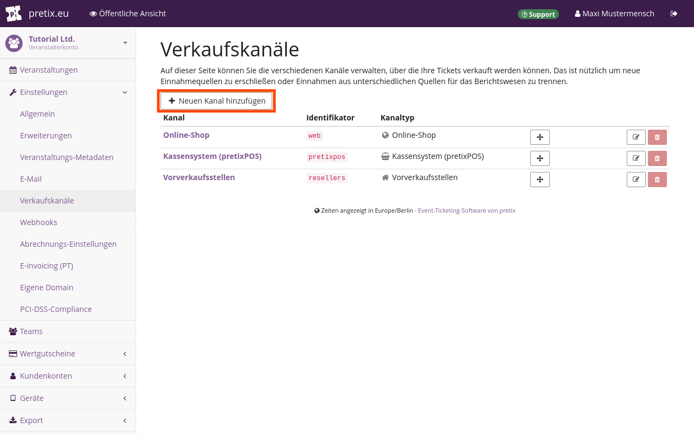
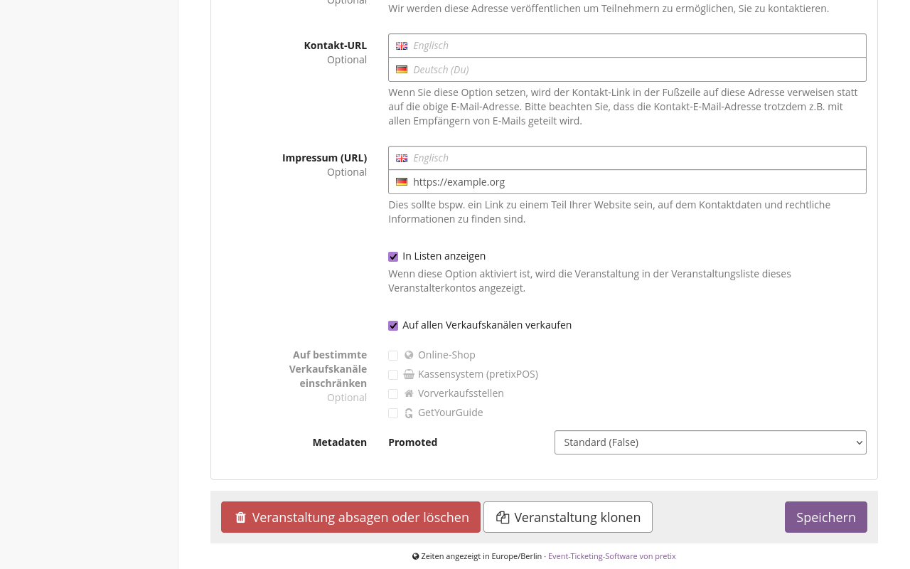
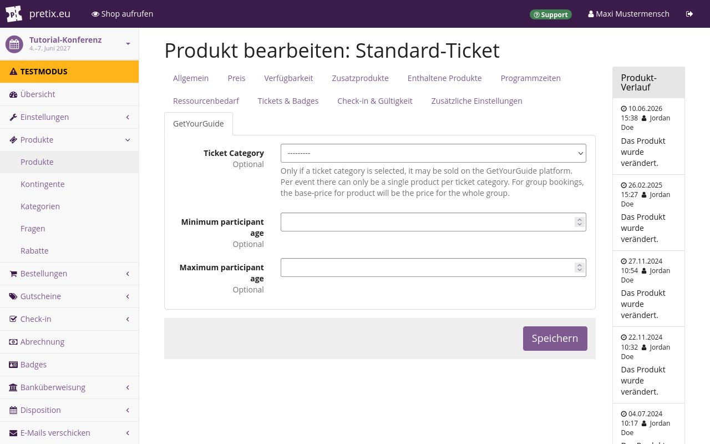

# GetYourGuide

Sie können externe Aggregatoren wie GetYourGuide nutzen und auf diese Weise Tickets nicht nur über Ihren eigenen Shop, sondern auch über die Webseite des Aggregators verkaufen.
Die Nutzung von GetYourGuide ist mit zwar Zusatzkosten verbunden, aber darüber können Sie ein größeres Publikum erreichen, das Ihren Shop sonst vielleicht gar nicht finden würde.

pretix ermöglicht die Integration mit GetYourGuide, damit Sie von diesem weiteren Verkaufskanal und den zusätzlichen Umsätzen profitieren, dabei aber den Aufwand zum Einrichten und Pflegen mehrerer Shops auf ein Minimum begrenzen können.
Dieser Artikel erläutert, wie Sie dazu vorgehen.

## Voraussetzungen

Wenn Sie die Integration mit GetYourGuide in pretix nutzen möchten, benötigen Sie Zugriff auf ein aktives Anbieterkonto bei GetYourGuide.
Die GetYourGuide-Integration gilt auf Veranstaltungsebene, Sie müssen also zuerst eine Veranstaltung anlegen.

## Anleitung

Folgende Schritte sind erforderlich, um die GetYourGuide-Integration einzurichten:

 1. Bitten Sie den pretix-Support, für Ihr Konto die [GetYourGuide-Erweiterung verfügbar zu machen](#ihr-veranstalterkonto-fur-getyourguide-einrichten).
 2. Erstellen Sie einen [Verkaufskanal](#ihr-veranstalterkonto-fur-getyourguide-einrichten).
 3. Aktivieren Sie die [Erweiterung](#ihre-veranstaltung-fur-getyourguide-einrichten).
 4. Konfigurieren Sie [Produkte](#produkte-fur-getyourguide-einrichten).
 5. [Verbinden](#mit-getyourguide-verbinden) Sie Ihr Konto mit GetYourGuide.

Dieser Artikel erklärt diese Schritte ausführlich.

### Ihr Veranstalterkonto für GetYourGuide einrichten

Die pretix-Integration mit GetYourGuide ist derzeit im Beta-Stadium.
Sie können sie erst nutzen, wenn das pretix-Team sie für Ihr Veranstalterkonto verfügbar gemacht hat.
Nehmen Sie per [E-Mail](mailto:support@pretix.eu) oder [Telefon](tel:+4962213217750) Kontakt zum Support auf und bitten Sie darum, dass Ihnen die GetYourGuide-Erweiterung zur Verfügung gestellt wird.

Bevor Sie GetYourGuide nutzen können, müssen Sie außerdem in Ihrem Veranstalterkonto einen entsprechenden Verkaufskanal erstellen.
pretix nutzt den Verkaufskanal, um Verkäufe korrekt GetYourGuide zuzuordnen.
Das bedeutet, dass pretix alle Bestellungen, die über GetYourGuide eingehen, für den Verkaufskanal "GetYourGuide" registriert.

Navigieren Sie zu :navpath:Ihr Veranstalter → :fa3-wrench: Einstellungen → Verkaufskanäle:.
Klicken Sie den Button :btn-icon:fa3-plus: Neuen Kanal hinzufügen:.
Wählen Sie auf der Seite "Verkaufskanal hinzufügen" die Option :btn:GetYourGuide:.
Klicken Sie den Button :btn:Speichern:.

Wiederholen Sie diese Schritte für jedes weitere Veranstalterkonto, für das Sie die Integration mit GetYourGuide nutzen möchten.

### Ihre Veranstaltung für GetYourGuide einrichten

Um die Erweiterung GetYourGuide für Ihre Veranstaltung zu aktivieren, navigieren Sie zu :navpath:Ihre Veranstaltung → :fa3-wrench: Einstellungen → Erweiterungen: und wechseln Sie zum Reiter :btn:Integrationen:.
Suchen Sie in der Liste nach der Erweiterung "GetYourGuide" und klicken Sie den Button :btn:Aktivieren: daneben.
Da Sie die Erweiterung GetYourGuide aktiviert haben, stehen Ihnen nun die Integration mit GetYourGuide sowie alle dazugehörigen Einstellungen für Ihre Veranstaltung zur Verfügung.

Um Tickets für Ihre Veranstaltung über den Verkaufskanal GetYourGuide zu verkaufen, navigieren Sie zu :navpath:Ihre Veranstaltung → :fa3-wrench: Einstellungen → Allgemein:.
Markieren Sie unter "Verkaufskanäle" das Kontrollkästchen neben "GetYourGuide" oder das neben "Auf allen Verkaufskanälen verkaufen".

Um Ihr Angebot für die GetYourGuide-Webseite zu konfigurieren, navigieren Sie zu :navpath:Ihre Veranstaltung → :fa3-wrench: Einstellungen → GetYourGuide: und wechseln Sie zum Reiter :btn:Configuration:.
Tragen Sie die erforderlichen Angaben ein und wählen Sie "Event time mode" und "Buchungsmodus".

Sie können über GetYourGuide für jede Ihrer Veranstaltungen entweder Einzel- oder Gruppentickets anbieten.
Weitere Informationen über den Unterschied zwischen Einzeltickets und Gruppentickets finden Sie im [nächsten Abschnitt](#produkte-fur-getyourguide-einrichten).
Wenn Sie alles wie gewünscht gewählt haben, klicken Sie den Button :btn:Speichern:.

Wiederholen Sie diese Schritte für jede weitere Veranstaltung, für die Sie Produkte über GetYourGuide anbieten möchten.

### Produkte für GetYourGuide einrichten

Konfigurieren Sie mindestens ein Produkt, das Sie über GetYourGuide verkaufen möchten.
Dazu navigieren Sie zu :navpath:Ihre Veranstaltung → :fa3-ticket: Produkte: und erstellen oder bearbeiten ein Produkt.
Wechseln Sie zum Reiter :btn:Verfügbarkeit: und markieren Sie unter "Verkaufskanäle" das Kontrollkästchen neben "GetYourGuide" oder das neben "Auf allen Verkaufskanälen verkaufen".

Wechseln Sie anschließend zum Reiter :btn:GetYourGuide: und geben Sie die GetYourGuide-Ticketkategorie an.
Die Einstellung "Ticket Category" ist nur für Tickets relevant, die Sie über GetYourGuide verkaufen.
Sie hat nichts zu tun mit den pretix-Einstellungen für "Kategorien".

Für jede Ihrer Veranstaltungen kann es pro GetYourGuide-Ticketkategorie nur ein Produkt geben.
Sie können für jede Ihrer pretix-Veranstaltungen über GetYourGuide entweder Einzel- oder Gruppentickets anbieten – aber nicht beides.

Wenn Sie den Buchungsmodus für **Gruppentickets** gewählt haben, müssen Sie unter "Ticket Category" die Option "Group" wählen.
Sie können für diese Veranstaltung nur ein Produkt über GetYourGuide anbieten.
Über die Felder "Minimal group size" und "Maximal group size" können Sie die Personenzahl einschränken, für die ein Ticket gültig ist.

Wenn Sie den Buchungsmodus für **Einzeltickets** gewählt haben, müssen Sie ein Produkt in der Kategorie "Adult" hinzufügen.
Sie können noch weitere Produkte in den anderen GetYourGuide-Kategorien ("Child", "Youth", "Senior" usw.) hinzufügen, aber **nicht** in der Kategorie "Group".
Jede GetYourGuide-Kategorie darf nur ein einziges Produkt enthalten.

Die pretix-Integration mit GetYourGuide überschreibt die in GetYourGuide festgelegten Preise.
Die Preise, die Sie auf der GetYourGuide-Website für die Kategorien einstellen, gelten also **nicht**.
Um den Preis für ein Produkt festzulegen, das Sie über GetYourGuide verkaufen möchten, müssen Sie das Produkt in pretix bearbeiten.
Wechseln Sie zum Reiter :btn:Preis: und geben Sie unter "Standardpreis" den vorgesehenen Preis ein.

Wie bei allen Produkten müssen Sie auch für Tickets, die Sie über GetYourGuide verkaufen möchten, in pretix ein Kontingent festlegen, damit die Produkte im Shop verfügbar sind.

### Mit GetYourGuide verbinden

Das GetYourGuide-Backend bezeichnet Ihre pretix-Veranstaltung als "Produkt".
Rufen Sie das [Anbieterportal](https://supplier.getyourguide.com/) von GetYourGuide auf und verbinden Sie es mit Ihrem pretix-Shop.
Dazu gehen Sie vor, wie im Hilfe-Center für Anbieter von GetYourGuide unter [So verbinden Sie ein neues Produkt mit Ihrem Reservierungssystem](https://supply.getyourguide.support/hc/de-de/articles/18008029689373-So-verbinden-Sie-ein-neues-Produkt-mit-Ihrem-Reservierungssystem) beschrieben.
Wählen Sie als "Reservierungssystem" "pretix.eu".
Um die benötigte "Produkt-ID" zu ermitteln, navigieren Sie in pretix zu :navpath:Ihre Veranstaltung → :fa3-wrench: Einstellungen → GetYourGuide: und wechseln Sie zum Reiter :btn:Configuration:.
Sie wird im Infofeld unten auf der Seite angezeigt, wenn Sie alle Pflichtangaben eingetragen und gespeichert haben.

Navigieren Sie zu :navpath:Ihre Veranstaltung → :fa3-wrench: Einstellungen → GetYourGuide: und wechseln Sie zum Reiter :btn:Analyzer:.
Auf dieser Seite sehen Sie, ob Ihr Shop und die Produkte im Shop korrekt für die Integration mit GetYourGuide eingerichtet sind.
Wenn Ihre Einrichtung korrekt ist, sehen Sie auf der Seite nur grüne :fa3-check-circle: und keine roten :fa3-times-circle:.

Wenn Ihr Shop online ist und die Integration mit GetYourGuide funktioniert, zeigt der Reiter "Analyzer" die Verfügbarkeiten an, die pretix für jedes Produkt an GetYourGuide übermittelt hat.
Ab jetzt importiert GetYourGuide Produkte und ihren Verfügbarkeitsstatus automatisch und bietet sie zum Verkauf an.