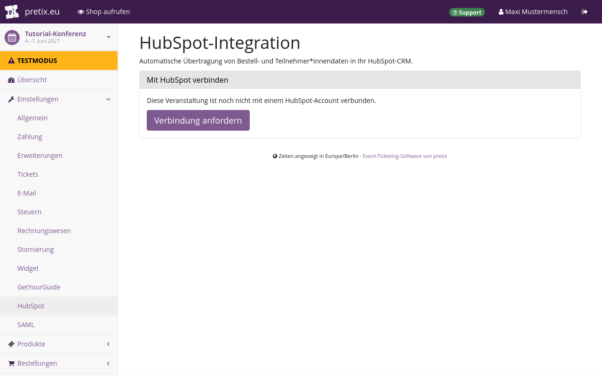
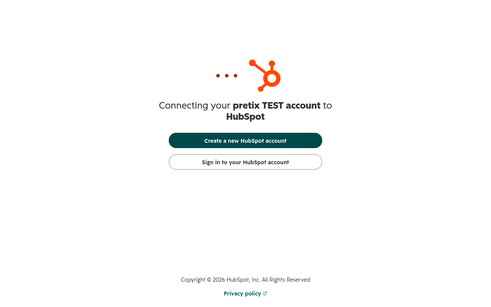
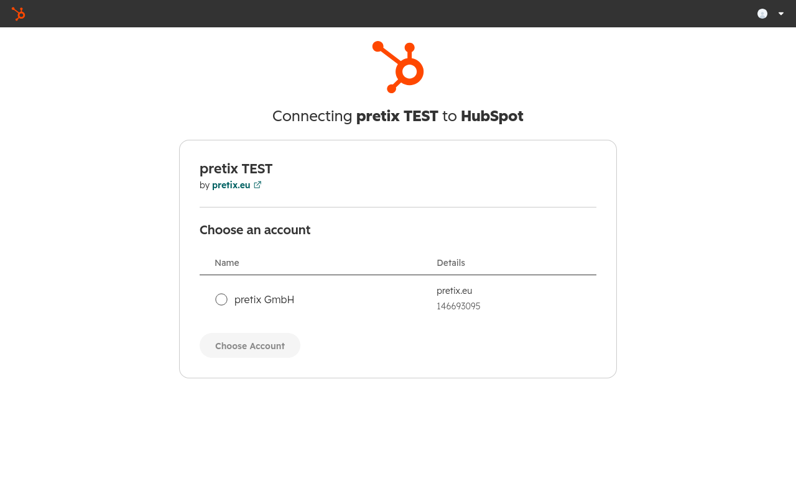
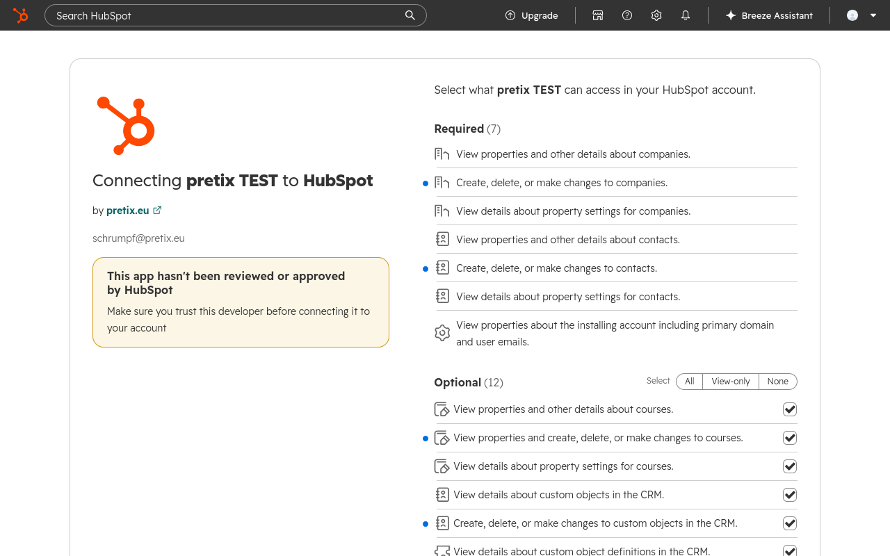
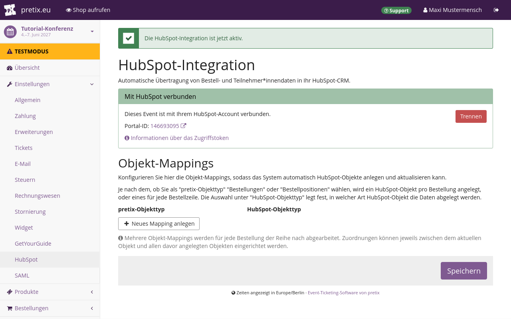
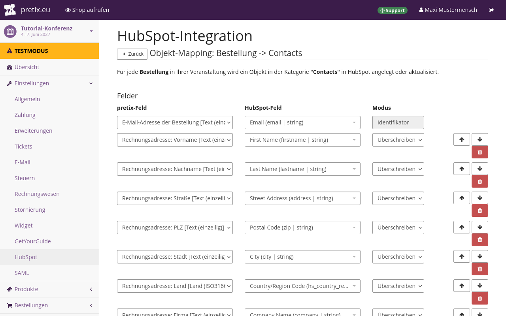
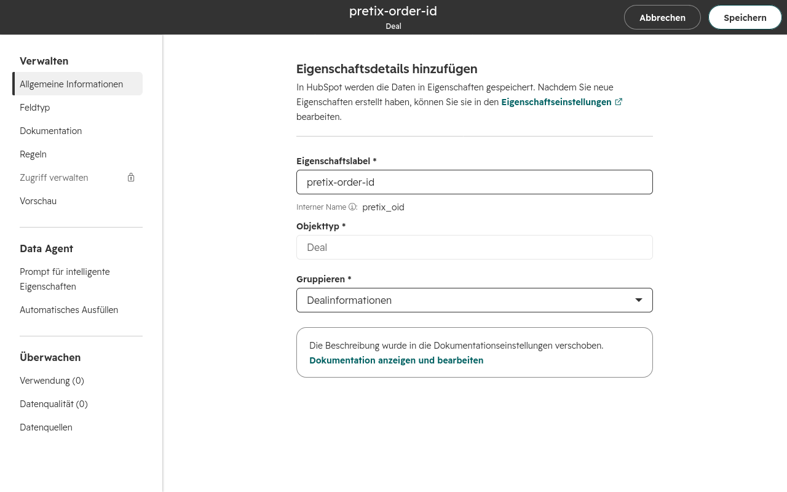
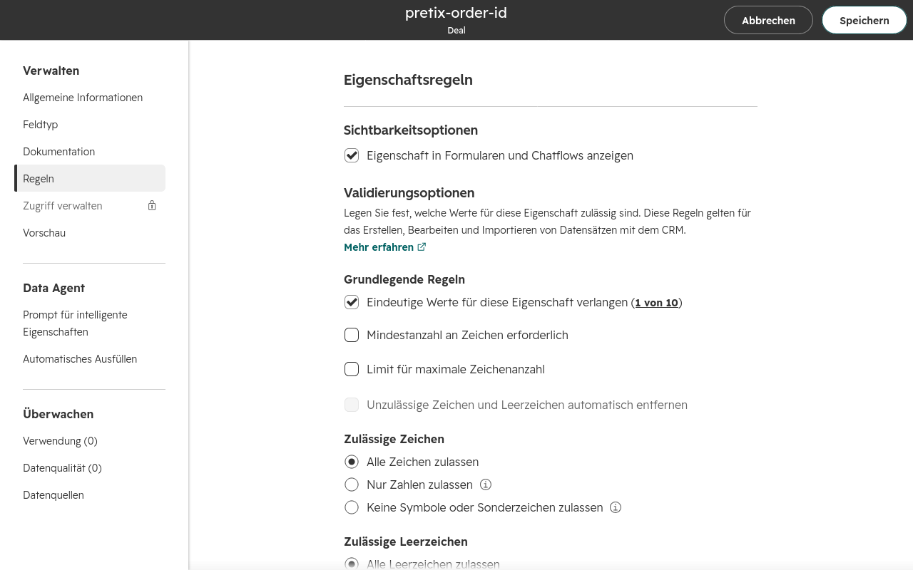

# HubSpot

Über die HubSpot-Integration können Sie Daten zu HubSpot exportieren, beispielsweise Kontaktdaten von Kund\*innen oder Transaktionen.
Dieser Artikel erklärt, wie Sie diese Funktion nutzen können

## Voraussetzungen

Erweiterungen gelten auf Veranstaltungsebene, Sie müssen also zuerst eine Veranstaltung anlegen.
Sie benötigen außerdem Zugriff auf ein HubSpot-Konto.

## Allgemeine Verwendung

Dieser Abschnitt erläutert, wie Sie die HubSpot-Erweiterung aktivieren und die Verbindung zwischen Ihrem pretix- und Ihrem HubSpot-Konto einrichten.
Diese Schritte sind notwendig, damit Sie Daten von pretix zu HubSpot exportieren können.

### Die Erweiterung aktivieren

Um die HubSpot-Erweiterung zu aktivieren, navigieren Sie zu :navpath:Ihre Veranstaltung → :fa3-wrench: Einstellungen → Erweiterungen: und wechseln Sie zum Reiter :btn:Integrationen:.
Klicken Sie den Button :btn:Aktivieren: neben der HubSpot-Erweiterung.

### Die Verbindung zu HubSpot einrichten

Klicken Sie das Dropdown-Menü :btn-icon:fa3-gear: Einstellungen: neben der Erweiterung HubSpot und dann :btn:Einstellungen > HubSpot:.
Alternativ navigieren Sie zu :navpath:Ihre Veranstaltung →  :fa3-wrench: Einstellungen → HubSpot:.
In beiden Fällen gelangen Sie zur Seite "HubSpot-Integration".

Um die Verbindung zu HubSpot einzurichten, klicken Sie den Button :btn:Verbindung anfordern:.

Sie gelangen zu einer Seite von HubSpot und werden (in englischer Sprache) aufgefordert, ein HubSpot-Konto anzulegen oder sich bei Ihrem vorhandenen Konto anzumelden.

Klicken Sie den Button :btn:Sign in to your HubSpot account:.
Die folgende Seite fordert Sie auf, ein Konto zu wählen.
Falls Sie noch kein HubSpot-Konto haben, klicken Sie stattdessen die Option :btn:Create a new HubSpot account: und legen Sie ein Konto an.

Wählen Sie Ihr Konto in der Liste und klicken Sie den Button :btn:Choose Account:.
Die nächste Seite warnt Sie, dass Sie dabei sind, eine ungeprüfte Anwendung zu verbinden.

Scrollen Sie an das Seitenende und klicken Sie den Button :btn:Connect app:.
Anschließend gelangen Sie zurück zum pretix-Backend auf die Seite mit den Einstellungen für die HubSpot-Integration.
Statt des Buttons "Verbindung anfordern" teilt die Seite Ihnen nun mit, dass die Veranstaltung mit HubSpot verbunden ist.
Darüber hinaus zeigt sie Einstellungen für Objekt-Mappings an.

Klicken Sie den Button :btn:Speichern:.

## Anwendungsmöglichkeiten

Dieser Abschnitt erläutert einige nützliche Einsatzmöglichkeiten für die HubSpot-Integration:

 - [Kund\*innen in Ihre Kontaktdatenbank bei HubSpot aufnehmen](#kundinnen-in-ihre-kontaktdatenbank-bei-hubspot-aufnehmen)
 - [Teilnehmende in Ihre Kontaktdatenbank bei HubSpot aufnehmen](#teilnehmende-in-ihre-kontaktdatenbank-bei-hubspot-aufnehmen)
 - [Bestellungen in Ihre HubSpot-Datenbank mit "Deals" aufnehmen](#bestellungen-als-deals-in-ihre-hubspot-datenbank-aufnehmen)

Bevor Sie eine dieser Möglichkeiten nutzen können, müssen Sie die Erweiterung aktivieren und die Verbindung herstellen, wie unter [Allgemeine Verwendung](#allgemeine-verwendung) beschrieben.

### Kund\*innen in Ihre Kontaktdatenbank bei HubSpot aufnehmen

Dieser Abschnitt erläutert, wie Sie in pretix geführte Kund\*innen Ihrer Kontaktdatenbank in HubSpot hinzufügen.
Öffnen Sie das pretix-Backend und navigieren Sie zu :navpath:Ihre Veranstaltung → :fa3-wrench: Einstellungen → HubSpot:.
Klicken Sie unter "Object mappings" den Button :btn-icon:fa3-plus: Add mapping:.

Wählen Sie unter "pretix-Objekttyp" die Option `Bestellung`.
Wählen Sie unter "HubSpot-Objekttyp" die Option `Contacts`.
Klicken Sie den Button :btn:Speichern:.

Um die Details der Daten zu ändern, die pretix den Einträgen in HubSpot zuordnet, klicken Sie den Button :btn-icon:fa3-edit: Mapping bearbeiten:.

Die erste Zeile unter "Felder" ist der Identifikator.
Wählen Sie unter "pretix-Feld" die Option `E-Mail-Adresse der Bestellung [Text (einzeilig)]`.
Wählen Sie unter "HubSpot-Feld" die Option `Email (Email | string)`.
Bei "Modus" ist die Option `Identifikator` festgeschrieben, was bedeutet, dass HubSpot diese Zeile als eindeutigen Identifikator für einen Eintrag in der Kontaktdatenbank verwendet.

Klicken Sie den Button :btn-icon:fa3-plus: Eigenschaft hinzufügen:, um eine neue Eigenschaft für den Export zu HubSpot festzulegen.
Ordnen Sie die Felder für die Rechnungsadresse aus pretix den entsprechenden Feldern in HubSpot zu.

Die pretix-Felder des Typs `Text (einzeilig)` entsprechen HubSpot-Feldern des Typs `string`.
Die pretix-Felder des Typs `Zahl` entsprechen HubSpot-Feldern des Typs `number` oder `string`.
Die pretix-Felder des Typs `Auswahl aus einer Liste` entsprechen HubSpot-Feldern des Typs `enumeration`.
Die pretix-Felder des Typs `Datum und Uhrzeit` entsprechen HubSpot-Feldern des Typs `datetime`.
Falls bei einer der Zeilen ein Warnsymbol :fa3-warning: angezeigt wird, sind bei dieser Zeile Probleme aufgrund inkompatibler Datentypen aufgetreten.

Wenn Sie "Modus" auf `Überschreiben` setzen, überschreibt die Integration die betreffenden Felder in Ihrer HubSpot-Datenbank.

Wenn Sie den "Modus" auf `Befüllen wenn neu` setzen, wird nur dann etwas in das HubSpot-Feld geschrieben, wenn der Eintrag ganz neu ist.
Wenn bereits ein Eintrag mit demselben eindeutigen Identifikator vorhanden ist, führt die Integration keine Änderungen durch.
Dies verhindert, dass vorhandene Einträge mit möglicherweise unpassenden Daten überschrieben werden.

Wenn Sie "Modus" auf `Befüllen wenn leer` setzen, befüllt die Integration nur leere Felder.
Auf diese Weise können fehlende Angaben nachgetragen werden, allerdings möglicherweise auch unpassende Daten.
Der Unterschied zwischen `Befüllen wenn neu` und `Befüllen wenn leer` besteht darin, dass `Befüllen wenn neu` nur ganz neue Einträge befüllt, deren eindeutiger Identifikator bislang noch nicht in der HubSpot-Datenbank vorhanden war.
`Befüllen wenn leer` ergänzt auch Angaben in bereits vorhandenen Einträgen.

Wenn Sie "Modus" auf `Zu Liste hinzufügen` setzen, fügt die Integration den Inhalt aus pretix als Listeneintrag in einem HubSpot-Feld des Typs Liste hinzu.
Dies eignet sich für HubSpot-Variablen, bei denen mehrere Einträge möglich sind, etwa "Multiple checkboxes" (Mehrfachauswahl möglich), "Radio select" (nur eine Auswahl möglich) und "Dropdown select" (Auswahl aus Dropdown-Liste).
Wenn Sie dies für eine Text-Variable in HubSpot verwenden, fügt die Integration den Text aus pretix durch ein Semikolon getrennt am Ende an.
Wenn Sie dies für eine Zahlen-Variable verwenden, läuft der Export bei einem leeren Feld ohne Probleme ab, führt bei einem bereits befüllten Feld aber zu einem Fehler.

Der folgende Screenshot und die Tabelle zeigen ein Beispiel dafür, wie eine Zuordnung aussehen könnte:

| pretix-Feld                                              | HubSpot-Feld                                           | Modus         |
|----------------------------------------------------------|--------------------------------------------------------|---------------|
| E-Mail-Adresse der Bestellung [Text (einzeilig)]         | Email (email \| string)                                | Identifikator |
| Rechnungsadresse: Vorname [Text (einzeilig)]             | First name (firstname \| string)                       | Überschreiben |
| Rechnungsadresse: Nachname [Text (einzeilig)]            | Last Name (lastname \| string)                         | Überschreiben |
| Rechnungsadresse: Straße [Text (einzeilig)]              | Street Address (address \| string)                     | Überschreiben |
| Rechnungsadresse: PLZ [Text (einzeilig)]                 | Postal Code (ZIP \| string)                            | Überschreiben |
| Rechnungsadresse: Stadt [Text (einzeilig)]               | City (city \| string)                                  | Überschreiben |
| Rechnungsadresse: Land (ISO3166-1-alpha-2-Ländercode)]   | Country/Region Code (hs_country_region_code \| string) | Überschreiben |
| Rechnungsadresse: Firma [Text (einzeilig)]               | Company (company \| string)                            | Überschreiben |

Diese Konfiguration ordnet die E-Mail-Adresse, über die in pretix eine Bestellung getätigt wurde, der HubSpot-Eigenschaft "email" zu.
Auch Vor- und Nachname, Straße, Postleitzahl, Stadt, Ländercode und Firmenname werden den am besten passenden HubSpot-Eigenschaften zugeordnet.
In der abgebildeten Konfiguration überschreibt die Integration alle diese Eigenschaften.

Wenn das Mapping, also die Zuordnung, Ihren Wünschen entspricht, klicken Sie den Button :btn:Speichern:.

### Teilnehmende in Ihre Kontaktdatenbank bei HubSpot aufnehmen

Wenn Sie in Ihre Kontaktdatenbank in HubSpot nicht nur die Daten Ihrer Kund\*innen eintragen möchten, sondern auch die Daten der Teilnehmenden, navigieren Sie zu :navpath:Ihre Veranstaltung → :fa3-wrench: Einstellungen → HubSpot:.
Fügen Sie ein Objekt-Mapping hinzu, bei dem Sie unter "pretix-Feld" `Order position` und unter "HubSpot-Feld" `Contacts` festlegen.

Bearbeiten Sie das Mapping und richten Sie es analog dem Mapping für Kund\*innendaten ein, wie [oben beschrieben](#kundinnen-in-ihre-kontaktdatenbank-bei-hubspot-aufnehmen), nur dass Sie hier nicht die Rechnungsdaten, sondern die Daten der Teilnehmenden denselben HubSpot-Feldern zuordnen.

### Bestellungen als "Deals" in Ihre HubSpot-Datenbank aufnehmen

Dieser Abschnitt erläutert, wie Sie Bestellungen aus pretix Ihrer "Deals"-Datenbank in HubSpot hinzufügen.

Bevor Sie Daten aus pretix in die "Deals"-Datenbank in HubSpot exportieren können, müssen Sie in HubSpot eine eigene Eigenschaft anlegen.
Die Integration nutzt diese Eigenschaft beim Export.

Lesen Sie in der HubSpot-Dokumentation nach, wie Sie eigene [Eigenschaften erstellen](https://knowledge.hubspot.com/de/properties/create-and-edit-properties?hubs_content=knowledge.hubspot.com/properties/create-and-edit-properties&hubs_content-cta=deutsch).
Geben Sie unter "Allgemeine Informationen" Folgendes ein:

 - Eigenschaftslabel: `pretix-order-id`
 - Objekttyp: `Deal`
 - Gruppieren: `Dealinformationen`

Wählen Sie unter "Feldtyp" die Option `Einzeiliger Text`.
Markieren Sie unter "Regeln" das Kontrollkästchen neben "Eindeutige Werte für diese Eigenschaft verlangen".

Wenn Sie die Eigenschaft erstellen, werden einige dieser Einstellungen festgeschrieben und Sie können sie nicht mehr ändern.
Vergewissern Sie sich, dass Sie die Eigenschaft wie hier beschrieben konfiguriert haben, und klicken Sie dann oben den Button :btn:Speichern:.

Öffnen Sie das pretix-Backend und navigieren Sie zu :navpath:Ihre Veranstaltung → :fa3-wrench: Einstellungen → HubSpot:.
Ändern Sie unter "Objekt-Mappings" den ersten Eintrag oder, falls Sie diesen bereits zu einem anderen Zweck nutzen, klicken Sie den Button :btn-icon:fa3-plus: Neues Mapping anlegen:.

Wählen Sie unter "pretix-Objekttyp" die Option "Order".
Wählen Sie unter "HubSpot-Objekttyp" die Option "Deals".
Klicken Sie den Button :btn:Speichern:.
Die Seite wird aktualisiert und zeigt dann neben dem Eintrag den Button :btn-icon:fa3-edit: Mapping bearbeiten: an.

Um die Details der Daten zu ändern, die pretix den Einträgen in HubSpot zuordnet, klicken Sie diesen Button.
Die erste Zeile unter "Felder" ist der Identifikator.
Wählen Sie unter "pretix-Feld" die Option `Bestellnummer [Text (einzeilig)]`.
Wählen Sie unter "HubSpot-Feld" die Option `pretix-order-id (pretix_order_id | string)`.
Unter "Modus" ist `Identifikator` gewählt und kann nicht geändert werden.

Klicken Sie den Button :btn-icon:fa3-plus: Eigenschaft hinzufügen:, um eine neue Eigenschaft für den Export zu HubSpot hinzuzufügen.
Fügen Sie pretix-Felder wie Datum und Uhrzeit oder den Betrag hinzu und ordnen Sie diese Felder den entsprechenden Feldern bei HubSpot zu.

Klicken Sie zur Bestätigung den Button :btn:Speichern:.

### Datenübertragungen verwalten

Wenn Sie die Exporte von pretix zu HubSpot eingerichtet haben, überträgt die Integration jedes Mal Daten, wenn der Server `periodic_task` ausführt.
Die Häufigkeit hängt von der Serverkonfiguration ab.
Bei pretix Hosted führt der Server die Aufgabe `periodic_task` alle zehn Minuten aus, beginnend fünf Minuten nach der vollen Stunde.
Die Integration exportiert eingehende Bestellungen also innerhalb von höchstens zehn Minuten zu HubSpot.

Die Integration exportiert nur Daten aus neu eingehenden Bestellungen.
Sie exportiert keine Bestellungen, die Ihre Kund\*innen bereits vor der Einrichtung der Verbindung zu HubSpot getätigt haben.
Ebenso exportiert sie Daten nicht automatisch ein zweites Mal, selbst wenn Sie die Konfiguration ändern.
Wenn Sie Daten aus älteren Bestellungen oder nach einer Konfigurationsänderung exportieren möchten, müssen Sie die Datenübertragung für die betreffenden Bestellungen manuell anstoßen.

Dazu navigieren Sie zu :navpath:Ihre Veranstaltung → :fa3-shopping-cart: Bestellungen: und wählen die betreffende Bestellung.
Klicken Sie im Feld "Datentransfer an externe Systeme" den Button :btn-icon:fa3-refresh: Jetzt synchronisieren:.

Im Feld wird daraufhin als Status ":fa3-hourglass: ausstehend" angezeigt.
Die Integration überträgt die Daten innerhalb von Sekunden an HubSpot.
Aktualisieren Sie die Seite.
Das Feld zeigt nun Links zu den entsprechenden Datensätzen in HubSpot sowie die Zeitstempel an.
Falls beim Export ein Problem aufgetreten ist, zeigt das Feld stattdessen ":fa3-warning: Fehler" an und unterhalb der Überschrift "HubSpot" eine Fehlermeldung, außerdem Buttons, um den Export erneut zu starten oder abzubrechen.

Informationen zum Umgang mit Fehlern beim Export finden Sie unter [Fehlerbehebung](#fehlerbehebung).

### Auf Fehler prüfen

Nachdem Sie die Exporte zu HubSpot eingerichtet haben, sollten Sie sich davon überzeugen, dass die Konfiguration wie beabsichtigt funktioniert.
Das ist auch nach Änderungen an der Konfiguration sinnvoll.

Wenn Sie prüfen möchten, ob während des Exports zu HubSpot Fehler aufgetreten sind, navigieren Sie zu :navpath:Ihre Veranstaltung:.
Falls Fehler aufgetreten sind, zeigt die Übersicht oben im Bildschirm einen gelben Kasten mit einer Warnung.

Alternativ können Sie auch zu :navpath:Ihre Veranstaltung → :fa3-wrench: Einstellungen → HubSpot: navigieren.
Auch diese Seite zeigt eine Warnung an, wenn Fehler aufgetreten sind.

Klicken Sie den Button :btn:Synchronisations-Probleme anzeigen: im Kasten mit der Warnung.
Sie gelangen zu einem Überblick über Bestellungen, bei denen beim Export zu HubSpot Probleme aufgetreten sind.

Sie können auch prüfen, ob auf Veranstalterebene Synchronisationsprobleme aufgetreten sind.
Das ist sinnvoll, wenn Sie die HubSpot-Integration für mehrere Veranstaltungen nutzen.
Navigieren Sie zu :navpath:Ihr Veranstalter → :fa3-download: Export → Datensynchronisation-Probleme:.
Die Seite zeigt für alle Veranstaltungen, für die die Erweiterung HubSpot aktiv ist, eine Liste der Synchronisationsprobleme an.

Um eine bestimmte Bestellung auf Fehler zu prüfen, navigieren Sie zu :navpath:Ihre Veranstaltung → :fa3-shopping-cart: Bestellungen: und wählen Sie die betreffende Bestellung aus.
Sehen Sie sich das Feld "Datentransfer an externe Systeme" an.
Falls dieses Feld unter der Überschrift "HubSpot" ":fa3-warning: Fehler" anzeigt, gibt es ein Problem mit dem Export der Daten dieser Bestellung zu HubSpot.

Informationen zur Behebung dieser Fehler finden Sie im Abschnitt [Fehlerbehebung](#fehlerbehebung).

## Fehlerbehebung

Auf der Übersichtsseite "Synchronisationsprobleme" oder der Seite für eine bestimmte Bestellung, die zu HubSpot exportiert werden soll, können vier verschiedene Fehlermeldungen angezeigt werden:

 - Temporärer Fehler, Anzahl automatischer Versuche überschritten
 - Systemfehler, benötigt manuelle Intervention
 - Endgültiger Fehler zurückgegeben
 - Fehlkonfiguration, bitte prüfen Sie die Synchronisations-Einstellungen

Wenn Sie die Fehlermeldung "Temporärer Fehler" erhalten, müssen Sie nichts unternehmen.
Der pretix-Server wird das Problem bei einer der nächsten Ausführungen von `periodic_task` voraussichtlich selbst beheben.

Wenn Sie die Fehlermeldung "Systemfehler" erhalten, gibt es ein Problem mit dem Server, auf dem pretix läuft.
Wenn Sie pretix Hosted nutzen, wenden Sie sich an den Support.
Wenn Sie pretix in den Editionen Community oder Enterprise nutzen, müssen Sie Fehler mit der Serverkonfiguration beheben.

Wenn Sie die Fehlermeldung "Endgültiger Fehler" oder "Fehlkonfiguration" erhalten, liegt das Problem in der Zuordnung der pretix-Variablen zu den HubSpot-Variablen.
Eine Anleitung zur Behebung dieser Fehler finden Sie unter [Konfigurationsfehler beheben](#konfigurationsfehler-beheben).

### Konfigurationsfehler beheben

Wenn Sie nach Änderungen an der Konfiguration der HubSpot-Integration die Fehlermeldung "Endgültiger Fehler" oder "Fehlkonfiguration" erhalten, dann ist wahrscheinlich eine fehlerhafte Konfiguration die Ursache dieser Fehler.
Navigieren Sie zu :navpath:Ihre Veranstaltung → :fa3-wrench: Einstellungen → HubSpot: und bearbeiten Sie eines der Mappings.
Falls bei einer der Zeilen ein Warnsymbol :fa3-warning: angezeigt wird, verursacht diese Zeile Probleme aufgrund inkompatibler Datentypen.

Überprüfen Sie den entsprechenden Eintrag im HubSpot-Backend auf Fehler.
Es ist möglich, dass pretix trotz der hier angezeigten Warnung die Daten doch erfolgreich exportiert hat.

Ändern Sie Ihre Festlegungen bei "pretix-Feld" und bei "HubSpot-Feld" zu einer kompatiblen Paarung.
Die pretix-Felder des Typs `Text (einzeilig)` entsprechen HubSpot-Feldern des Typs `string`.
Die pretix-Felder des Typs `Zahl` entsprechen HubSpot-Feldern des Typs `number` oder `string`.
Die pretix-Felder des Typs `Auswahl aus einer Liste` entsprechen HubSpot-Feldern des Typs `enumeration`.
Die pretix-Felder des Typs `Datum und Uhrzeit` entsprechen HubSpot-Feldern des Typs `datetime`.
Klicken Sie zur Bestätigung den Button :btn:Speichern:.

Wiederholen Sie dieses Vorgehen für jedes Mapping in Ihrer Konfiguration.
Vergewissern Sie sich, dass bei keinem der Mappings Warnungen angezeigt werden.

Wenn Fehler auftreten, aber auf den Seiten mit den Mappings keine Warnsymbole angezeigt werden, überprüfen Sie die Bestellungsprotokolle.
Navigieren Sie zu einer der Seiten für Synchronisationsprobleme, wie unter [Auf Fehler prüfen](#auf-fehler-prufen) beschrieben.
Klicken Sie eine der Bestellungen, die einen Fehler verursachen.
Im Feld "Bestellverlauf" auf der rechten Seite wird "Fehler bei der Übertragung von Daten an HubSpot" sowie eine Fehlermeldung angezeigt, die beim Identifizieren des Problems helfen kann.