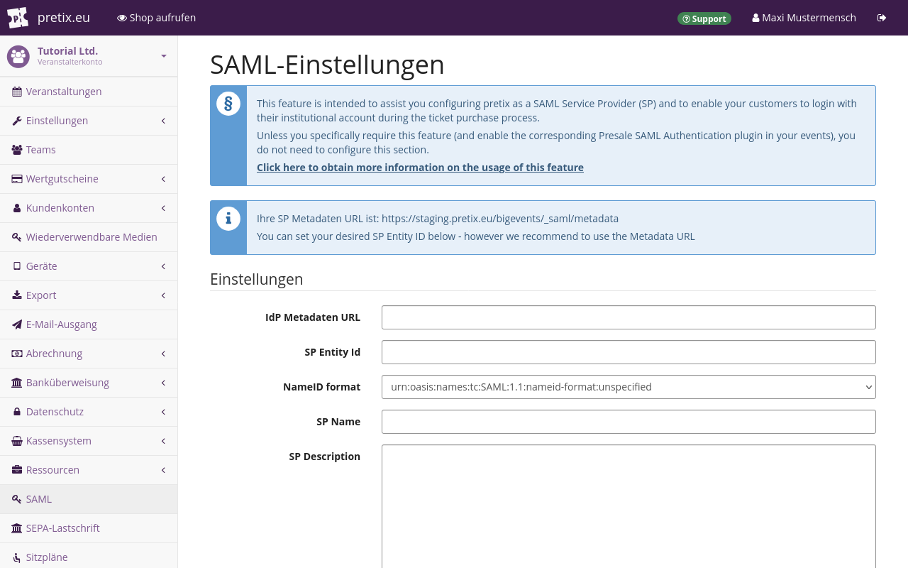

# SAML-Authentifizierung vor dem Verkauf

Dieser Artikel erläutert, wie Sie mithilfe der "Security Assertion Markup Language" (SAML) eine zuverlässige Identifizierung von Kund\*innen einrichten.
Über die Erweiterung "Presale SAML Authentication" können Sie pretix als Service-Provider (SP) mit einem SAML-Identity-Provider (IdP) verknüpfen.
Wenn dies eingerichtet ist, müssen sich Ihre Kund\*innen an der Kasse Ihres Onlineshops bei Ihrem SAML-IdP einloggen.

!!! Hinweis
    Die SAML-Authentifizierung ist nur für besondere Anwendungsfälle gedacht.
    Wenn Sie bislang noch keine SAML-Infrastruktur außerhalb von pretix nutzen, brauchen Sie diese Funktion höchstwahrscheinlich nicht.

## Voraussetzungen

Bevor Sie die SAML-Integration nutzen können, benötigen Sie Zugriff auf einen SAML-Identity-Provider.

## Anleitung

Folgende Schritte sind erforderlich, um die SAML-Integration einzurichten:

 1. Wenn Sie pretix Hosted nutzen, bitten Sie den pretix-Support, für Ihr Konto die Erweiterung "Presale SAML Authentication" verfügbar zu machen.
 Wenn Sie pretix Enterprise nutzen, installieren Sie die Erweiterung und richten Sie sie ein.
 2. Sie richten den Service-Provider (SP) auf Veranstalterebene ein.
 3. Sie aktivieren die Erweiterung für die Veranstaltung.
 4. Sie richten die SAML-Authentifizierung auf Veranstaltungsebene ein.

### Erweiterung installieren und einrichten

<!-- md:enterprise -->

Wenn Sie pretix Enterprise nutzen, müssen Sie als Erstes die Erweiterung "Presale SAML Authentication" installieren und in Ihrer pretix-Instanz einige Dinge einrichten.
Diese Schritte sind **nicht** erforderlich, wenn Sie pretix Hosted nutzen.

Um [für pretix Enterprise Erweiterungen zu installieren](../../self-hosting/installation/enterprise.md), gehen Sie vor, wie in der Dokumentation zum Self-Hosting beschrieben.

Sie müssen entscheiden, ob Ihre pretix-Instanz als gemeinsamer Service-Provider (SP) für alle Veranstalter fungieren oder ob jeder Veranstalter sein eigener SP sein soll.
Ein einziger, gemeinsamer SP ist sinnvoll, wenn alle auf der pretix-Instanz gehosteten Veranstalter derselben Organisation angehören.
Wenn beispielsweise der SP, die pretix-Instanz und alle darauf gehosteten Veranstalter zu Ihrem Unternehmen gehören, ist ein einziger SP ausreichend.

Wenn aber jeder Veranstalter eine eigenständige Körperschaft ist, müssen Sie die pretix-Instanz so einrichten, dass jeder Veranstalter als sein eigener SP fungieren kann.
Beispielsweise kann pretix Hosted so, wie es unter [pretix.eu](https://pretix.eu) bereitgestellt wird, mehrere Clients verwalten.
Jeder Veranstalter ist eine eigenständige Körperschaft und muss deshalb sein eigener SP sein, wenn für diesen Veranstalter die SAML-Integration genutzt werden soll.

Wenn Sie einen gemeinsamen SP für die gesamte Instanz nutzen möchten, ergänzen Sie die Konfigurationsdatei `<config>` um folgende Zeilen:

``` ini
[presale_saml]
level=global
```

Wenn jeder Veranstalter sein eigener SP sein soll, ergänzen Sie die Konfigurationsdatei `<config>` stattdessen um folgende Zeilen:

``` ini
[presale_saml]
level=organizer
```

Wenn Sie `level` auf `global` setzen, verwendet Ihre Instanz einen einzigen SP für das gesamte System.
Wenn Sie `level` auf `organizer` setzen, müssen Sie den SP für jeden Veranstalter individuell konfigurieren.
Wenn Sie `level` nicht definieren, wird standardmäßig `organizer` verwendet.

### Die Erweiterung aktivieren

<!-- md:hosted -->

Wenn Sie pretix Hosted nutzen, können Sie die Erweiterung "Presale SAML Authentication" erst nutzen, wenn das pretix-Team sie für Ihr Veranstalterkonto verfügbar gemacht hat.
Nehmen Sie per [E-Mail](mailto:support@pretix.eu) oder [Telefon](tel:+4962213217750) Kontakt zum Support auf und bitten Sie darum, dass die SAML-Erweiterung aktiviert wird.
Wenn die Erweiterung im Veranstalterkonto verfügbar ist, wird der Button ":fa3-key: SAML" im Menü der Seitenleiste unterhalb der Veranstaltereinstellungen angezeigt.

<!-- md:enterprise -->

Wenn Sie pretix Enterprise nutzen, gelten für die Erweiterung keine Einschränkungen.
Sie können "Presale SAML Authentication" wie jede andere Erweiterung aktivieren.

Navigieren Sie zu :navpath:Ihr Veranstalter → :fa3-wrench: Einstellungen → Erweiterungen:.
Wechseln Sie zum Reiter :btn:Integrationen:.
Suchen Sie die Erweiterung "Presale SAML Authentication" in der Liste.
Wenn sie aktiv ist, hat sie ein grünes Tag "Aktiv" und einen weißen Button "Deaktivieren".
Wenn sie inaktiv ist, fehlt das Tag und es gibt einen violetten Button "Aktivieren".

Vergewissern Sie sich, dass die Erweiterung aktiv ist.
Wenn die Erweiterung aktiv ist, finden Sie in der Seitenleiste unter den Veranstaltereinstellungen den Eintrag ":fa3-key: SAML".

Wiederholen Sie diese Schritte für jedes Veranstalterkonto, für das Sie SAML-Authentifizierung nutzen möchten.

### Den Service-Provider einrichten

<!-- md:enterprise -->

Wenn Sie pretix Enterprise nutzen und den Service-Provider (SP) für die gesamte pretix-Instanz konfigurieren möchten, navigieren Sie zur :navpath::i-pretix: Übersicht:, klicken Sie den Button :btn-icon:fa3-id-card: Admin-Modus: und dann im Menü der Seitenleiste den Button :btn-icon:fa3-key: SAML:.
Wenn Sie den SP für das Veranstalterkonto konfigurieren möchten, navigieren Sie stattdessen zu :navpath:Ihr Veranstalter → :fa3-key: SAML:.
Ab hier ist die Vorgehensweise dieselbe.

#### Die Verbindung einrichten

Um die Verbindung zwischen SP und IdP einzurichten, sind viele Informationen erforderlich.
Wenn Sie nicht sicher sind, welche Einstellung Sie wählen oder was Sie in eines der Felder eintragen sollen, wenden Sie sich an Ihren IdP-Betreiber.
Der sollte genau wissen, welche Angaben seitens des IdP erwartet und unterstützt werden.



Geben Sie unter "IdP Metadaten URL" die URL an, an der Ihr IdP seine Metadaten ausgibt.
Bei den meisten IdP ist diese URL unveränderlich und für alle SP dieselbe.
Wenn Sie Mitglied von DFN-AAI sind, finden Sie die Metadaten für die [Test-, Basic- und Advanced-Föderation](https://doku.tid.dfn.de/de:metadata) auf der Website der Organisation.

Erkundigen Sie sich bei Ihrem IdP-Betreiber, ob Sie sich an den DFN-AAI wenden müssen.
Es ist auch möglich, dass Sie einfach den lokalen IdP Ihrer Einrichtung nutzen können, der seine Metadaten über eine andere URL bereitstellt.

Die URL muss öffentlich zugänglich sein.
Es ist nicht möglich, die Einstellungen zu speichern, wenn die IdP-Metadaten nicht abgerufen werden können.
pretix aktualisiert die IdP-Metadaten regelmäßig automatisch.

Verwenden Sie die vom System vorgeschlagene Metadaten-URL als "SP Entity Id".
Falls von Ihrem IdP so gefordert, können Sie auch jede beliebige andere URL als "SP Entity Id" angeben.

Die meisten IdP zeigen Ihren Kund\*innen bei der Authentifizierung den Namen und die Beschreibung Ihres SP an.
Sie können die Felder "SP Name" und "SP Description" nutzen, um Ihren Kund\*innen zu erklären, wie Sie ihre Daten nutzen.

Ihr SP benötigt ein "SP X.509 Zertifikat" und einen "SP X.509 Private Key".
Erkundigen Sie sich bei Ihrem IdP, ob dieser Ihnen dieses Zertifikat und den Schlüssel bereitstellen kann.
Falls nicht, müssen Sie beides selbst generieren.

Zertifikate haben ein Ablaufdatum und müssen regelmäßig erneuert werden.
Damit der Umstieg vom auslaufenden zum neuen Zertifikat reibungslos gelingt, können Sie schon vor dem Ablauf des alten Zertifikats unter "SP X.509 Neues Zertifikat" ein neues bereitstellen.
pretix verwendet automatisch das richtige Zertifikat.

Wenn das alte Zertifikat abgelaufen ist und nicht mehr verwendet wird, können Sie das neue Zertifikat in das Feld "SP X.509 Zertifikat" verschieben, damit das Feld für neue Zertifikate bereit für die nächste Zertifikatserneuerung ist.

#### Angeforderte Attribute auswählen

Nicht alle IdP verwenden zur Authentifizierung von Benutzer\*innen dieselben Attribute.
Ihr IdP gibt vor, welche der verfügbaren Attribute Ihr SP empfangen kann.

pretix verwendet die meisten Attribute nur zur Authentifizierung Ihrer Kund\*innen und verarbeitet die erhaltenen Daten darüber hinaus nicht.
Es gibt zwei Sonderfälle, in denen pretix die entsprechenden Felder beim Bezahlvorgang automatisch ausfüllt und dann sperrt, sodass sie durch die Kund\*innen **nicht bearbeitet werden können**:

 - Falls sowohl `givenName` als auch `sn` vorhanden sind und pretix so konfiguriert ist, dass der Name des\*der Kund\*in erfasst wird, verwendet pretix `givenName` als Vornamen und `sn` als Nachnamen.
 - Falls das Attribut `email` vorhanden ist, verwendet pretix dieses als E-Mail-Adresse für den\*die Kund\*in.

Bei Letzterem können Probleme auftreten, falls der IdP ein Attribut `email` überträgt, das eine E-Mail-Adresse auf Systemebene enthält, die nur als interner Identifikator, nicht aber zum Empfang von E-Mails verwendet wird.
Dieses Problem beheben Sie, indem Sie die Eigenschaft `friendlyName` auf einen anderen Wert als `email` setzen oder indem Sie das Attribut ganz aus der Liste entfernen.

Definieren Sie über das Feld "Requested Attributes" ganz genau, welche Attribute der SP anfordern soll.
Für dieses Feld gibt es eine Eingabemaske, die Ihnen die korrekte Formatierung erleichtert.
Die Daten werden als JSON-Objektliste mit jeweils 5 Eigenschaften bereitgestellt:

 - `attributeValue`: Kann standardmäßig `[]` sein.
 - `friendlyName`: Ein in den Einstellungen auf Veranstaltungsebene verwendeter String zum Abrufen der Attributdaten.
 - `isRequired`: Ein boolescher Wert, der angibt, ob der IdP die Übertragung dieses Attributs erzwingen muss.
   In den meisten Fällen ist `true` die beste Wahl.
 - `name`: Ein String mit dem internen bzw. technischen Namen des angeforderten Attributs.
   Er beginnt oft mit `urn:mace:dir:attribute-def:`, `urn:oid:` oder `http://`/`https://`.
 - `nameFormat`: Ein String zur Beschreibung der Art der Eigenschaft `name`, die im vorigen Abschnitt festgelegt wurde.
   Er beginnt oft mit `urn:mace:shibboleth:1.0:` oder `urn:oasis:names:tc:SAML:2.0:`.

Bitten Sie Ihren IdP um eine Liste verfügbarer Attribute.
Zwei Beispiele für eine solche Konfiguration finden Sie unten im Abschnitt mit [Konfigurationsbeispielen](presale-saml.md#konfigurationsbeispiele).

!!! Hinweis
    Sie können mehrere Attribute mit demselben Werten für `friendlyName`, aber unterschiedlichen Werten für `name` haben.
    Das ist praktisch, wenn dieselbe Angabe, zum Beispiel der Name eines\*r Kund\*in, in mehr als einem Feld gespeichert wird.
    Eine solche Konfiguration kann notwendig sein, wenn ein Teil der Software Attribute im Format SAML 1.0 und ein anderer Teil der Software Attribute im Format SAML 2.0 zurückgibt.

    Dies tritt überwiegend in gemischten Umgebungen wie DFN-AAI auf, in denen es viele Teilnehmende gibt.
    Wenn Sie nur den IdP Ihrer eigenen Einrichtung nutzen und keine Authentifizierung für Externe bereitstellen, kommt das für Sie wahrscheinlich nicht in Frage.

#### Optionale Einstellungen

Erkundigen Sie sich bei Ihrem IdP nach den korrekten Einstellungen für die Kontrollkästchen auf der Seite mit den SAML-Einstellungen.
Jedes aktivierte Kontrollkästchen erhöht die Sicherheit der Konfiguration.
Einige IdP-Konfigurationen können Probleme bei einigen dieser Einstellungen verursachen.

Wählen Sie bei "Signature Algorithm" und "Digest algorithm" eine Option, mit der sowohl pretix bzw. Ihr SP als auch der IdP kommunizieren können.
Eine häufige Ursache von Problemen beim Verbinden mit einem IdP auf Shibboleth-Basis ist der "Digest algorithm".
pretix unterstützt RSA-OAEP nicht.
Falls der IdP dieses Verfahren erzwingt, wird die Authentifizierung fehlschlagen.

Anlaufstellen für technische Fragen und Support sind in den öffentlichen Metadaten des SP hinterlegt.
Sie werden Kund\*innen unter Umständen angezeigt, falls bei diesen im Zuge der Authentifizierung Probleme auftreten.
Wir empfehlen, zwei separate Kontaktadressen für diese Anlaufstellen zu hinterlegen: eine für allgemeinen Support und eine für technische Probleme.

Wenn Sie alles wie gewünscht eingerichtet haben, klicken Sie den Button :btn:Speichern:.

### Konfiguration auf Veranstaltungsebene

Dieser Abschnitt erläutert, wie Sie die SAML-Authentifizierung auf Veranstaltungsebene einrichten.
Um die Erweiterung zu aktivieren, navigieren Sie zu :navpath:Ihre Veranstaltung → :fa3-wrench: Einstellungen → Erweiterungen: und rufen den Reiter :btn:Integrationen: auf.  
Klicken Sie den Button :btn:Aktivieren: neben der Erweiterung "Presale SAML Authentication".

In der Seitenleiste wird der Button :btn-icon:fa3-key: SAML: angezeigt.
Klicken Sie den Button, um die SAML-Einstellungen auf Veranstaltungsebene aufzurufen.


Vielen Kund\*innen dürfte nicht klar sein, warum sie sich authentifizieren müssen, um etwas in Ihrem Shop zu kaufen.
Im Feld "Checkout Explanation" können Sie eine Erklärung des Ablaufs und der Gründe dafür hinterlegen, die dann im Shop angezeigt wird.

#### Teilnahme mit "Attribute RegEx" weiter einschränken

Standardmäßig können Kund\*innen nach der erfolgreichen Authentifizierung beim IdP mit ihrem Kauf fortfahren.
Wenn Sie die Zielgruppe noch weiter einschränken möchten, können Sie im Feld "Attribute RegEx" zu diesem Zweck reguläre Ausdrücke definieren.
Der standardmäßige reguläre Ausdruck ist  `{}`.
Damit kann jede\*r authentifizierte Benutzer\*in fortfahren.

Wenn Sie in das Feld "Attribute RegEx" beispielsweise eintragen `{ "affiliation": "^(employee@pretix.eu|staff@pretix.eu)$" }`, können nur Kund\*innen fortfahren, die ein Attribut `affiliation` mit dem Wert `employee@pretix.eu` oder `staff@pretix.eu` haben.
Sie können hier nur Attribute abfragen, die vom IdP angefordert werden.
Oben auf der Seite mit den SAML-Einstellungen führt der Abschnitt "Information" alle zum jeweiligen Zeitpunkt konfigurierten Attribute auf.

Das Feld "RegEx Fail Explanation" wird nur in Verbindung mit dem oben beschriebenen Feld "Attribute RegEx" genutzt.
Über dieses Feld können Sie eine Fehlermeldung definieren, die angezeigt wird, wenn ein\*e Kund\*in nicht die Bedingungen erfüllt, die Sie über die regulären Ausdrücke als Beschränkung hinterlegt haben.
Wenn Sie beispielsweise eine Universitätsveranstaltung organisieren, an der ausschließlich Studierende teilnehmen dürfen, können Sie im Feld "RegEx Fail Explanation" die Erklärung hinterlegen, dass Personal der Universität keine Tickets kaufen darf.

#### Über das Attribut "Ticket Secret SAML Attribute" ein SAML-Attribut in den Ticket-Code aufnehmen

pretix kann eines der Attribute von Kund\*innen nutzen, um den Ticket-Code zu generieren, beispielsweise die ID oder die Nummer der Zugangskarte.
Wenn pretix Ticket-Codes auf diese Weise generieren soll, geben Sie das SAML-Attribut unter "Ticket Secret SAML Attribute" an.
Ticket-Codes müssen weiterhin eindeutig sein.
Wenn bei "Ticket Secret SAML attribute" ein Attribut angegeben ist, generiert pretix Ticket-Codes, denen der Attributwert vorangestellt ist.

Ein Beispiel:
Das Attribut `cardid` eines\*r Kund\*in hat den Wert `01189998819991197253`.
Ist unter "Ticket Secret SAML attribute" nichts angegeben, lautet der nach dem Zufallsprinzip generierte Ticket-Code `yczygpw9877akz2xwdhtdyvdqwkv7npj`.
Ist unter "Ticket Secret SAML attribute" ein Attribut angegeben, lautet der vollständige nach dem Zufallsprinzip generierte Ticket-Code `01189998819991197253_yczygpw9877akz2xwdhtdyvdqwkv7npj`.

Auf diese Weise ist der Ticket-Code weiterhin eindeutig, aber der \*die Kund\*in kann beim Check-in zur Veranstaltung anhand des Identifikators problemlos gesucht und gefunden werden.

### Attribute in Fragen speichern

Sie können den Wert eines SAML-Attributs in der Antwort auf eine von dem\*der Benutzer\*in definierte Frage speichern.
Das kann praktisch sein, wenn Sie zum Beispiel die Organisationzugehörigkeit, des\*der  Kund\*in erfassen möchten, um sie auf ein Badge zu drucken.
Die Antwort ist dann festgeschrieben und kann von den Kund\*innen nicht mehr geändert werden.


Um eine solche Frage einzurichten, navigieren Sie zu :navpath:Ihre Veranstaltung → :fa3-ticket: Produkte → Fragen:.
Klicken Sie den Button :btn-icon:fa3-plus: Neue Frage erstellen: oder klicken Sie den Button zum Bearbeiten :btn-icon:fa3-wrench:: neben einer vorhandenen Frage.
Wechseln Sie zum Reiter :btn:Erweitert:.
Tragen Sie in das Feld "Interne Referenz" denselben Wert wie bei `friendlyName` eines der SAML-Attribute ein, die Sie in den globalen oder veranstalterbezogenen SAML-Einstellungen unter "Requested Attributes" definiert haben.

Aufgrund von Formatanforderungen sind manche komplexere Fragen möglicherweise nicht kompatibel mit SAML-Attributen.
Wenn Sie nicht sicher sind, ob Ihr Fragentyp unterstützt wird, oder wenn ein Fehler auftritt, wechseln Sie zum Reiter :btn:Allgemein: und wählen Sie unter "Art der Antwort" die Option "Text (einzeilig)".

### Konfigurationsbeispiele

Dieser Abschnitt enthält zwei Beispiele für SAML-Konfigurationen, über die das Feld "Requested Attributes" in den globalen oder veranstalterbezogenen SAML-Einstellungen befüllt werden kann.
Weitere Informationen zu diesem Feld finden Sie im Abschnitt [Angeforderte Attribute auswählen](presale-saml.md#angeforderte-attribute-auswahlen).

#### Attribute im Format SAML 1.0 und 2.0 von einem akademischen IdP anfordern

Dieser Code fordert `eduPersonPrincipalName` (manchmal kurz als EPPN bezeichnet), `email`, `givenName` und `sn` in den Attributformaten SAML 1.0 und SAML 2.0 an.

``` json
[
    {
        "attributeValue": [],
        "friendlyName": "eduPersonPrincipalName",
        "isRequired": true,
        "name": "urn:mace:dir:attribute-def:eduPersonPrincipalName",
        "nameFormat": "urn:mace:shibboleth:1.0:attributeNamespace:uri"
    },
    {
        "attributeValue": [],
        "friendlyName": "eduPersonPrincipalName",
        "isRequired": true,
        "name": "urn:oid:1.3.6.1.4.1.5923.1.1.1.6",
        "nameFormat": "urn:oasis:names:tc:SAML:2.0:attrname-format:uri"
    },
    {
        "attributeValue": [],
        "friendlyName": "email",
        "isRequired": true,
        "name": "urn:mace:dir:attribute-def:mail",
        "nameFormat": "urn:mace:shibboleth:1.0:attributeNamespace:uri"
    },
    {
        "attributeValue": [],
        "friendlyName": "email",
        "isRequired": true,
        "name": "urn:oid:0.9.2342.19200300.100.1.3",
        "nameFormat": "urn:oasis:names:tc:SAML:2.0:attrname-format:uri"
    },
    {
        "attributeValue": [],
        "friendlyName": "givenName",
        "isRequired": true,
        "name": "urn:mace:dir:attribute-def:givenName",
        "nameFormat": "urn:mace:shibboleth:1.0:attributeNamespace:uri"
    },
    {
        "attributeValue": [],
        "friendlyName": "givenName",
        "isRequired": true,
        "name": "urn:oid:2.5.4.42",
        "nameFormat": "urn:oasis:names:tc:SAML:2.0:attrname-format:uri"
    },
    {
        "attributeValue": [],
        "friendlyName": "sn",
        "isRequired": true,
        "name": "urn:mace:dir:attribute-def:sn",
        "nameFormat": "urn:mace:shibboleth:1.0:attributeNamespace:uri"
    },
    {
        "attributeValue": [],
        "friendlyName": "sn",
        "isRequired": true,
        "name": "urn:oid:2.5.4.4",
        "nameFormat": "urn:oasis:names:tc:SAML:2.0:attrname-format:uri"
    }
]
```

#### skIDentity-Attribute für elektronische Personalausweise anfordern

Dieser Code fordert die Basisattribute `eIdentifier`, `IDType`, `IDIssuer` und `NameID` vom SAML-Dienst [skIDentity](https://www.skidentity.de/) an.
Diese Attribute sind für elektronische ID-Karten verfügbar, beispielsweise die neuen deutschen Personalausweise mit RFID-Chip.
(Andere Attribute wie Name und Adresse sind vom IdP gegen eine Zusatzgebühr erhältlich.)

``` json
[
    {
        "attributeValue": [],
        "friendlyName": "eIdentifier",
        "isRequired": true,
        "name": "http://www.skidentity.de/att/eIdentifier",
        "nameFormat": "urn:oasis:names:tc:SAML:2.0:attrname-format:uri"
    },
    {
        "attributeValue": [],
        "friendlyName": "IDType",
        "isRequired": true,
        "name": "http://www.skidentity.de/att/IDType",
        "nameFormat": "urn:oasis:names:tc:SAML:2.0:attrname-format:uri"
    },
    {
        "attributeValue": [],
        "friendlyName": "IDIssuer",
        "isRequired": true,
        "name": "http://www.skidentity.de/att/IDIssuer",
        "nameFormat": "urn:oasis:names:tc:SAML:2.0:attrname-format:uri"
    },
    {
        "attributeValue": [],
        "friendlyName": "NameID",
        "isRequired": true,
        "name": "http://www.skidentity.de/att/NameID",
        "nameFormat": "urn:oasis:names:tc:SAML:2.0:attrname-format:uri"
    }
]
```