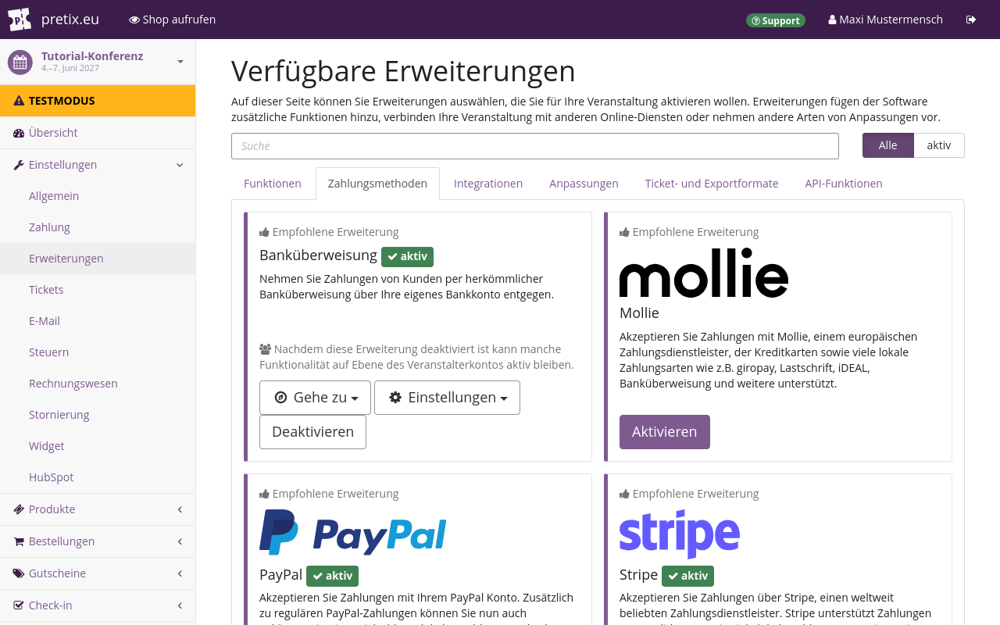
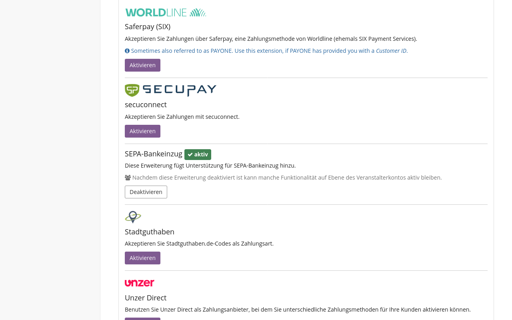
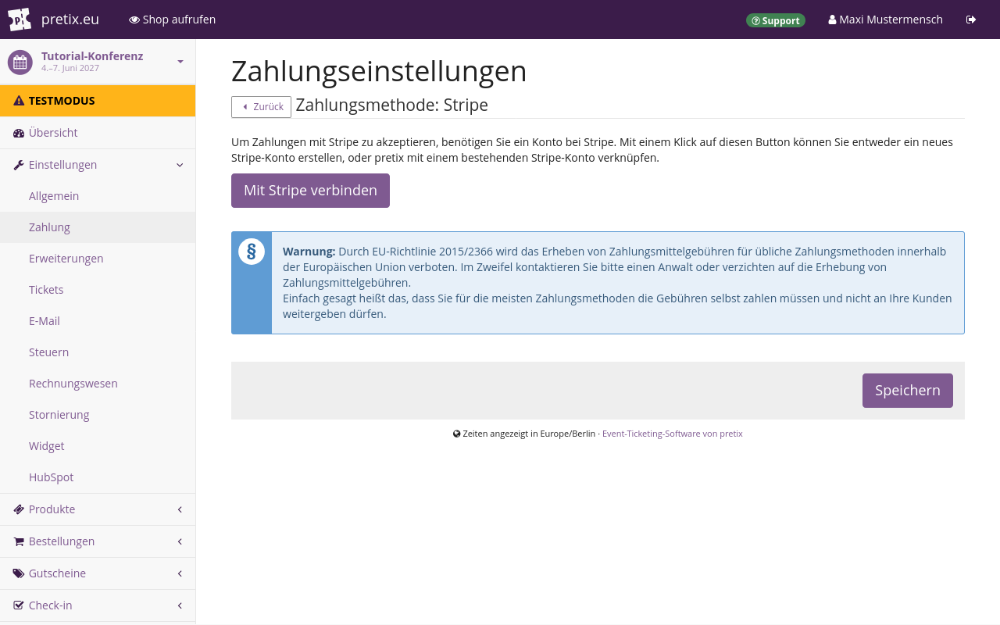
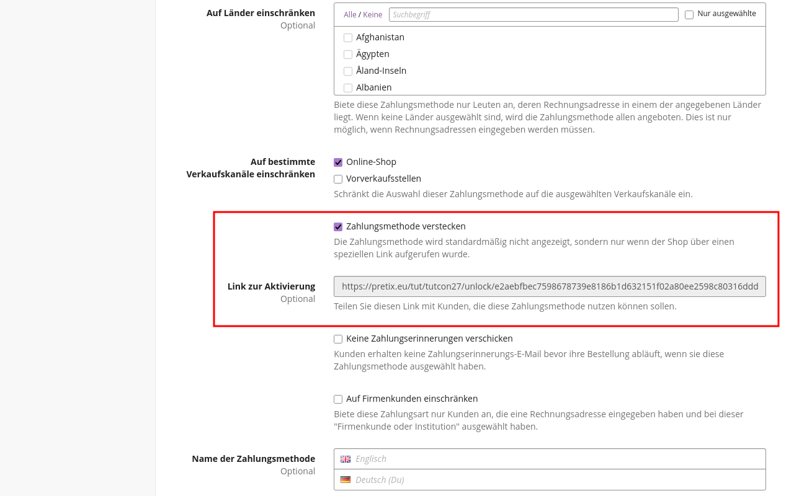
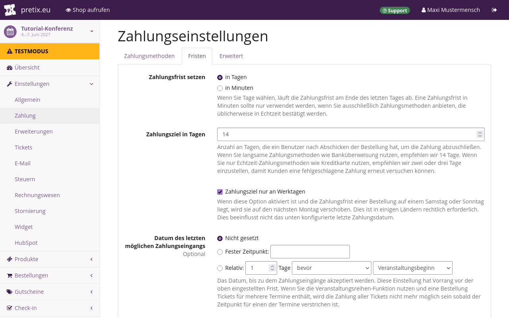

# Zahlung

Wenn nicht alle Produkte in Ihrem Shop kostenlos sind, dann brauchen Ihre Kund\*innen eine Möglichkeit, Ihnen Zahlungen zukommen zu lassen.
pretix ermöglicht Zahlungen über eine breite Palette von Zahlungsdienstleistern.
Es gibt zwei Arten von Zahlungsmethoden:

 - Zahlungen, die vollständig innerhalb von pretix ablaufen, etwa Banküberweisungen oder Wertgutscheine
 - Integrationen mit externen Zahlungsdienstleistern wie Mollie, PayPal oder Stripe

Wenn Sie von Ihren Kund\*innen Zahlungen über pretix erhalten möchten, müssen Sie mindestens einen Zahlungsdienstleister aktivieren und einrichten.
Dieser Artikel erläutert die Vorgehensweise dazu.
Er erklärt außerdem optionale Maßnahmen wie das Einrichten zusätzlicher Gebühren oder Fristen.

Wenn Sie Tickets an der Abendkasse oder gegen Bargeld verkaufen möchten, sollten Sie die App [pretixPOS](../pretixpos/index.de.md) nutzen.

## Voraussetzungen

Sie richten Zahlungsdienstleister auf Veranstaltungsebene ein, also müssen Sie zuerst eine Veranstaltung anlegen.

Vergewissern Sie sich, dass Sie bei allen externen Zahlungsdienstleistern, die Sie mit pretix verwenden möchten, ein aktives Konto besitzen.
Wenn Sie beispielsweise Zahlungen über Mollie empfangen möchten, dann brauchen Sie ein Mollie-Konto.

## Anleitung

Folgende Schritte sind erforderlich, um in pretix Zahlungsdienstleister einzurichten:

 1. [Aktivieren Sie die Erweiterung](#erweiterungen-fur-zahlungsdienstleister) für den Zahlungsdienstleister.
 2. Verbinden Sie Ihr Konto bei dem Zahlungsdienstleister mit pretix.
 3. Tragen Sie auf der [Seite mit Einstellungen](#allgemeine-einstellungen-fur-zahlungsdienstleister) die notwendigen Angaben für den Zahlung ein.
 4. Nehmen Sie optionale Anpassungen vor, etwa indem Sie [Zusatzgebühren](#zusatzgebuhren) einrichten.
 5. Aktivieren Sie den Zahlungsdienstleister für Ihren Shop.
 6. Wiederholen Sie die Schritte 1 bis 5 für alle Zahlungsdienstleister, die Sie verwenden möchten.
 7. Richten Sie [Fristen](#fristen) und erweiterte Einstellungen ein.

Die folgenden Abschnitte erklären alle Schritte ausführlich.

### Erweiterungen für Zahlungsdienstleister

pretix ermöglicht Zahlungen über mehr als 35 verschiedene Zahlungsdienstleister.
Für jeden von ihnen gibt es eine Erweiterung.
Sie müssen die Erweiterungen für jeden Zahlungsdienstleister aktivieren, den Sie für Ihre Veranstaltung nutzen möchten.
Dieser Abschnitt erläutert die Vorgehensweise dazu.



Navigieren Sie zu :navpath:Ihre Veranstaltung →  :fa3-wrench: Einstellungen → Erweiterungen:.
Der Reiter :btn:Zahlungsmethoden: zeigt Erweiterungen für die wichtigsten Zahlungsdienstleister an: Oben auf der Seite stehen Banküberweisung, Mollie, PayPal und Stripe.
Darunter finden Sie eine Liste aller Erweiterungen für die übrigen in pretix verfügbaren Zahlungsdienstleister.
Standardmäßig sind die Erweiterungen für Banküberweisungen, PayPal, Stripe und SEPA-Bankeinzug aktiv.



Wählen Sie diejenigen der wichtigsten Zahlungsdienstleister, die Sie verwenden möchten, und klicken Sie den Button :btn:Aktivieren: daneben.
Wenn Sie eine Erweiterung aktiviert haben, wird daneben das grüne Tag ":fa3-check: Aktiv" angezeigt und statt des violetten Buttons "Aktivieren" steht dort ein weißer Button "Deaktivieren".
Deaktivieren Sie alle aktiven Erweiterungen, die Sie nicht für Ihre Veranstaltung nutzen möchten.

### Allgemeine Einstellungen für Zahlungsdienstleister

Das Aktivieren einer Erweiterung alleine reicht nicht aus, damit die betreffende Zahlungsmethode im Shop zur Verfügung steht.
Sie müssen außerdem für alle Zahlungsdienstleister, die Sie verwenden möchten, bestimmte Daten angeben.
Dieser Abschnitt erläutert die Vorgehensweise dazu.

Navigieren Sie zu :navpath:Ihre Veranstaltung →  :fa3-wrench: Einstellungen → Zahlung:.
Der Reiter :btn:Zahlungsdienstleister: auf dieser Seite enthält eine Liste aktiver Zahlungsdienstleister.
Standardmäßig enthält diese Liste Banküberweisung, Wertgutschein, PayPal, SEPA-Bankeinzug und Stripe.
Die Option "Wertgutschein" ist aktiviert, alle anderen Einträge sind deaktiviert.
Falls Sie Erweiterungen für Zahlungsdienstleister aktiviert oder deaktiviert haben, sieht Ihre Liste anders aus.

Jeder Zahlungsdienstleister, für den Sie die entsprechende Erweiterung auf der Seite "Erweiterungen" aktiviert haben, wird in der Liste angezeigt.
Diese Liste enthält außerdem immer einen Eintrag für Wertgutscheine.
Wertgutscheine sind die einzige Zahlungsmethode, für die keine Erweiterung erforderlich ist, weil Wertgutscheine zu den Kernfunktionen von pretix gehören.
Weitere Informationen finden Sie unter [Wertgutscheine](../gift-cards.de.md).


Sie können Zahlungsdienstleister bearbeiten und aktivieren, indem Sie den Button :btn-icon:fa3-gear:Einstellungen: daneben klicken.
Für jede Zahlungsmethode müssen Sie bestimmte Pflichtangaben eintragen und Einstellungen vornehmen, bevor Sie die Methode aktivieren können.
Beispielsweise müssen Sie auf der Seite mit Einstellungen für Banküberweisungen Ihre Bankverbindung angeben und mit einem Kontrollkästchen bestätigen, dass Ihnen bewusst ist, welche besonderen Bedingungen für diese Zahlungsmethode gelten.

Für jeden Zahlungsdienstleister können Sie außerdem zahlreiche optionale Einstellungen vornehmen.
Sie können die Verfügbarkeit einer Zahlungsmethode einschränken: nach Datum ("Verfügbar ab" und "Verfügbar bis"), Land ("Auf Länder einschränken") und Verkaufskanal ("Auf bestimmte Verkaufskanäle einschränken").



Falls es sich bei dem Zahlungsdienstleister um einen externen Dienst handelt, ist auf der Seite mit Einstellungen zunächst nur ein Button zu sehen, über den Sie Ihr Konto bei diesem Dienst verbinden.
Wenn Sie die Verbindung hergestellt haben, zeigt die Seite mit den Einstellungen für diesen Zahlungsdienstleister die üblichen Einstellungen an.
Ausführliche Informationen zum Einrichten und Aktivieren folgender Zahlungsdienstleister finden Sie auf diesen Unterseiten:

 - [Banküberweisung](bank-transfer.de.md)
 - [Mollie](mollie.de.md)
 - [PayPal](paypal.de.md)
 - [Stripe](stripe.de.md)

### Zahlungsdienstleister verbergen

In pretix können Sie einen Zahlungsdienstleister in Ihrem Shop verbergen und nur solchen Benutzer\*innen anzeigen, die einen bestimmten Link genutzt haben.
Dies kann beispielsweise nützlich sein, wenn Ihre Zielgruppe hauptsächlich aus Privatpersonen besteht, aber auch einige Unternehmen darunter sind.

Um einen Zahlungsdienstleister zu verbergen, navigieren Sie zu :navpath:Ihre Veranstaltung →  :fa3-wrench: Einstellungen → Zahlung: und klicken Sie den Button :btn-icon:fa3-gear: Einstellungen: neben dem Zahlungsdienstleister, den Sie verbergen möchten.
Markieren Sie das Kontrollkästchen neben "Zahlungsmethode verstecken".



Auf der Seite wird nun das Feld "Link zur Aktivierung" neu angezeigt.
Kopieren Sie den Link in diesem Feld und schicken Sie ihn an die Kund\*innen, die die Möglichkeit haben sollen, diesen Zahlungsdienstleister zu nutzen.

Sie können für diese Kund\*innen auch einen Gutscheincode vorauswählen.
Dazu fügen Sie am Ende der URL `?voucher=` an und tragen nach dem Gleichheitszeichen (=) am Ende der URL den Gutscheincode ein.
Der Link könnte beispielsweise so aussehen:

```
https://pretix.eu/tut/tutcon27/unlock/9f8d374cf050d22e3fed41e66baead6e17e7057f62ecfb683d673515afce1761/?voucher=speaker8ZLLVR5MYXT2KWZG
```

In diesem Beispiel lautet der Gutscheincode `speaker8ZLLVR5MYXT2KWZG`.
Kund\*innen, die den Link klicken, gelangen zum Shop mit vorausgewähltem Gutschein **und** aktivierter Zahlungsmethode.

Mehr über Gutscheine erfahren Sie im Artikel über [Gutscheine](../vouchers.md).

### Zusatzgebühren

!!! Warnung
    Die EU-Richtlinie 2015/2366 verbietet Aufschläge für die Nutzung der meisten verbreiteten Zahlungsmethoden in der Europäischen Union.
    Holen Sie rechtliche Beratung ein oder verzichten Sie auf Zahlungsgebühren für Transaktionen innerhalb der Europäischen Union.

Die meisten Zahlungsdienstleister berechnen eine Gebühr für jede verarbeitete Transaktion.
Wenn Sie planen, diese Gebühr selbst zu zahlen, müssen Sie keine Einstellungen ändern.
Wenn Sie diese Gebühr auf den Zahlbetrag Ihrer Kund\*innen aufschlagen möchten, lassen Sie sich rechtlich dazu beraten, ob diese Vorgehensweise legal ist.

Standardmäßig verwendet pretix die Standard-Steuer-Regel Ihrer Veranstaltung für Zahlungsgebühren.
Falls Sie keine Steuern auf Zahlungsgebühren erheben wollen, navigieren Sie zu :navpath:Ihre Veranstaltung →  :fa3-wrench: Einstellungen → Zahlung: und öffnen Sie den Reiter :btn:Erweitert:.
Wählen Sie unter "Besteuerung für Zahlungsgebühren" die Option `Keine Steuern erheben`.

Mehr zum Umgang mit Steuern in pretix erfahren Sie in unserem Artikel über [Steuern](../taxes.md).

Wechseln Sie anschließend zum Reiter :btn:Zahlungsdienstleister: und rufen Sie die Seite mit Einstellungen für den Zahlungsdienstleister auf, für den Sie Zusatzgebühren aktivieren möchten.

Für Zusatzgebühren sind auf dieser Seite drei Elemente relevant: zwei Felder namens "Zusätzliche Gebühr" und ein Kontrollkästchen namens "Berechne die Gebühr als Anteil vom Endbetrag".
Das erste Feld hat die Beschreibung "Fester Betrag" und interpretiert Ihre Eingabe als Geldbetrag.
Das zweite Feld hat die Beschreibung "Prozentsatz der Bestellsumme" und interpretiert Ihre Eingabe als Prozentsatz.
Welche Optionen Sie wie nutzen, hängt vom jeweiligen Anwendungsfall ab.

Der nächste Abschnitt erläutert Ihre Vorgehensweise, wenn Sie eine Gebühr an Ihre Kund\*innen weitergeben möchten oder wenn Sie der Wahl eines Zahlungsdienstleisters durch eine Zusatzgebühr entgegenwirken möchten.

#### Gebühren von Zahlungsdienstleistern an Kund\*innen weitergeben

Ein Beispiel: Ihr Zahlungsdienstleister berechnet Ihnen eine Transaktionsgebühr von 2,99 % plus einen Festbetrag von 0,49 €.
Geben Sie in das Feld "Fester Betrag" `0,49` ein und in das Feld "Prozentsatz der Bestellsumme" `2,99`.
Keine der beiden Eingaben ist verpflichtend.
Sie können daher auch nur einen festen Betrag oder nur einen Prozentwert eingeben.

Vergewissern Sie sich, dass das Kontrollkästchen neben "Berechne die Gebühr als Anteil vom Endbetrag" markiert ist, und klicken Sie den Button :btn:Speichern:.
Das Kontrollkästchen bestimmt, wie pretix Zusatzgebühren berechnet.
Wenn das Kontrollkästchen markiert ist, berechnet pretix Gebühren folgendermaßen:

```
((Preis + Gebühr_abs) * (1 / (1 - Gebühr_prozent / 100)) - Preis)
```

`Preis` ist der Netto-Gesamtbetrag der Bestellung, `Gebühr_abs` ist der Festbetrag in der Gebühr und `Gebühr_prozent` ist der Prozentanteil in der Gebühr.
Bei den genannten Beispielgebühren und einem Kauf mit einem Netto-Gesamtbetrag von 250 € ergibt sich folgende Rechnung:

```
((250 + 0,49) * (1 / (1 - 2,99 / 100)) - 250) = 8,21049376353 ≈ 8,21
```

Das Ergebnis ist die Gebühr, die pretix auf den Netto-Gesamtbetrag des Kaufs aufschlägt.
Im Beispiel müsste der\*die Kund\*in 258,21 € zahlen, der Zahlungsdienstleister zieht Transaktionsgebühren in Höhe von 8,21 € ab und Sie erhalten 250 € gutgeschrieben.
Abhängig von den jeweiligen genauen Berechnungs- und Rundungsverfahren des Zahlungsdienstleisters kann der Betrag, der Ihnen gutgeschrieben wird, um einen Cent abweichen.

Ein Zahlungsdienstleister wird seine Gebühren immer auf der Grundlage des Gesamtbetrags einer oder mehrerer Transaktionen berechnen.
Mit dem Verfahren "Berechne die Gebühr als Anteil vom Endbetrag" haben Sie mehr Kontrolle über den Betrag, den Ihnen der Zahlungsdienstleister überweist.
Die folgende Tabelle vergleicht die beiden Berechnungsverfahren in pretix:

|                                         | Berechnung aus Zwischensumme ohne Gebühr  | Berechnung aus Gesamtsumme mit Gebühr          |
|-----------------------------------------|-------------------------------------------|------------------------------------------------|
| Ticketpreis                             | 250,00 €                                  | 250,00 €                                       |
| Von pretix berechnete Gebühr            | 7,96 €                                    | 8,21 €                                         |
| Gesamt-Zahlbetrag für Kund\*innen        | 257,96 €                                  | 258,21 €                                       |
| Vom Zahlungsdienstleister berechnete Gebühr  | 8,20 €                                    | 8,21 €                                         |
| Ihrem Konto gutgeschriebener Betrag     | 249,76 €                                  | 250,00 €                                       |

#### Der Wahl eines Zahlungsdienstleisters durch eine Zusatzgebühr entgegenwirken

Zur Berechnung dieser Gebühr können Sie in pretix auch eine einfachere Formel verwenden.
Das ist nützlich, wenn Sie beispielsweise durch eine Zusatzgebühr Ihre Kund\*innen davon abbringen möchten, einen bestimmten Zahlungsdienstleister zu nutzen.

Ein Beispiel: Ihr Zahlungsdienstleister berechnet Ihnen eine Gebühr von 2,99 % plus einen Festbetrag von 0,49 €.
Geben Sie in das Feld "Fester Betrag" `0,49` ein und in das Feld "Prozentsatz der Bestellsumme" `2,99`.
Keine der beiden Eingaben ist verpflichtend.
Sie können daher auch nur einen festen Betrag oder nur einen Prozentwert eingeben.

Wenn Sie die Markierung aus dem Kontrollkästchen "Berechne die Gebühr als Anteil vom Endbetrag" entfernen und den Button :btn:Speichern: klicken, verwendet pretix zur Berechnung die folgende Formel:

```
Preis * (Gebühr_prozent / 100) + Gebühr_abs
```

Bei den genannten Beispielgebühren und einem Kauf mit einem Netto-Gesamtbetrag von 100 € ergibt sich folgende Rechnung:

```
250 * (2,99 / 100) + 0,49 = 7,965 ≈ 7,96
```

Ihr\*e Kund\*in muss 257,96 € zahlen.
Dieser Betrag ist niedriger als der mit der ersten Formel berechnete Betrag.
Wenn Sie die von einem externen Zahlungsdienstleister berechnete Gebühr auf diese Weise berechnen, werden Ihrem Konto 249,756996 ≈ 249,76 € gutgeschrieben und damit etwas weniger als die ursprüngliche Netto-Gesamtsumme von 250 €.

Wenn Sie möchten, dass Ihre Benutzer\*innen die vom Zahlungsdienstleister berechneten Gebühren vollständig übernehmen, verwenden Sie das [oben](#gebuhren-von-zahlungsdienstleistern-an-kundinnen-weitergeben) beschriebene Berechnungsverfahren.

### Fristen



Navigieren Sie zu :navpath:Ihre Veranstaltung →  :fa3-wrench: Einstellungen → Zahlung:.
Auf dem Reiter :btn:Fristen: können Sie Zahlungsfristen in Tagen oder Minuten angeben.
Die Standardfrist, innerhalb derer Ihre Kund\*innen bezahlen müssen, ist 14 Tage.
Auf dieser Seite können Sie außerdem optionale Änderungen vornehmen, wie etwa das Datum des letzten möglichen Zahlungseingangs festlegen, eine Zusatzfrist über das mitgeteilte Datum hinaus gewähren oder vorauszusetzen, dass Fristen immer an einem Werktag enden.

!!! Hinweis
    Wenn Sie ein "Datum des letzten möglichen Zahlungseingangs" festlegen, setzt dieses Datum sowohl die festgelegte Zahlungsfrist als auch die Einstellung bei "Späte Zahlungen akzeptieren" außer Kraft.
    Nach dem bei "Datum des letzten möglichen Zahlungseingangs" festgelegten Datum werden keine Zahlungen mehr akzeptiert.

    Es ist nicht möglich, eine Bestellung nach diesem Datum von Hand als bezahlt zu kennzeichnen.
    Wenn Sie Situationen vermeiden möchten, in denen dies zu Problemen führen kann, behalten Sie für "Datum des letzten möglichen Zahlungseingangs" die Einstellung `Nicht gesetzt` bei.

Die Einstellungen für Fristen gelten nur auf Veranstaltungsebene, also ebenso wie alle Zahlungsmethoden.
Wenn Sie Zahlungsmethoden mit längerer Verarbeitungsdauer nutzen, zum Beispiel Banküberweisungen, setzen Sie ausreichend lange Fristen, die diese Verarbeitungsdauer berücksichtigen.

In pretix ist es nicht möglich, für verschiedene Zahlungsmethoden unterschiedliche Fristen festzulegen, da dies für Ihre Kund\*innen bei Bestellung und Bezahlung zu Verwirrung und Unzufriedenheit führen könnte.

Ein Beispiel: Stellen Sie sich vor, in pretix wären für Zahlungsmethoden unterschiedliche Fristen möglich.
Ein\*e Kund\*in gibt eine Bestellung mit einer Zahlungsmethode auf, entscheidet sich dann aber doch für eine andere Methode mit kürzerer Frist.
Damit würde diese Bestellung ungültig.
Der\*die Kund\*in müsste aus nicht klar nachvollziehbaren Gründen eine neue Bestellung aufgeben.

Bei einer neuen Bestellung ginge außerdem die Reservierung der Artikel im Warenkorb verloren.
Falls das Kontingent in der Zwischenzeit aufgebraucht ist, kann der\*die Kund\*in das gewünschte Produkt nicht mehr kaufen und wird dann möglicherweise überhaupt nichts mehr kaufen.

Falls pretix stattdessen die Zahlungsfrist jeder Zahlungsmethode zur alten addieren würde, könnten Kund\*innen durch Hin- und Her-Wechseln zwischen Zahlungsmethoden die Zahlungsfrist unbegrenzt ausdehnen – und Sie könnten Ihr Geld nie einfordern.

Aus diesen Gründen erlaubt pretix nur einheitliche Zahlungsfristen, die für alle Zahlungsmethoden gleichermaßen gelten.

## Fehlerbehebung

### Ein Zahlungsdienstleister wird nicht in den Zahlungseinstellungen angezeigt

Wenn ein Zahlungsdienstleister nicht in unter :navpath:Ihre Veranstaltung → :fa3-wrench: Einstellungen → Zahlung: angezeigt wird, ist die entsprechende Erweiterung nicht aktiv.

Navigieren Sie zu :navpath:Ihre Veranstaltung →  :fa3-wrench: Einstellungen → Erweiterungen: und öffnen Sie den Reiter "Zahlungsdienstleister".
Aktivieren Sie die entsprechende Erweiterung.
Vergewissern Sie sich, dass daneben das grüne Tag ":fa3-check: Aktiv" angezeigt wird.

### Ein Zahlungsdienstleister wird nicht in Ihrem Shop angezeigt

Wenn ein Zahlungsdienstleister nicht im Test-Shop angezeigt wird oder Kund\*innen beim Kauf eine Zahlungsmethode nicht wählen können, vergewissern Sie sich, dass Zahlungsdienstleister und Zahlungsmethode aktiv sind.

Navigieren Sie zu :navpath:Ihre Veranstaltung →  :fa3-wrench: Einstellungen → Zahlung: und öffnen Sie den Reiter "Zahlungseinstellungen".
Klicken Sie den Button :btn-icon:fa3-gear:Einstellungen: neben dem Zahlungsdienstleister, der nicht im Shop angezeigt wird.
Vergewissern Sie sich, dass alle Pflichtangaben eingetragen sind.
Markieren Sie das Kontrollkästchen neben "Zahlungsmethode aktivieren".
Wenn der Zahlungsdienstleister mehrere Zahlungsmethoden anbietet, markieren Sie die Methoden, die Sie in Ihrem Shop anbieten möchten.
Scrollen Sie an das Seitenende und klicken Sie :btn:Speichern:.

Falls jetzt noch Pflichtangaben fehlen, erhalten Sie eine entsprechende Meldung.
Tragen Sie alle Pflichtangaben ein und klicken Sie erneut :btn:Speichern:.
Nun sollte die betreffende Zahlungsmethode in Ihrem Online-Shop angeboten werden.

## Weitere Informationen

Hier ist die Liste aller Artikel, die beschreiben, wie Sie bestimmte Zahlungsdienstleister einrichten und nutzen:

 - [Banküberweisung](bank-transfer.de.md)
 - [Mollie](mollie.de.md)
 - [PayPal](paypal.de.md)
 - [Stripe](stripe.de.md)
