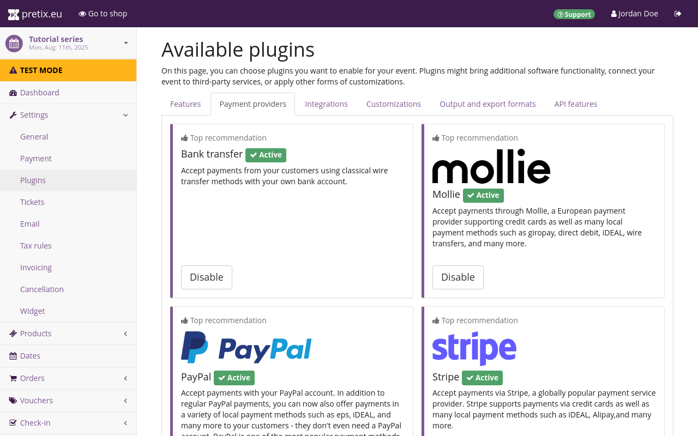

# Mollie

Mollie ist eine der zahlreichen Möglichkeiten, in pretix Zahlungen abzuwickeln. 
Sie können Mollie für folgende Zahlungsmethoden einsetzen: 

Alma, Apple Pay, BANCOMAT Pay, Bancontact, Banküberweisung, Belfius Pay (Button), Bitcoin, BLIK, EPS, Google Pay, iDEAL, ING Home'Pay, KBC/CBC Payment (Button), Klarna, Kreditkarte, MyBank, PayPal, paysafecard, Przelewy24, Satispay, Trustly und Twint. 

Dieser Artikel erklärt, wie Sie Ihr Mollie-Konto verknüpfen, um darauf Zahlungen über pretix zu empfangen. 

## Voraussetzungen

Zahlungsdienstleister richten Sie auf Veranstaltungsebene ein, Sie müssen also zuerst eine Veranstaltung anlegen. 
Vergewissern Sie sich, dass Sie ein aktives Mollie-Konto haben. 
Eine [Anleitung zum Anlegen eines Mollie-Kontos](https://docs.mollie.com/docs/create-an-account) finden Sie auf der Mollie-Website. 

## Anleitung 

Folgende Schritte sind erforderlich, um Mollie in pretix als Zahlungsdienstleister einzurichten: 

 1. Aktivieren Sie die Mollie-Erweiterung. 
 2. Verknüpfen Sie Ihr Mollie-Konto. 
 3. Tragen Sie auf der Seite mit Einstellungen für Mollie die notwendigen Informationen ein.
 4. Nehmen Sie optionale Anpassungen vor.
 5. Aktivieren Sie Zahlungen über Mollie.
 6. Testen Sie die eingerichtete Zahlungsmethode. 
 7. Schalten Sie den API-Endpunkt für Mollie live. 

Dieser Artikel erklärt diese Schritte ausführlich. 

Navigieren Sie zu :navpath:Ihre Veranstaltung →  Einstellungen → Erweiterungen:.  
Wechseln Sie zum Reiter :btn:Zahlungsmethoden:. 
Auf dieser Seite wird die Erweiterung für Mollie oben angezeigt.
Wenn sie aktiv ist, hat sie ein grünes Tag ":fa3-check: Aktiv", einen weißen Button "Deaktivieren" und zwei Dropdown-Menüs. 
Wenn sie inaktiv ist, fehlt das Tag und es gibt einen violetten Button :btn:Aktivieren:. 
Vergewissern Sie sich, dass die Erweiterung aktiv ist. 

Sie können direkt zu den Einstellungen für Mollie springen, indem Sie das Dropdown-Menü :btn-icon:fa3-gear:Einstellungen: und anschließend :btn:Zahlung > Mollie: klicken.   

Alternativ navigieren Sie zu :navpath:Ihre Veranstaltung →  Einstellungen → Zahlung:.  
Der Reiter :btn:Zahlungsdienstleister: auf dieser Seite enthält eine Liste aktiver Zahlungsdienstleister. 
Die Liste sollte jetzt einen Eintrag für Mollie mit einem roten Tag ":fa3-times: Deaktiviert" enthalten. 
Die Erweiterung ist zwar aktiv, aber Sie haben Mollie für die Veranstaltung noch nicht als Zahlungsdienstleister eingerichtet und aktiviert. 

Klicken Sie den Button :btn-icon:fa3-cog:Einstellungen: neben Mollie. 
Das weitere Vorgehen hängt ab hier davon ab, ob Sie pretix Hosted oder eine selbst gehostete Edition von pretix (Community oder Enterprise) verwenden. 

### Verknüpfung zu Mollie mit pretix Hosted 

<!-- md:hosted -->

Wenn Sie pretix Hosted verwenden und Ihr Konto noch nicht mit Mollie verknüpft haben, zeigt die Seite mit den Einstellungen für Mollie nur den Button :btn:Mit Mollie verbinden: an. 
Klicken Sie den Button und schließen Sie die Anmeldung und Autorisierung bei Mollie ab. 

Weitere Informationen zum Autorisierungsvorgang bei Mollie erhalten Sie in der [Mollie-Dokumentation](https://docs.mollie.com/docs/getting-started). 

Nachdem Sie sich angemeldet haben, sieht die Seite mit den Mollie-Einstellungen im pretix-Backend anders aus. 
Statt des einen Buttons sehen Sie nun zahlreiche Einstellungsmöglichkeiten. 
Ihr Mollie-Konto wird im oberen Bereich der Seite angezeigt. 
Es gibt mehrere Kontrollkästchen zum Aktivieren von Zahlungsmethoden wie Kreditkarten, Apple Pay, Google Pay und Banküberweisungen. 

Markieren Sie das Kontrollkästchen bei jeder Zahlungsmethode, die Sie aktivieren möchten. 
Für einige der hier angebotenen Zahlungsmethoden sind in Mollie weitere Berechtigungen erforderlich. 
Wenn Sie diese aktivieren, müssen Sie den Button :btn:Erneute Verbindung zu Mollie (Berechtigungen ändern): klicken. 

Alle weiteren Einstellungen auf dieser Seite sind optional. 
Sehen Sie sich die Einstellungen auf dieser Seite genau an und aktivieren Sie alle, die Sie für Ihre Veranstaltung für diesen Zahlungsdienstleister wünschen. 
Wenn alles wie gewünscht ist, markieren Sie das Kontrollkästchen neben "Zahlungsmethode aktivieren" und Klicken Sie den Button :btn:Speichern:. 
Die Zahlungsmethoden, die Sie auf dieser Seite und in Ihrem Mollie-Konto aktiviert haben, stehen nun den Kund\*innen in Ihrem Shop als Zahlungsoptionen zur Verfügung. 

Wenn Sie Ihren Shop live geschaltet haben, ändern Sie auf dieser Seite die Option "API-Endpunkt" von "Test-System" zu "Live". 

### Verknüpfung zu Mollie mit einer selbst gehosteten Edition von pretix 

<!-- md:community --> 
<!-- md:enterprise -->

Wenn Sie pretix Community oder pretix Enterprise verwenden und Ihr Konto noch nicht mit Mollie verknüpft haben, zeigt die Seite mit den Einstellungen für Mollie Felder für API-Schlüssel an. 
Gehen Sie zu [https://www.mollie.com/dashboard/settings/profiles](https://www.mollie.com/dashboard/settings/profiles) und melden Sie sich an Ihrem Konto an. 
Wenn Sie Zahlungen über Mollie testen möchten, kopieren Sie die Test-Schlüssel von der Mollie-Seite für APIs in die entsprechenden Felder auf der pretix-Seite mit Mollie-Einstellungen. 

Wenn alles zum Empfang von Zahlungen über Mollie bereit ist, kopieren Sie die echten Schlüssel von der Mollie-Seite für APIs in die entsprechenden Felder auf der pretix-Seite mit Mollie-Einstellungen.
Weitere Informationen finden Sie in der Mollie-Dokumentation über [API-Schlüssel](https://docs.mollie.com/reference/authentication#creating-api-keys).  

Sie müssen außerdem einen Webhook erstellen, damit Mollie Informationen wie beispielsweise stornierte Zahlungen an pretix weitergeben kann. 
Kopieren Sie die Webhook-URL aus dem Info-Feld unten auf der pretix-Seite mit Mollie-Einstellungen und fügen Sie sie in das entsprechende Feld im Mollie-Backend ein. 
Wählen Sie bei der Einrichtung des Webhooks, dass alle Ereignistypen an pretix gesendet werden. 
Weitere Informationen finden Sie in der Mollie-Dokumentation über [Webhooks](https://docs.mollie.com/reference/webhooks). 

Nachdem Sie die Verknüpfung zwischen pretix und Mollie eingerichtet haben, zeigt die Seite mit den Mollie-Einstellungen im pretix-Backend zahlreiche Einstellungen. 
Alle neuen Einstellungen hier sind optional. 
Sehen Sie sich die Einstellungen auf dieser Seite genau an und aktivieren Sie alle, die Sie für Ihre Veranstaltung für diesen Zahlungsdienstleister wünschen. 
Wenn alles wie gewünscht eingerichtet ist, scrollen Sie zum Seitenanfang und kreuzen das Kontrollkästchen neben "Zahlungsmethode aktivieren" an. 
Nun stehen Mollie und die anderen hier aktivierten Zahlungsmethoden Ihren Kund\*innen in Ihrem Shop als Zahlungsoption zur Verfügung. 

Wenn Sie Ihren Shop live schalten, ändern Sie auf dieser Seite die Option "API-Endpunkt" von "Test-System" zu "Live". 