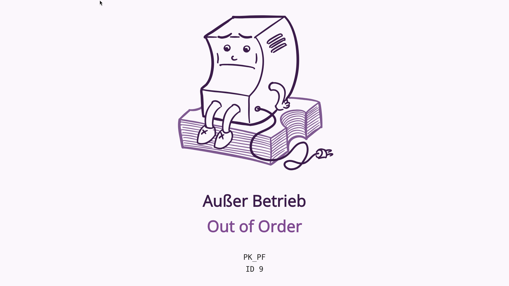

# Fehlercodes

Bei einem Ausfall von pretixKIOSK wird ein Fehlerbildschirm angezeigt, der ungefähr so aussieht:

Die erste Zeile, `PK_PU`, ist ein Fehlercode, den Sie in der folgenden Tabelle finden.
Die zweite Zeile, `ID 218`, ist die ID des Geräts in Ihrem Veranstalterkonto.

| Fehlercode | Bedeutung                                 | Empfohlene Maßnahme                                                                   |
|------------|-------------------------------|---------------------------------------------------------------------------------------------------|
| `PK_IN`    | Kein Internet/Keine Verbindung zum Server | Internetverbindung des Ticketautomaten prüfen                                         |
| `PK_PM`    | Keine Zahlungsmethode verfügbar           | Protokolle der Serverkomponente des Ticketautomaten auf Fehler bei der Zahlung prüfen, Bezahlterminal neu starten |
| `PK_MO`    | Manuell außer Betrieb                     | Servicemenü aufrufen und Modus "Außer Betrieb" deaktivieren                           |
| `PK_SM`    | Servicemodus aktiviert                    | Servicemenü aufrufen und Servicemodus deaktivieren                                    |
| `PK_BD`    | Modus zur Annahme von Geldscheinen aktiviert   | Servicemenü aufrufen und Betrieb für Zahlung mit Geldscheinen fortsetzen oder beenden oder auf Zeitüberschreitung warten |
| `PK_CD`    | Modus zur Annahme von Münzen aktiviert  | Servicemenü aufrufen und Betrieb für Zahlung mit Münzen fortsetzen oder beenden oder auf Zeitüberschreitung warten |
| `PK_HD`    | Hardware-Abstraktionsebene ist deaktiviert | Serviceschnittstelle des Hardwareherstellers prüfen                                  |
| `PK_HI`    | Hardware-Abstraktion wird initialisiert | Auf Abschluss der Initialisierung warten oder Protokolldateien prüfen                   |
| `PK_HC`    | Keine Verbindung zur Hardware-Abstraktionsebene | Prüfen, ob die Software des Hardwareherstellers läuft                            |
| `PK_HF`    | Hardwarefehler                             | Serviceschnittstelle des Hardwareherstellers prüfen                                  |
| `PK_VL`    | Keine Stromversorgung (USV-Modus)         | Stromversorgung wiederherstellen                                                      |
| `PK_PU`    | Drucker nicht verfügbar                   | Druckernamen in der Konfiguration und Druckerverfügbarkeit im Betriebssystem prüfen   |
| `PK_PD`    | Drucker deaktiviert                       | Protokolle prüfen, Servicemenü aufrufen und Druckerverbindungen neu starten           |
| `PK_PF`    | Druckerfehler                             | Funktionstüchtigkeit des Druckers prüfen, Servicemenü aufrufen und Druckerverbindungen neu starten |
| `PK_PP`    | Kein Papier im Drucker                    | Papier einlegen                                                                       |
