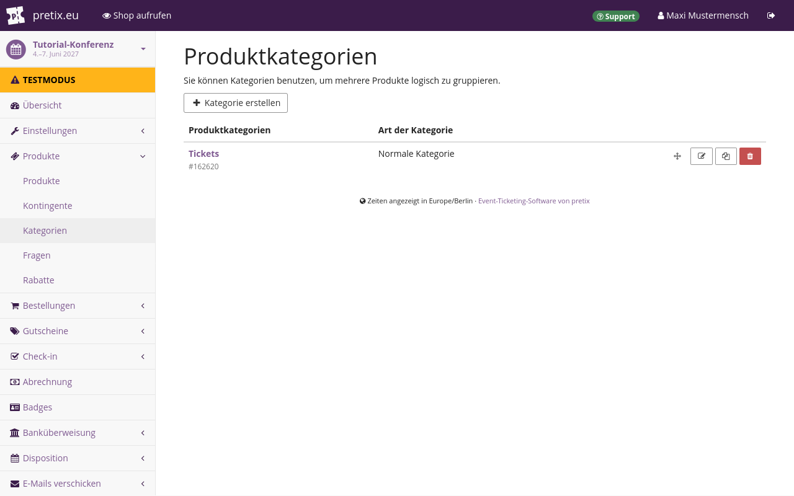
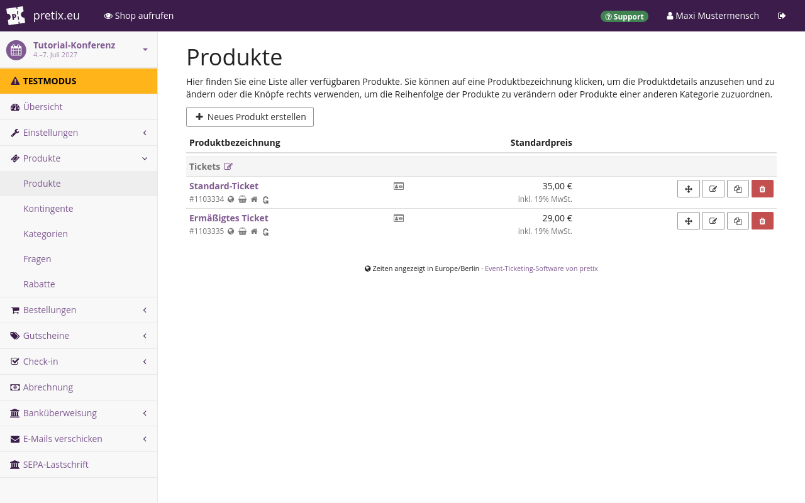

# Produkte

Ein Produkt ist alles, was Sie über pretix verkaufen: Tickets, Wertgutscheine, Konferenz-T-Shirts und so weiter.
pretix bietet Ihnen nahezu unbegrenzte Möglichkeiten, Produkte zu konfigurieren und zu strukturieren.
Dieser Artikel erläutert die grundlegende Vorgehensweise zum Erstellen eines Produkts und stellt einige praktische Anwendungsfälle für einige der fortgeschrittenen Funktionen vor.

## Voraussetzungen

Produkte konfigurieren Sie auf Veranstaltungsebene, Sie müssen also zuerst eine Veranstaltung erstellen.

## Allgemeine Verwendung

Dieser Abschnitt erläutert die grundlegende Vorgehensweise zum Erstellen eines Produkts.
Zuerst erstellen Sie Kategorien, dann die eigentlichen Produkte und schließlich Kontingente.
Sie können Zusatzprodukte oder Produkte zum Cross-Selling **nur** erstellen, wenn Sie dafür eine Kategorie wählen.
Sie können ein Kontingent **nur** erstellen, wenn Sie ihm mindestens ein Produkt zuordnen.
Diese Anleitung erläutert die notwendigen Schritte daher in genau dieser Reihenfolge.

### Kategorien erstellen und bearbeiten

Kategorien erfüllen mehrere Zwecke.
Sie helfen Ihnen, Produkte sinnvoll zu gruppieren, sowohl im Backend als auch in Ihrem Shop.
Ihre Shop-Seite zeigt Produkte nach Kategorien geordnet an, damit Kund\*innen den gesuchten Artikel einfacher finden.
Produkte nach Kategorien zu ordnen, kann Ihnen helfen, im Backend den Überblick zu behalten.

Kategorien sorgen auch für die Trennung zwischen normalen Produkten, die direkt angeboten werden, und Zusatzprodukten, die nur zusammen mit normalen Produkten käuflich sind.
Wenn Sie nicht nur Zutrittstickets verkaufen möchten, sondern auch Extras wie Merchandise, müssen Sie eine Kategorie für Zusatzprodukte erstellen.
Auch wenn Sie die Cross-Selling-Funktion nutzen möchten, benötigen Sie eine weitere Kategorie.

Wenn Sie nur eine begrenzte Zahl unterschiedlicher Produkte verkaufen und keine Zusatz- oder Cross-Selling-Produkte nutzen, müssen Sie keine Kategorien bearbeiten oder erstellen.

Um Kategorien zu bearbeiten oder zu erstellen, navigieren Sie zu :navpath:Ihre Veranstaltung → :fa3-ticket: Produkte → Kategorien:.
Die angezeigte Seite listet alle zuvor erstellten Produktkategorien auf.

Klicken Sie den Button :btn-icon:fa3-plus: Kategorie erstellen: und geben Sie einen Namen für die neue Kategorie ein.
Wählen Sie den zum Produkttyp in dieser Kategorie passenden Kategorietyp: normal, Zusatzprodukt, Cross-Selling oder normal und Cross-Selling.

Normale Produkte sind Einzelprodukte, die direkt gekauft werden können.
Zusatzprodukte sind Produkte, die **nicht** direkt gekauft, sondern nur als Zusatz zu anderen Produkten, die sich bereits im Warenkorb befinden.
Art und Anzahl der Produkte im Warenkorb bestimmen, welche Zusatzprodukte der\*die Kund\*in wählen kann.

Cross-Selling-Produkte werden nicht im Shop, sondern erst an der Kasse angeboten.
Anders als bei Zusatzprodukten hängt es nicht vom Inhalt des Warenkorbs ab, welche Cross-Selling-Produkte der\*die Kund\*in kaufen kann.
Produkte des Typs "normal + Cross-Selling" werden sowohl als Einzelprodukte als auch im Cross-Selling-Schritt angeboten.
Die unten aufgeführte Einstellung "Cross-Selling-Bedingung" legt fest, wie Produkte der Kategorien "Cross-Selling" und "normal + Cross-Selling" in Ihrem Shop angeboten werden.

Klicken Sie unten auf der Seite den Button :btn:Speichern:.
Damit gelangen Sie zurück zur Seite "Produktkategorien", auf der nun auch die neue Kategorie aufgeführt wird.

Sie können auch eine bereits vorhandene Kategorie bearbeiten und dabei ihren Namen, ihre Beschreibung und ihren Typ ändern.
Dazu klicken Sie auf ihren Namen oder den Bearbeitungsbutton :btn-icon:fa3-edit:: neben dem Listeneintrag.

### Produkte erstellen und bearbeiten

Wenn Sie Produkte erstellen oder bearbeiten möchten, navigieren Sie zu :navpath:Veranstaltung → :fa3-ticket: Produkte → Produkte:.
Die angezeigte Seite zeigt eine Liste aller Produkte zu dieser Veranstaltung.
Klicken Sie den Button :btn-icon:fa3-plus: Neues Produkt erstellen:.
Wählen Sie einen Namen, eine Beschreibung, einen Standardpreis und den [Umsatzsteuer](../taxes.de.md)-Satz und klicken Sie den Button :btn:Speichern:.

Sie können auch ein vorhandenes Produkt bearbeiten, indem Sie seinen Namen oder den Bearbeitungsbutton :btn-icon:fa3-edit:: neben dem Listeneintrag klicken.

### Kontingente erstellen und bearbeiten

Ein Kontingent legt fest, wie viele Einheiten Ihres Produkts verkauft werden können.
Jedes Produkt muss Teil mindestens eines Kontingents sein, damit es im Shop verfügbar ist.

Wenn Sie Kontingente erstellen oder bearbeiten möchten, navigieren Sie zu :navpath:Veranstaltung → :fa3-ticket: Produkte → Kontingente:.
Die Seite zeigt eine Liste aller Kontingente für die Veranstaltung sowie für jedes Kontingent Gesamtanzahl und verbleibende Kapazität.

Klicken Sie den Button :btn:Kontingent erstellen:.
Wählen Sie einen Namen und eine Kapazität (Gesamtzahl), markieren Sie die Produkte, die in diesem Kontingent enthalten sein sollen, sowie bei Bedarf erweiterte Optionen und klicken Sie dann den Button :btn:Speichern:.

Sie können auch ein vorhandenes Kontingent bearbeiten, indem Sie seinen Namen oder den Bearbeitungsbutton :btn-icon:fa3-edit:: neben dem Listeneintrag klicken.

## Anwendungsfälle

Für eine Erklärung von fortgeschritteneren Anwendungsfällen und deren Umsetzung lesen Sie die anderen Artikel im Verzeichnis "Produkte":

 - [Rabatte](discounts.de.md) erklärt, wie Sie unterschiedliche Preisniveaus, Gruppentarife, Frühbuchertickets und Rabattpakete einrichten können.
 - [Eingeschränkte Teilnahmeberechtigung](restricted-audience.de.md) erklärt, wie Sie den Zugang zu Ihrer Veranstaltung mit Gutscheincodes, manueller Bestellfreigabe oder Mitgliedschaften einschränken können.
 - [Dauerkarten](season-tickets.de.md) erklärt, wie Sie durch Mitgliedschaften, einen separaten Shop, oder komplexe Check-in-Regeln Dauerkarten anbieten können.
 - [Sitzungen](sessions.de.md) erklärt, wie Sie den Zugang zu Workshops oder Aktivitäten, die im Rahmen Ihrer Hauptveranstaltung stattfinden, kontrollieren können.
 - [Zeitfenster](time-slots.de.md) erklärt, wie Sie den Zugang zu einem Veranstaltungsort mit begrenzter Kapazität über Zeitfenster einrichten können.

Abschnitte im Artikel über [Steuern](../taxes.de.md) erläutern, wie Sie anhand von Produktpaketen Produkte mit gemischten Steuersätzen erstellen.
Die genaue Vorgehensweise hängt davon ab, ob die [Steuer im Preis enthalten](../taxes.de.md#gemischte-steuersatze-preis-enthalt-umsatzsteuer) ist oder die [Steuer auf den Preis aufgeschlagen](../taxes.de.md#gemischte-steuersatze-preis-wird-ohne-umsatzsteuer-angezeigt) wird.

## Fehlerbehebung

### Ein Produkt wird nicht im Shop angezeigt

**Problem:** Sie haben ein Produkt erstellt, aber es wird nicht in Ihrem Shop angezeigt.

**Lösung:** Es kann verschiedene Gründe geben.
Überprüfen Sie Folgendes:

 1. Das Produkt könnte inaktiv sein.
 Um dies zu beheben, navigieren Sie zu :navpath:Ihre Veranstaltung → :fa3-ticket: Produkte → Produkte:.
 Bearbeiten Sie das Produkt, das im Shop nicht angezeigt wird.
 Vergewissern Sie sich auf dem Reiter :btn:Allgemein:, dass das Kontrollkästchen neben "Aktiv" markiert ist.

!!! Hinweis
    Alle Änderungen an der Konfiguration des Produkts treten erst in Kraft, nachdem Sie den Button :btn:Speichern: klicken.

 2. Die Verfügbarkeit Ihres Produkts könnte auf andere Verkaufskanäle als Ihren Shop beschränkt sein.
 Um dies zu beheben, wechseln Sie zum Reiter :btn:Verfügbarkeit:.
 Vergewissern Sie sich, dass das Kontrollkästchen neben "Auf allen Verkaufskanälen verkaufen" markiert ist.
 Ist dieses Kontrollkästchen nicht markiert, vergewissern Sie sich, dass das Kontrollkästchen neben "Online-Shop" markiert ist.

 3. Die Verfügbarkeit Ihres Produkts könnte auf einen bestimmten Zeitraum beschränkt sein.
 Um dies zu beheben, prüfen Sie zunächst die Einträge in den Feldern "Verfügbar ab" und "Verfügbar bis".
 Wenn die Felder leer sind, gibt es keine solche Einschränkung.
 Falls eines der Felder Daten und Uhrzeiten enthält, überprüfen Sie, dass das aktuelle Datum im angegebenen Zeitraum liegt.
 Wenn Sie möchten, dass das Produkt auch außerhalb des festgelegten Zeitraums im Shop angezeigt wird, aktivieren Sie die Option :btn-icon:fa3-info:: "Zeige das Produkt mit einer Information, warum es nicht verfügbar ist".

 3. Das Produkt könnte nur über einen Gutschein erhältlich sein.
 Um dies zu beheben, vergewissern Sie sich, dass das Kontrollkästchen neben "Dieses Produkt kann nur mit einem Gutschein gekauft werden" **nicht** markiert ist.
 Ist es markiert, zeigt der Shop dieses Produkt nur solchen Kund\*innen an, die einen passenden Gutscheincode eingegeben haben.
 Wenn der Shop das Produkt dennoch allen Kund\*innen anzeigen soll, aktivieren Sie die Option :btn-icon:fa3-info:: "Zeige das Produkt mit einer Information, warum es nicht verfügbar ist".

 4. Das Produkt könnte nur als Teil eines Produktpakets erhältlich sein.
 Um dies zu beheben, vergewissern Sie sich, dass das Kontrollkästchen neben "Dieses Produkt nicht einzeln verkaufen, sondern nur als Teil eines festen Produktpakets" **nicht** markiert ist.
 Ist es markiert, wird das Produkt nicht als eigenständiges Produkt im Shop angezeigt.
 Es wird nur als Teil eines anderen Produkts angezeigt, dem Sie es als Teil eines Produktpakets hinzugefügt haben.

 5. Das Produkt könnte nur über eine Mitgliedschaft erhältlich sein.
 Um dies zu beheben, vergewissern Sie sich, dass das Kontrollkästchen neben "Erfordere eine aktive Mitgliedschaft" **nicht** markiert ist.
 Ist es markiert, zeigt der Shop dieses Produkt nur solchen Kund\*innen an, die in ihrem Konto angemeldet sind und eine gültige Mitgliedschaft besitzen.

 6. Das Produkt könnte nur erhältlich sein, wenn ein anderes Produkt ausverkauft ist.
 Um dies zu beheben, vergewissern Sie sich, dass das Kontrollkästchen neben "Nicht anzeigen, wenn Kontingent verfügbar" leer ist.
 Wenn Sie in diesem Feld ein anderes Produkt angeben, wird der Shop dieses Produkt nur anzeigen, wenn das andere Produkt ausverkauft ist.
 Wenn der Shop das Produkt unabhängig von der Verfügbarkeit des anderen Produkts anzeigen soll, aktivieren Sie die Option :btn-icon:fa3-info:: "Zeige das Produkt mit einer Information, warum es nicht verfügbar ist".

 7. Das Produkt könnte den falschen Kategorietyp haben.
 Um dies zu beheben, navigieren Sie zu :navpath:Ihre Veranstaltung → :fa3-ticket: Produkte → Kategorien:.
 Bearbeiten Sie die Kategorie, zu der das Produkt gehört.
 Vergewissern Sie sich, dass unter "Art der Kategorie" entweder `Normale Kategorie` oder `Normale und Cross-Selling-Kategorie` gewählt ist.
 Falls `Zusatzprodukt-Kategorie` gewählt ist, ist das Produkt nur als Zusatzprodukt erhältlich.
 Falls `Cross-Selling-Kategorie` gewählt ist, ist das Produkt nur während des Cross-Selling-Schritts bei einem Kauf erhältlich.

 8. Das Produkt könnte nicht Teil eines Kontingents sein.
 Um dies zu beheben, navigieren Sie zu :navpath:Ihre Veranstaltung → :fa3-ticket: Produkte → Kontingente:.
 Vergewissern Sie sich, dass das Produkt in einem der Kontingente enthalten ist.
 Falls das Produkt Varianten hat, vergewissern Sie sich, dass mindestens eine Variante Teil eines Kontingents ist.
 Falls Sie eine Veranstaltungsreihe veranstalten, vergewissern Sie sich, dass das Kontingent dem Termin zugewiesen ist, der über den Shop gebucht werden soll.

 9. Das Produkt könnte Teil eines leeren Kontingents sein.
 Um dies zu beheben, vergewissern Sie sich, dass keines der Kontingente, in denen das Produkt enthalten ist, leer ist.
 Falls eines der Kontingente bereits ausverkauft war, vergewissern Sie sich, dass das Kontrollkästchen neben "Dieses Kontingent schließen, sobald es einmal ausverkauft war" **nicht** markiert ist.