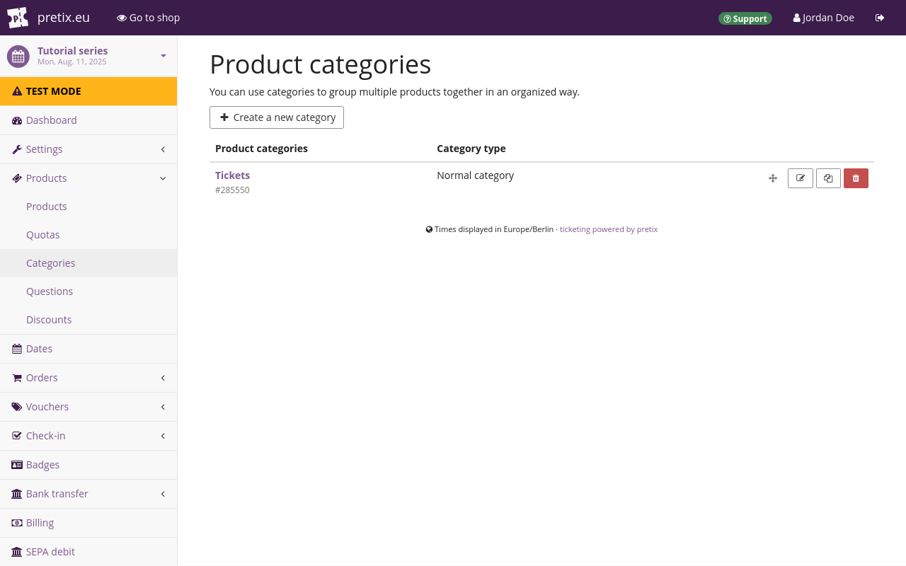
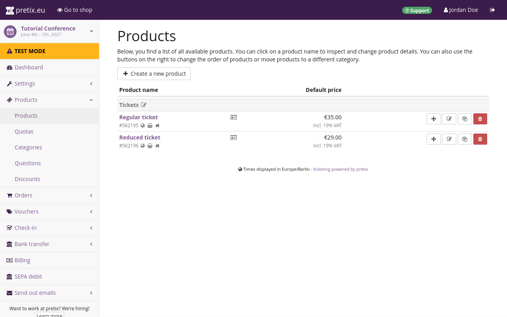

# Products

A product is anything sold via pretix: tickets, gift cards, conference t-shirts, and so on.
pretix offers you almost unlimited possibilities for configuring and structuring products.
This article guides you through the basic process of creating a product and explains several practical applications for some of the more advanced features of pretix.

## Prerequisites

Products are configured on the event level, so you have to create an event first.

## General usage

This section guides you through the basic process of product creation.
This involves first creating categories, then the products themselves, and finally quotas.
You **cannot** create add-on products or products for cross-selling without choosing a category for them.
You **cannot** create a quota without adding at least one product to it.
Thus, this guide will explain those steps in that order.

### Creating and editing categories

Categories do several things.
They help you group products sensibly, both in the backend and in your shop.
Your shop page will display products grouped by categories which can help customers find the item they are looking for more easily.
Sorting products into categories can help you keep track of them in the backend.

Categories also separate normal products, which can be purchased directly, from additional products, which are only offered as add-ons to normal products.
If you want to sell not only admission tickets, but also extras such as merchandise, you have to create a category for add-on products.
You also need an extra category if you are planning to use the cross-selling feature.

If you only sell a limited number of different products and you are not using the add-ons or cross-selling feature, then you do not need to edit or create any categories.

In order to edit or create categories, navigate to :navpath:Your event → :fa3-ticket: Products → Categories:.
This page lists all previously created product categories.

Click the :btn-icon:fa3-plus: Create a new category: button and give the new category a name.
Choose the category type depending on the type of products in this category: normal, add-on, cross-selling, or normal + cross-selling.

Normal products are standalone products that can be purchased directly.
Add-on products are products that **cannot** be purchased directly, but only as add-ons to other products during checkout.
The types and numbers of products in the cart decides what add-on products the customer can select.

Cross-selling products are not offered in the shop, but during checkout.
Unlike add-on products, the contents of the cart do not decide what cross-selling products the customer can buy.
Finally, products of the "normal + cross-selling" type are offered as both standalone products and in the cross-selling step.
The "Cross-selling condition" setting below determines how products in categories of the type "cross-selling" and "normal + cross-selling" are offered in your shop.

Click the :btn:Save: button at the bottom of the page.
This takes you back to the product categories page, which now also lists the newly created category.

You can also edit an already existing category and change its name, description, and type, by clicking its name or the :btn-icon:fa3-edit:: edit button next to it in the list.

### Creating and editing products

If you want to create or edit products, navigate to :navpath:Event → :fa3-ticket: Products → Products:.
This page shows the list of all products of this event.
Click the :btn-icon:fa3-plus: Create a new product: button.
Choose a name, a description, a default price and a [sales tax](../taxes.md) and click the :btn:Save: button.

You can also edit an already existing product by clicking its name or the :btn-icon:fa3-edit:: edit button next to it in the list.

### Creating and editing quotas

A quota determines how many instances of your product can be sold.
Every product has to be part of at least one quota before it becomes available in the shop.

If you want to create or edit quotas, navigate to :navpath:Event → :fa3-ticket: Products → Quotas:.
This page shows the list of all quotas for the event as well as the total capacity and how many items are left for each quota.

Click the :btn-icon:fa3-plus: Create a new quota: button.
Choose a name and a capacity, check the products to be contained in this quota, and any advanced options, and then click the :btn:Save: button.

You can also edit an already existing quota by clicking its name or the :btn-icon:fa3-edit:: edit button next to it in the list.

## Applications

For an explanation of more advanced use cases and how to implement them, refer to the other articles in the "Products" directory:

 - [Discounts](discounts.md) explains how to set up different price levels, group discounts, early bird tickets, and discount packages.
 - [Restricted audience](restricted-audience.md) explains how to limit access to your events through voucher codes, order approvals, or memberships.
 - [Season tickets](season-tickets.md) explains how to implement season passes using memberships, a separate shop, or complex check-in rules.
 - [Sessions](sessions.md) explains how to control access to workshops or activities that take place within the context of your main event.
 - [Time slots](time-slots.md) explains how to set up access to a venue with limited capacity based on time slots.

The article on [taxes](../taxes.md) has sections explaining how to set up products with mixed taxation using bundles.
The exact method differs depending on whether [tax is included in the price](../taxes.md#mixed-taxation-tax-included-in-price) or [tax is added on top of the price](../taxes.md#mixed-taxation-tax-added-on-top-of-price).

## Troubleshooting

### A product does not show up in the ticket shop

**Problem:** You have created a product, but it does not show up in your shop.

**Solution:** This can have a variety of reasons.
Perform the following checks:

 1. The product may be inactive.
 In order to resolve this, navigate to :navpath:Your event → :fa3-ticket: Products → Products:.
 Edit the product that is not showing up in your shop.
 On the :btn:General: tab, verify that the box next to "Active" is checked.

!!! Note
    Any change you make to the product's configuration only takes effect after you click the :btn:Save: button.

 2. Your product may be restricted to sales channels other than your shop.
 In order to resolve this, open the :btn:Availability: tab.
 Verify that the box next to "Sell on all sales channels" is checked.
 If that box is unchecked, verify that the box next to "Online shop" is checked.

 3. Your product's availability may be restricted to a certain time frame.
 In order to resolve this, check the "Available from" or "Available until" fields.
 If the fields are empty, then there is no such restriction.
 If any of the fields contain dates and times, verify that you are within the specified time frame.
 If you want the product to show up in your shop even outside the specified time frame, set the toggles to :btn-icon:fa3-info:: "Show product with info on why it's unavailable".

 3. Your product may only be available through a voucher.
 In order to resolve this, verify that the box next to "This product can only be bought using a voucher" is **not** checked.
 If that box is active, then your shop will only show the product to customers who have entered a matching voucher code.
 If you still want your shop to show the product to all customers, set the toggle to :btn-icon:fa3-info:: "Show product with info on why it's unavailable".

 4. Your product may only be available as part of a bundle.
 In order to resolve this, verify that the box next to "Only sell this product as part of a bundle" is **not** checked.
 If that box is active, then it will not show up as a standalone product in your shop.
 It will only show up as part of another product to which you added this product as a bundled product.

 5. Your product may only be available through a membership.
 In order to resolve this, verify that the box next to "Require a valid membership" is **not** checked.
 If that box is active, then your shop will only show the product to customers who are logged in to their account and who have a valid membership.

 6. Your product may only be available after another product has been sold out.
 In order to resolve this, verify that the field next to "Only show after sellout of" is empty.
 If you specify another product in that field, then your shop will only show this product if the other product is sold out.
 If you still want your shop to show the product regardless of the availability of the other product, set the toggle to :btn-icon:fa3-info:: "Show product with info on why it's unavailable".

 7. Your product may be in the wrong type of category.
 In order to resolve this, navigate to :navpath:Your event → :fa3-ticket: Products → Categories:.
 Edit the category to which your product belongs.
 Verify that the selection under "Category type" is either `Normal category` or `Normal + cross-selling category`.
 If the selection is `Add-on product category`, then your product is only available as an add-on.
 If the selection is `Cross-selling category`, then your product is only available during the cross-selling step of the purchase.

 8. Your product may not be part of a quota.
 In order to resolve this, navigate to :navpath:Your event → :fa3-ticket: Products → Quotas:.
 Verify that one of the quotas contains this product.
 If your product has variations, verify that at least one variation is part of a quota.
 If you are hosting an event series, verify that the quota is assigned to the date which you are accessing in your shop.

 9. Your product may be part of an empty quota.
 In order to resolve this, verify that none of the quotas that contain your product are empty.
 If any of the quotas have ever been sold out, verify that the box next to "Close this quota permanently once it is sold out" is **not** checked.
