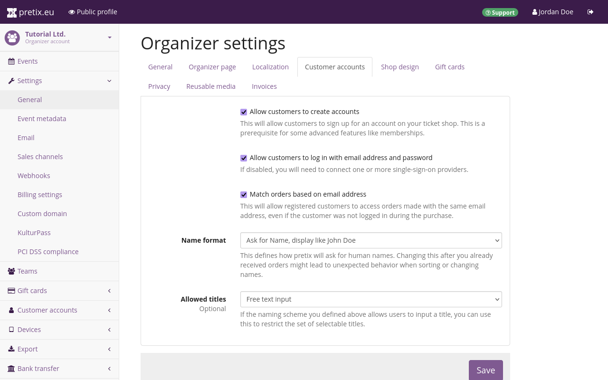
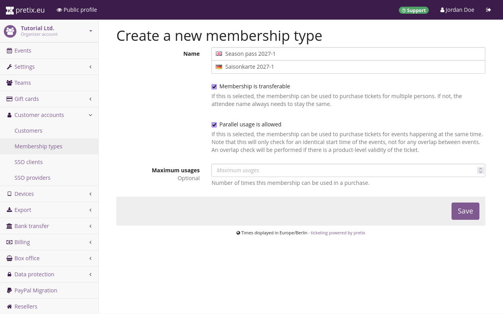
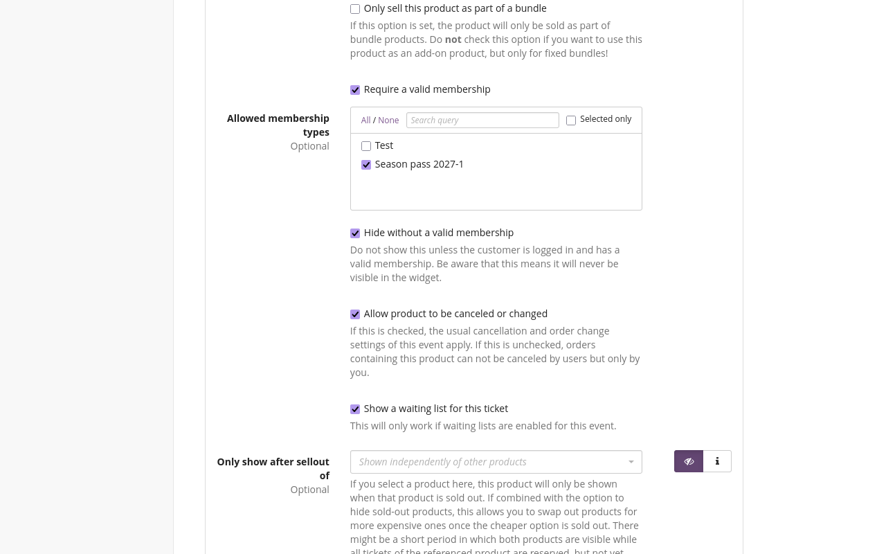
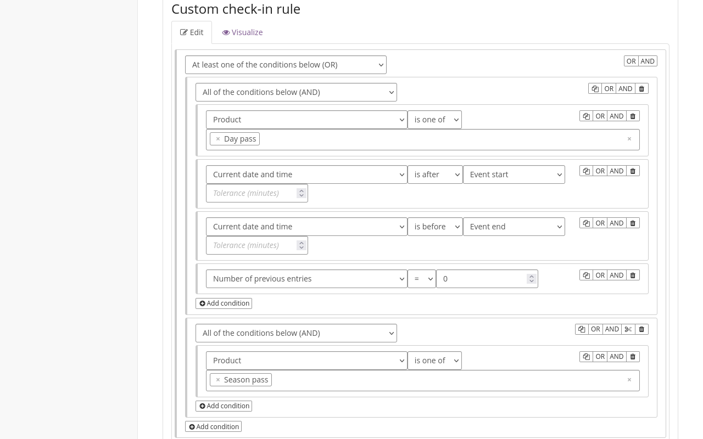

# Season tickets

Season tickets are often used for public swimming pools, sports clubs, theaters, and other types of venues.
This section explains three methods for setting them up in pretix.
These methods can be used for any ticket that grants access to all events during a certain time period.
It does not matter whether that time period spans several years or just a single day.

The first method, option A, uses memberships.
Option B uses a separate event shop that only sells season tickets.
Option C uses a single season ticket and advanced check-in rules.

With **Option A**, a customer who purchases a season ticket creates an account with their email address and a password.
That account stores a membership, which acts as the season ticket.
Whenever the customer wants to use the season ticket for an event, they need to purchase a ticket for that event.
Their membership allows them to get that ticket for free.
This method allows you to control the total number of people that can be admitted to an event or time slot using quotas.

With **Option B**, you create a separate event or date for the entire season and sell season tickets in that shop.
Direct customers who are interested in season tickets to that event shop or date.
a customer who purchases a season ticket receives a single ticket with a single ticket secret that they can use an unlimited number of times.
You then use the expert mode in pretixSCAN to check in attendees for multiple events at the same time: your regular current event and the entire season.

With **Option C**, you offer a season ticket in the same shop as your regular tickets.
Just like with option B, a customer who purchases a season ticket receives a single ticket with a single ticket secret that they can use an unlimited number of times.
You then set up advanced check-in rules to ensure that regular ticket holders can only enter at specified times.

## Option A: Memberships and multiple tickets

Option A requires customers to be identified with a customer account.
Thus, you first need to enable the customer accounts feature in your organizer settings in the "Customer accounts" tab.
See also: [Customer accounts](../customer-accounts.md)

Once you have done that, navigate to :navpath:Your organizer → :fa3-user: Customer accounts → Membership types:.
Click the :btn-icon:fa3-plus: Create a new membership type: button.

Give the new membership type a distinct and informative name.
If you want the membership to allow purchase of tickets for multiple different people, check the box next to "Membership is transferable".
If you want the membership to allow purchases for multiple different events or dates with the same start time, check the box next to "Parallel usage is allowed".

If you want to limit the membership to a certain number of purchases, specify that number in the "Maximum usages" field.
If you want to allow unlimited purchases within the specified time frame, leave this field empty.
Once you are happy with your choices, click the :btn:Save: button.

Once you have created the membership type, you also need a way to sell these memberships.
Create a new event with start and end dates corresponding to the duration of the season for which you want to sell season passes.
Navigate to :navpath:Your event → :fa3-ticket: Products: and click the :btn-icon:fa3-plus: Create a new product: button.
Choose a name such as "Season pass" and a price, and then click the :btn:Save and continue with more settings: button.

Then, open the :btn:Additional settings: tab.
Under "This product creates a membership of type", select the membership you just created.
By default, the box next to "The duration of the membership is the same as the duration of the event or event series date" is checked.
If you are selling multiple time-based passes with different periods of validity which do not match the duration of the event, uncheck the box.

In order to prevent customers from confusing their season pass with their ticket, it makes sense to disable ticket downloads.
Navigate to :navpath:Your event → :fa3-wrench: Settings: and uncheck the box next to "Allow users to download tickets".

Once the season pass shop has been set up, you need to create free products that can only be purchased with the season pass for each applicable event.
Clone an existing admission ticket, append a descriptor such as "for season ticket holders" to the name, and set the price to zero.
Click the :btn:Save and continue with more settings: button and then open the :btn:Availability: tab.
Check the box next to "Require a valid membership" and select the membership type you created.
If you want to display this product only to customers who already have an active membership in your shop, check the box next to "Hide without a valid membership".

Repeat these steps for every product you want to make available for free for season pass holders.
If you want season pass holders to be able to attend multiple of your events for free, repeat these steps for every applicable event.

## Option B: Separate season pass shop

Option B is setting up a separate event or date for selling season tickets.

If you want to offer season passes for **multiple events**, then the most efficient way to do this is to finish the configuration for at least one of your individual events.
Then, you [create a new event](../../tutorial/single-events/event.md).
Use the event name, short form and description to make it clear that the shop sells season passes for a specific time span.
For example, the name could be "Season passes summer 2027".
Set the "Event start time" and "Event end time" to the start and end dates of your season.

During step 3 of the event creation process, use the "Copy configuration from" field to copy information from one of your individual events during the season.

In the newly created event, delete all existing products.
Then, create a personalized admission product with a name such as "Season pass summer 2027".
Add the product to a quota and edit the quota according to your preferences.

If you want to offer season passes for an **event series**, create a personalized admission product with a name such as "Season pass".
Add the product to a quota and edit the quota according to your preferences.

Then, create a date within that event series.
Use the date's name and frontpage text to make it clear that customers can purchase season passes by selecting that date.
For example, the name could be "Season passes".
Set the "Event start time" and "Event end time" to the start and end dates of your season.

You can offer more than one type of season pass.
For example, you could offer [different price levels](discounts.md#different-price-levels).

You can encourage customers to still buy a season pass later in the season by reducing its price.
If you want to offer cheaper season passes as the season progresses, you could use a reverse implementation of the [early bird tickets based on time](discounts.md#early-bird-tickets-based-on-time-for-singular-events) with the season pass being replaced by a cheaper version every month.
Alternatively, if there are long pauses between the individual events throughout the season, you could start with a high price on the season pass and reduce that price manually a few times between events as the season progresses.

With this method, you need to be prepared to check in attendees to two separate events at the same time.
If you are using pretixSCAN, you can use the expert mode to do this.
Open pretixSCAN.
At the top of the screen, tap the name of the event.
Select the individual active event from the list and tap :btn:OK:.
Check the box next to "Expert mode".
Select the check-in list for the event and tap :btn:OK:.

Tap the :btn-icon:fa3-plus:: button.
Select the season passes event and tap :btn:OK:.
Select the check-in list and tap :btn:OK: again.
The screen should now list both your individual event and your season passes event along with the start date, short form, check-in list, and buttons for editing and deleting the entry.

At the top of the screen, tap :btn-icon:fa3-check::.
You should now be able to scan tickets for both events at the same time.

## Option C: Season access in a single ticket

Option C is setting up a single ticket that grants access to an event series for an entire season.
This option is easier to use for your customers than option A because it does not require them to set up accounts and book a new ticket on every visit.
It also does not require setting up a separate event shop for season tickets like option B does.
On the downside, option C requires setting up complex check-in rules.

In order to create a season ticket for this method, navigate to :navpath:Your event → :fa3-ticket: Products: and click the :btn-icon:fa3-plus: Create a new product: button.
Give the new product a name such as "Season ticket".
Enable this product for all dates in your event series.

You have to set up custom check-in rules to allow customers access to all dates with the season pass.
Navigate to :navpath:Your event → :fa3-check-square-o: Check-in → Check-in lists: and click the :btn-icon:fa3-plus: Create a new check-in list: button.

Specify a name, but do not choose a specific date.
This check-in list will apply to all dates.
Open the :btn:Advanced: tab.

Under "Custom check-in rule", click the :btn-icon:fa3-plus-circle: Add condition: button and select "At least one of the conditions below (OR)" from the dropdown menu.
Click the :btn-icon:fa3-plus-circle: Add condition: button again and select "All of the conditions below (AND)" from the dropdown menu.
You now have an OR-bracket with an AND-bracket inside it.

Click the :btn-icon:fa3-plus-circle: Add condition: button **within the AND-bracket** and select "Product", then "is one of", and then all admission tickets **other than** the season pass.
Click the :btn-icon:fa3-plus-circle: Add condition: button within the AND-bracket again and select "Current date and time", then "is after", then "Event start".
You can leave the "Tolerance (minutes)" fields empty or specify a tolerance of, for example, "10" to allow entry for attendees 10 minutes before the corresponding time slot begins.

Click the :btn-icon:fa3-plus-circle: Add condition: button within the AND-bracket again and select "Current date and time", then "is before", then "Event end".
Click the :btn-icon:fa3-plus-circle: Add condition: button within the AND-bracket a final time and select "Number of previous entries", then "=", then "0".

Then, click the :btn-icon:fa3-plus-circle: Add condition: button that is located within the OR-bracket, but **not** within the AND-bracket.
It should be further down on the page.
Hovering your mouse over the brackets highlights AND-brackets in red, OR-brackets in green, and the innermost bracket in purple.
Select "Product", then "is one of", and then your season pass product.

You should add another condition to prevent the season pass being used by more than one person.
Click the :btn-icon:fa3-plus-circle: Add condition: below your season pass condition.
You have several options:

 - Select "Current entry status", then "=", and then "absent".
 This means that the season pass can only be used if it is checked out.
 The prerequisite for this is that you check season pass users out as they leave the event, which may require additional personnel.
 - Select "Number of previous entries since midnight", "=", and "0".
 This means that the season pass can only be used once per day.
 - Select "Minutes since last entry" "≤", and "15".
 This means that the season pass can only be used once every fifteen minutes.

The logic is depicted in the screenshot above.
These rules ensure that regular tickets holders are only admitted to their chosen date and if their ticket has not been used before.
They also ensure that season ticket holders are admitted to every date.
