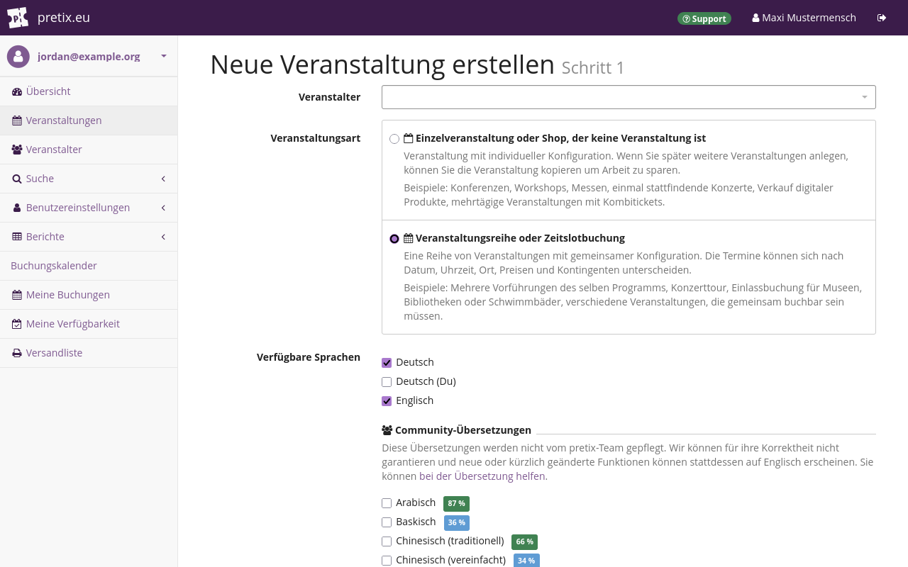
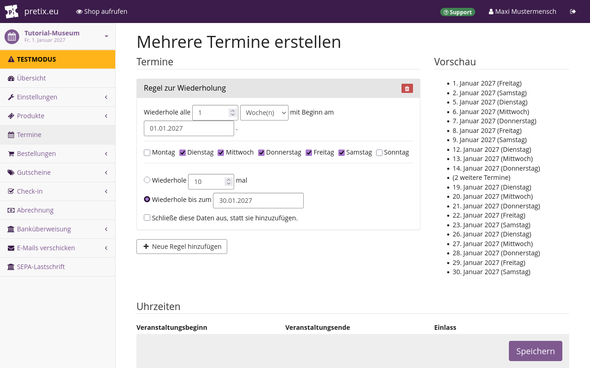
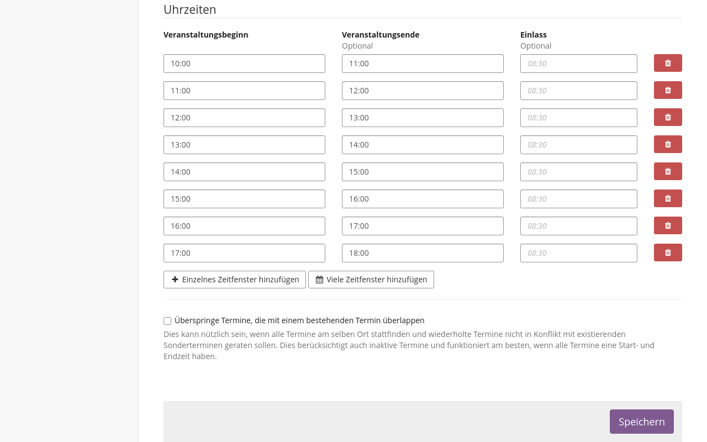
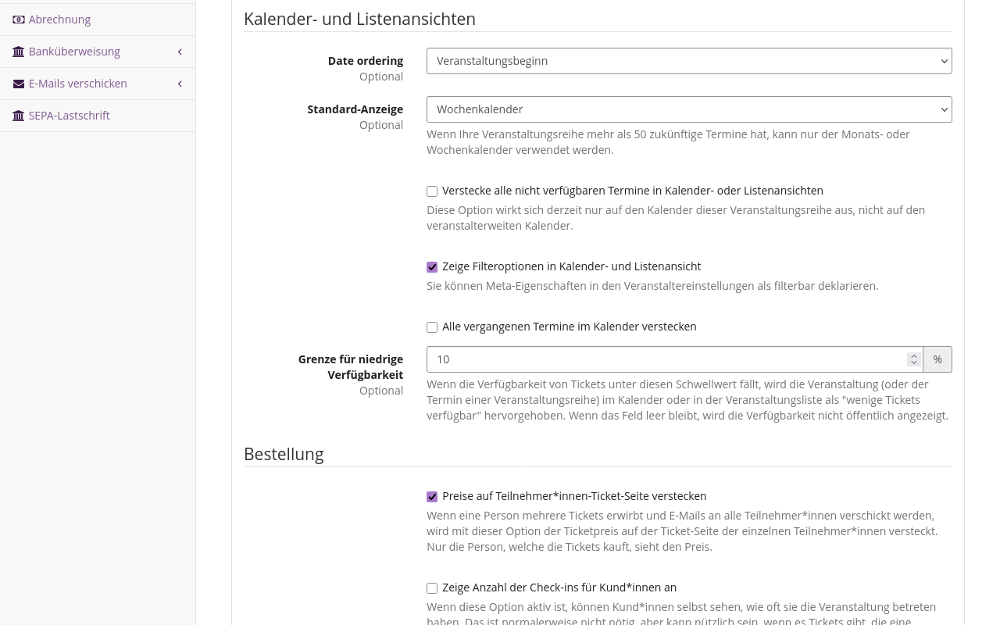
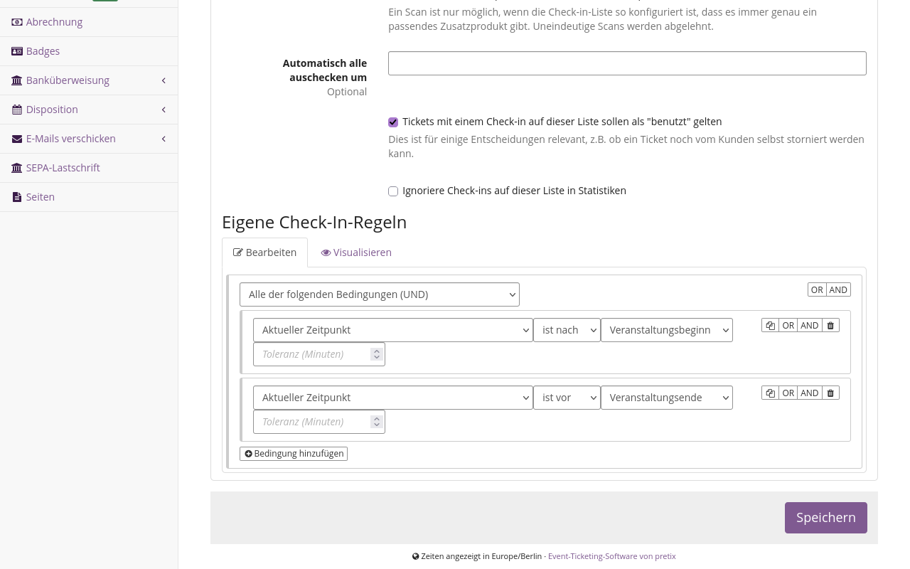

# Zeitfenster

In pretix können Sie den Zutritt zu einem Veranstaltungsort mit einer begrenzten Besucherkapazität, z.B. einem Museum, über Zeitfenster definieren.
Dieser Guide erläutert Ihnen, wie Sie eine Veranstaltung mit Zeitfenstern erstellen.

Erstellen Sie eine neue Veranstaltung.
Wählen Sie bei "Veranstaltungsart" die Option "Veranstaltungsreihe oder Zeitslotbuchung".

Grundlegende Informationen, wie Sie in pretix eine Veranstaltungsreihe erstellen, erhalten Sie in unserem Guide zu [Veranstaltungsreihen](../event-series.de.md).

## Zeitfenster erstellen

Um Zeitfenster zu erstellen, müssen Sie in der Veranstaltungsreihe eine Reihe von "Terminen" anlegen.
Navigieren Sie zu :navpath:Ihre Veranstaltung → :fa3-calendar: Termine: und klicken Sie den Button :btn-icon:fa3-plus:Mehrere neue Termine erstellen:.
Geben Sie ein Muster für die Veranstaltungstage ein.
Wenn Ihr Veranstaltungsort im Januar 2027 beispielsweise jede Woche von Dienstag bis Samstag geöffnet ist, geben Sie folgendes Muster ein:
"Wiederhole alle `1` `Woche(n)` mit Beginn am `01.01.2027`"
Aktivieren Sie die Kontrollkästchen für Dienstag, Mittwoch, Donnerstag, Freitag und Samstag.
Wählen Sie die Option "Wiederhole bis zum" und geben Sie in das Feld `31.01.2027` ein.

Es ist sinnvoll, Zeitfenster für mehrere Wochen zu erstellen.
Erstellen Sie keine Zeitfenster für ein ganzes Jahr oder einen noch längeren Zeitraum:
Das macht es unnötig kompliziert, falls Sie später Änderungen daran vornehmen müssen.

Geben Sie unter "Uhrzeiten" die Zeitfenster für jeden Veranstaltungstag ein.
Wenn Ihr Veranstaltungsort jeden Tag von 10 bis 18 Uhr geöffnet ist und jedes Zeitfenster eine volle Stunde beträgt, können Sie den Button :btn-icon:fa3-calendar: Viele Zeitfenster hinzufügen: klicken.
Geben Sie für "Beginn des ersten Zeitfensters" "10:00:00" ein, für "Ende der Zeitfenster" "18:00:00", für "Länge der Zeitfenster" "60" und für "Pause zwischen Zeitfenstern" "0".
Klicken Sie dann den Button :btn-icon:fa3-check: Erstellen:.
Falls Ihr Zeitfenster-Muster unregelmäßig oder komplexer ist, verwenden Sie den Button :btn-icon:fa3-plus: Einzelnes Zeitfenster hinzufügen: und bearbeiten Sie jede Zeile einzeln.

Wenn Sie an verschiedenen Wochentagen unterschiedliche Öffnungszeiten haben, müssen Sie diesen Vorgang jede Variante der Öffnungszeiten einzeln erstellen.

Erstellen Sie bei "Kontingente" ein oder mehrere Kontingente.
Diese Kontingente bestimmen, wie viele Personen ein Ticket für ein Zeitfenster buchen können.
Wenn Sie möchten, dass pro Zeitfenster nur jeweils 50 Personen Einlass erhalten, setzen Sie die "Gesamtanzahl" auf `50`.
Sobald Sie mit Ihrer Auswahl zufrieden sind, klicken Sie den Button :btn:Speichern:.

!!! Hinweis
    Wenn Sie viele Zeitfenster auf einmal erstellen, kann es eine kurze Zeit dauern, bis alle angezeigt werden.
    Wenn Sie in dieser Phase eine Fehlermeldung erhalten, warten Sie einige Minuten, bis der Server die Aufgabe abgeschlossen hat.
    Versuchen Sie es **nicht** sofort noch einmal.
    In den meisten Fällen werden die Termine korrekt angelegt, auch wenn eine Fehlermeldung angezeigt wird.

## Die Kalenderansicht "Wochenkalender" aktivieren

Für eine Veranstaltungsreihe oder das Buchen von Zeitfenstern ist es sinnvoll, auf der Shop-Seite den Überblick als Wochenkalender zu aktivieren.
Dazu navigieren Sie zu :navpath:Ihre Veranstaltung → :fa3-wrench: Einstellungen → Allgemein:.
Rufen Sie den Reiter :btn:Anzeige: auf und wählen Sie bei "Standard-Anzeige" die Option "Wochenkalender".

In Ihrem Shop wird jetzt ein Wochenüberblick aller Zeitfenster und ihrer jeweiligen Verfügbarkeit angezeigt.

## Check-in

Wenn Sie Tickets für bestimmte Zeitfenster verkaufen, dann sollten Sie auch dafür sorgen, dass Kund/*innen nur eingelassen werden, wenn ihr Ticket für das betreffende Zeitfenster gilt.
Dieser Abschnitt erläutert, wie Sie hierfür eigene Check-in-Regeln einrichten.
Navigieren Sie zu :navpath:Ihre Veranstaltung → :fa3-check-square-o: Check-in → Check-in-Listen: und klicken Sie den Button :btn-icon:fa3-plus: Neue Check-in-Liste erstellen:.

Geben Sie einen Namen an, aber wählen Sie **keinen** bestimmten Termin.
Diese Check-in-Liste gilt für alle Termine.
Wechseln Sie zum Reiter :btn:Erweitert:.

Klicken Sie unter "Eigene Check-In-Regeln" den Button :btn-icon:fa3-plus-circle: Bedingung hinzufügen: und wählen Sie im Dropdown-Menü "Alle der folgenden Bedingungen (UND)".
Klicken Sie den Button :btn-icon:fa3-plus-circle: Bedingung hinzufügen: erneut und wählen Sie erst "Aktueller Zeitpunkt", dann "ist nach" und dann "Veranstaltungsbeginn".
Das Feld "Toleranz (Minuten)" können Sie leer lassen.
Wenn Sie den Teilnehmer\*innen die Möglichkeit geben möchten, beispielsweise 10 Minuten vor Veranstaltungsbeginn eingelassen zu werden, geben Sie bei "Toleranz (Minuten)" `10` an.
Klicken Sie den Button :btn-icon:fa3-plus-circle: Bedingung hinzufügen: erneut und wählen Sie erst "Aktueller Zeitpunkt", dann "ist vor" und dann "Veranstaltungsende".

Mit diesen beiden Einschränkungen können Kund\*innen Ihre Veranstaltung nur in dem Zeitfenster besuchen, für das sie ein Ticket gekauft haben.
Wenn Sie alles wie gewünscht gewählt haben, klicken Sie den Button :btn:Speichern:.

Wenn Sie pretixSCAN mit dieser Konfiguration verwenden, fordert die App Sie auf, einen der Termine zu wählen.
Es macht keinen Unterschied, welchen Sie wählen.
Wichtig ist nur, dass Sie die Check-in-Liste wählen, die Sie eben konfiguriert haben.
Wählen Sie einen beliebigen Termin, der Teil der Veranstaltungsreihe ist, und anschließend die oben beschriebene Check-in-Liste.
