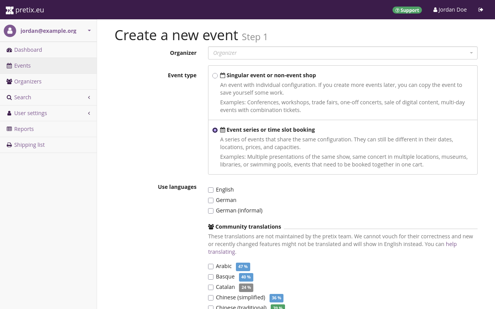
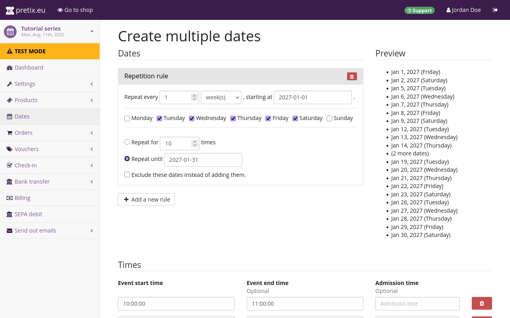
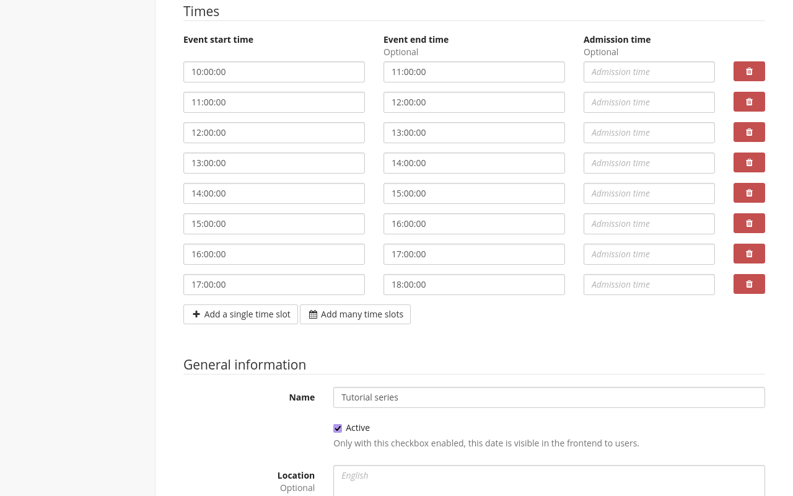
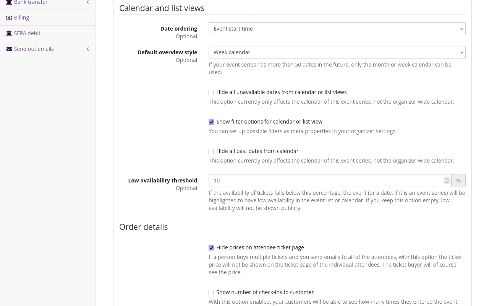
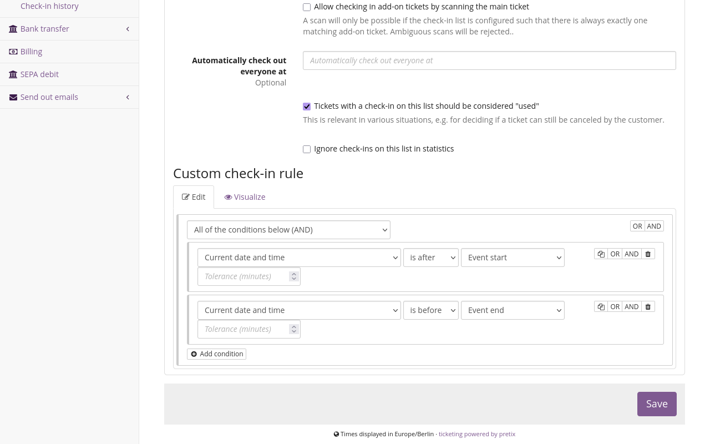

# Time slots

You can use pretix to set up access to a venue with a limited visitor capacity, such as a museum, based on time slots.
This guide shows you how to create an event with time slots.

Create a new event.
Under "Event type", select "Event series or time slot booking".

For general instructions on how to set up an event series with pretix, refer to our guide on [event series](../event-series.md).

## Creating slots

In order to create time slots, you have to create a number of "dates" in the event series.
Navigate to :navpath:Your event → :fa3-calendar: Dates: and click the :btn-icon:fa3-plus:Create many new dates: button.
Enter a pattern for your opening days.
If your venue opens every week from Tuesday to Saturday in January of 2027, enter the following pattern:
"Repeat every `1` `week(s)`, starting at `2027-01-01`"
Check the boxes for Tuesday, Wednesday, Thursday, Friday, and Saturday.
Select "Repeat until" and enter `2027-01-31` into the field.

It makes sense to create time slots for a few weeks at a time.
Do not create time slots for a full year or an even longer period of time.
Doing so would make it too complicated to make changes later.

Under "Times", specify the time slots for each opening day.
If your venue opens every day from 10 AM to 6 PM and each time slot corresponds to a full hour, you can click the :btn-icon:fa3-calendar: Add many time slots: button.
Specify "Start of first slot" as "10:00:00", "End of time slots" as "18:00:00", "Length of slots" as "60" and "Break between slots" as "0".
Then, click the :btn-icon:fa3-check: Create: button.
If your time slot pattern is more irregular or complex, use the :btn-icon:fa3-plus: Add a single time slot: button and edit each line individually.

If you have different opening times on different days of the week, you will need to go through the creation process once for each individual variation of opening hours.

Under "Quotas", create one or multiple quotas.
These quotas determine how many people can book a ticket for each time slot.
If you want each time slot to be attended by a maximum of 50 people, set the "Total capacity" to `50`.
Once you are happy with your choices, click the :btn:Save: button.

!!! Note
    If you create a large number of time slots at once, it may take a moment until all of them can be displayed.
    If you encounter an error message during this stage, wait a few minutes for the server to finish the task.
    Do **not** try again immediately.
    In most cases, the dates will be created successfully even if an error message is displayed.

## Enabling the week calendar view

For an event series or time slot booking, it makes sense to enable the "Week calendar" overview style for the shop page.
In order to do so, navigate to :navpath:Your event → :fa3-wrench: Settings → General:.
Open the :btn:Display: tab and set "Default overview style" to "Week calendar":

Your ticket shop will now display a weekly overview over all time slots and their availability.

## Check-in

If you are selling tickets for certain time slots, then you also want customers to be admitted to the event only if their ticket matches the current time slot.
This section explains how to set this up using custom check-in rules.
Navigate to :navpath:Your event → :fa3-check-square-o: Check-in → Check-in lists: and click the :btn-icon:fa3-plus: Create a new check-in list: button.

Specify a name, but do **not** choose a specific date.
This check-in list will apply to all dates.
Open the :btn:Advanced: tab.

Under "Custom check-in rule", click the :btn-icon:fa3-plus-circle: Add condition: button and select "All of the conditions below (AND)" from the dropdown menu.
Click :btn-icon:fa3-plus-circle: Add condition: again and select "Current date and time", then "is after", then "Event start".
You can leave the "Tolerance (minutes)" field empty.
If you want attendees to be able get in, for example, 10 minutes before the event starts, specify a "Tolerance (minutes)" of `10`.
Click :btn-icon:fa3-plus-circle: Add condition: again and select "Current date and time", then "is before", then "Event end".

With these two restrictions, customers can only access your event during the time slot for which they bought a ticket.
Once you are happy with your choices, click the :btn:Save: button.

When using pretixSCAN with this setup, the app will ask you to select one of the time slots.
The choice does not matter.
It is only important that you select the check-in list you just set up.
Select any time slot that is part of the event series and then select the check-in list described above.
