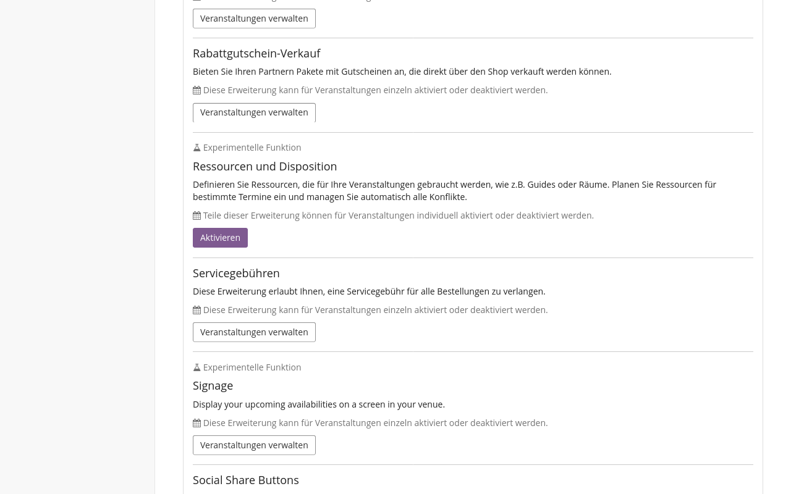
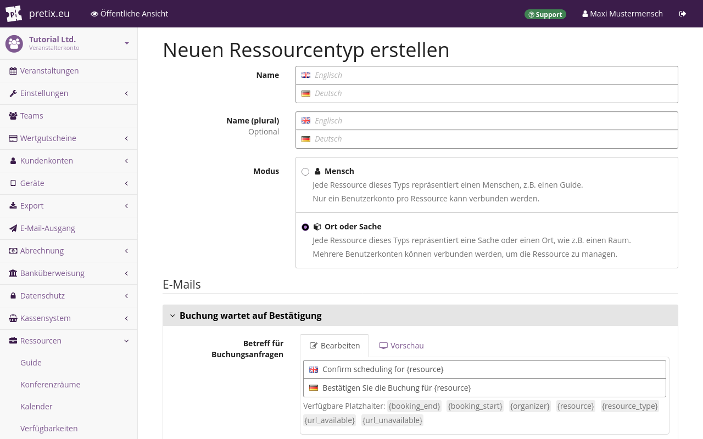
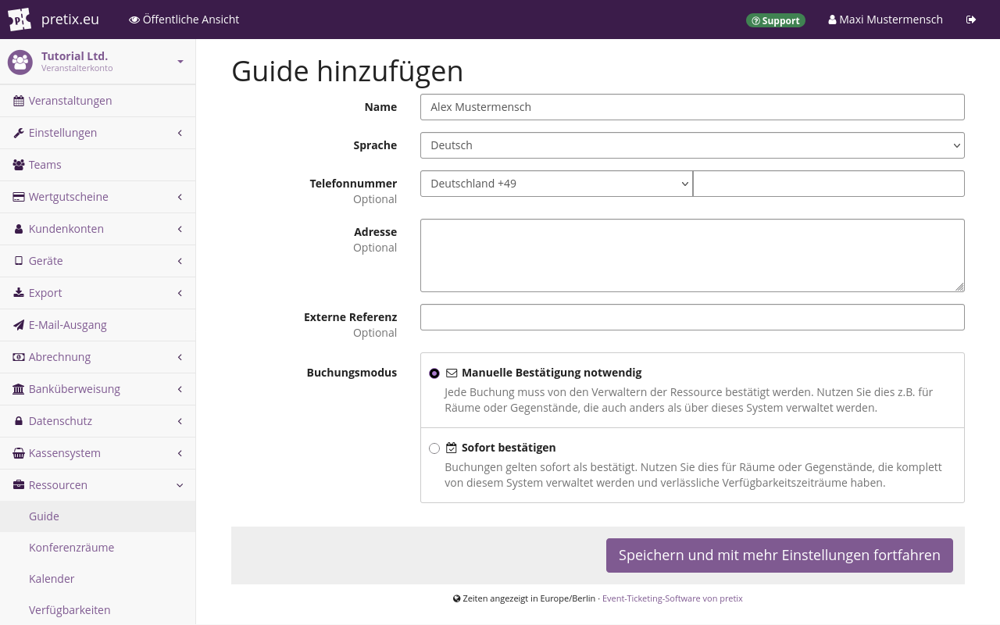
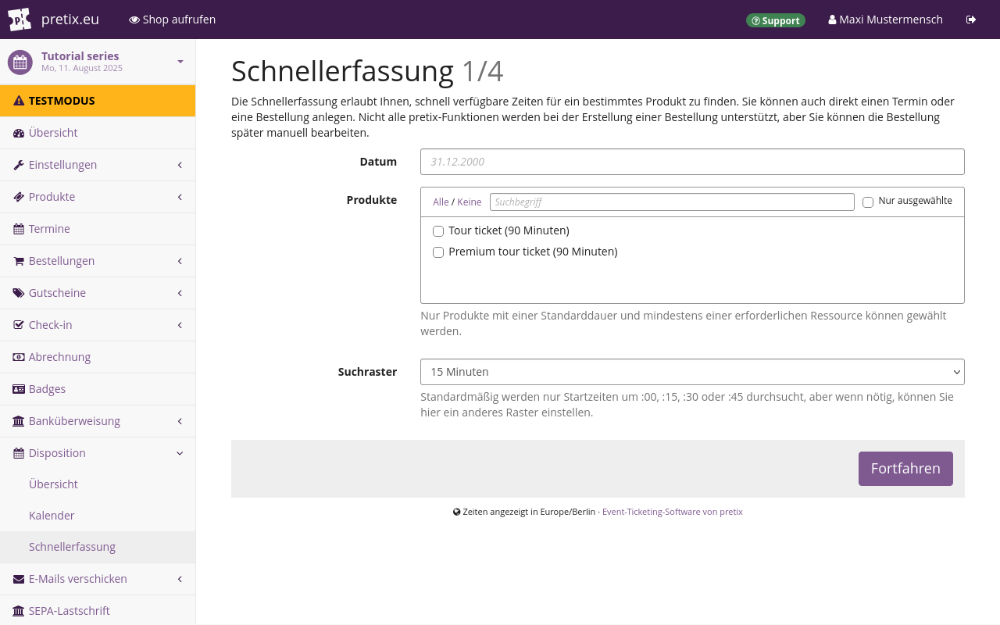
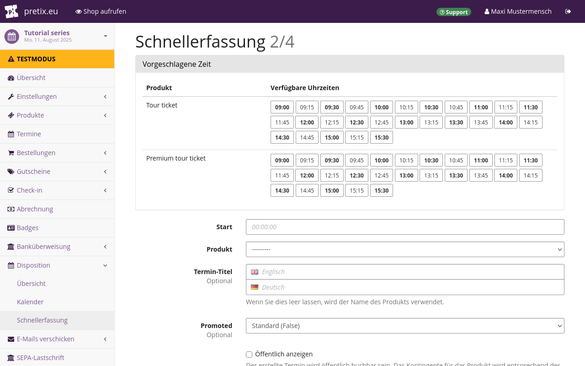
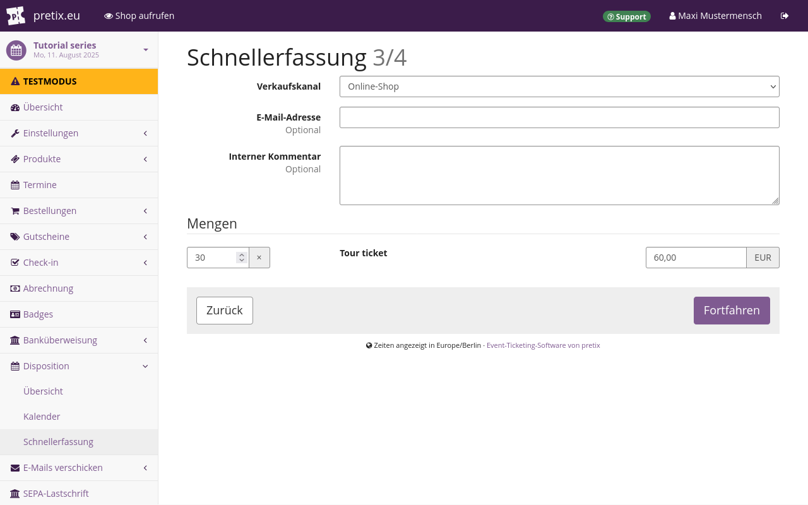
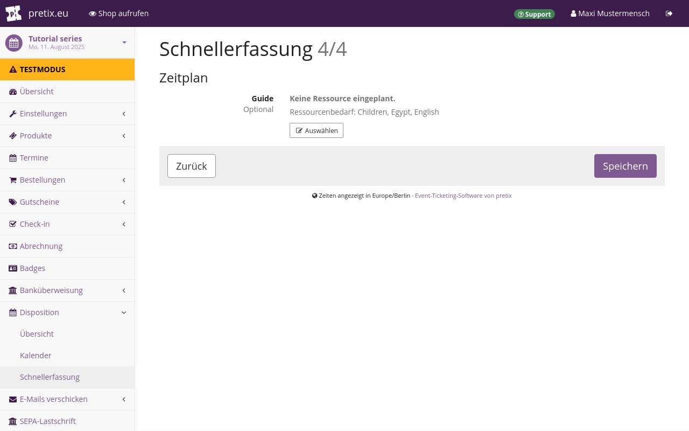
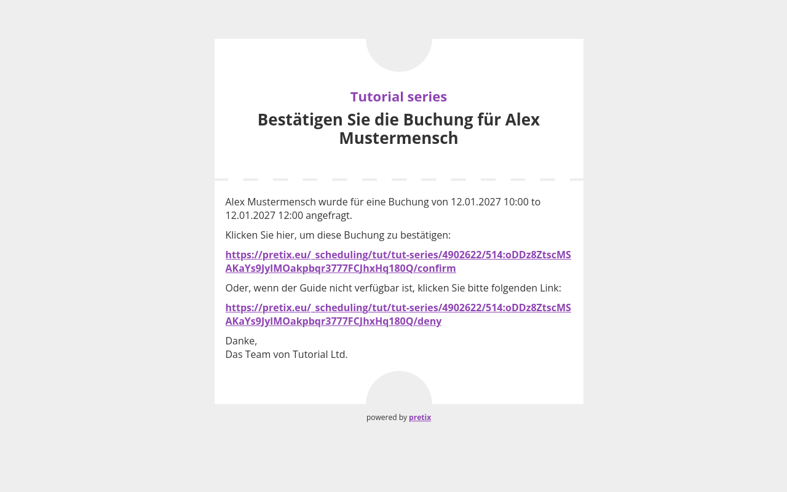
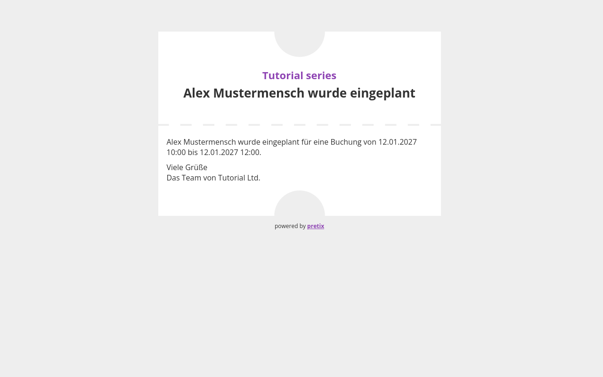

# Ressourcen und Disposition

Falls die Termine für Ihre Veranstaltungen von der Verfügbarkeit von Personal, Räumen, Technik oder sonstigen Ressourcen abhängen, sollten Sie die Erweiterung "Ressourcen und Disposition" verwenden.
Mit dieser Erweiterung können Sie diese Ressourcen verwalten und die Termine Ihrer [Veranstaltungsreihe](event-series.de.md) entsprechend festlegen.
Dieser Artikel erklärt, wie Sie dazu vorgehen.

## Voraussetzungen

Es muss mindestens eine Veranstaltungsreihe vorhanden sein, für die Sie die Erweiterung "Ressourcen und Disposition" verwenden möchten.
Diese Erweiterung enthält keine Funktionen, die sich für Einzelveranstaltungen sinnvoll einsetzen lassen.

## Anleitung

Die Arbeit mit dieser Erweiterung besteht aus folgenden Schritten:

 1. Die [Erweiterung aktivieren](#die-erweiterung-aktivieren), auf der Ebene von Veranstalter und Veranstaltungsreihe
 2. [Ressourcentypen erstellen](#ressourcentypen-erstellen), etwa einen Typ für alle Guides oder einen für alle Räume
 3. Für Ressourcentypen [Eigenschaften verwalten](#eigenschaften-verwalten)
 4. [Konkrete Ressourcen erstellen](#konkrete-ressourcen-erstellen), beispielsweise konkrete Personen als Guides oder bestimmte Räume
 5. [Ein Produkt für die Disposition erstellen](#ein-produkt-fur-die-disposition-erstellen), etwa ein Ticket für eine Führung
 6. [Termine für die Disposition anlegen](#termine-fur-die-disposition-anlegen), etwa geführte Touren
 7. [Ressourcen zu Terminen zuweisen](#ressourcen-zu-terminen-zuweisen), beispielsweise einen Guide zu einer Führung
 8. Alternativ Termine mit der Funktion [Schnellerfassung](#schnellerfassung) planen

Die folgenden Abschnitte erklären alle Schritte ausführlich.
Außerdem erklärt dieser Artikel, wie Sie eine [Terminplanung bestätigen oder ablehnen](#disposition-bestatigen-oder-ablehnen), je nach Verfügbarkeit der benötigten Ressourcen zum geplanten Termin.
Diese Information ist nützlich für diejenigen, die diese Ressource verwalten.

### Die Erweiterung aktivieren

Um die Erweiterung für Ihren Veranstalter zu nutzen, navigieren Sie zu :navpath:Ihre Veranstaltung → :fa3-wrench: Einstellungen → Erweiterungen:.
Suchen Sie in der Liste nach der Erweiterung "Ressourcen und Disposition" und klicken Sie den Button :btn:Aktivieren:.
Falls die Erweiterung "Ressourcen und Disposition" bereits aktiv ist, sehen Sie daneben das grüne Tag ":fa3-check: Aktiv".
Klicken Sie in diesem Fall den Button :btn:Veranstaltungen verwalten:.

Über beide Buttons gelangen Sie zu einer Seite mit den Veranstaltungen dieses Veranstalters.
Markieren Sie jede Veranstaltungsreihe, für die Sie die Erweiterung verwenden möchten, und klicken Sie den Button :btn:Speichern:.

Alternativ können Sie die Erweiterung auch für eine einzelne Veranstaltungsreihe aktivieren, indem Sie zu :navpath:Ihre Veranstaltungsreihe → :fa3-wrench: Einstellungen → Erweiterungen: navigieren.
Suchen Sie in der Liste nach der Erweiterung "Ressourcen und Disposition" und klicken Sie den Button :btn:Aktivieren:.
Falls die Erweiterung bereits aktiv ist, sehen Sie daneben das grüne Tag ":fa3-check: Aktiv".

### Ressourcentypen erstellen

Bevor Sie konkrete Ressourcen erstellen und verwalten können, müssen Sie Ressourcentypen erstellen.
Ein Beispiel: Sie möchten eine konkrete Ressource verwalten, nämlich eine Person namens "Alex Mustermensch".
Diese Person arbeitet als Guide in Ihrem Museum.
Daher erstellen Sie einen Ressourcentyp namens "Guides".

Dies ist die Voraussetzung dafür, dass Sie später die konkrete Ressource "Alex Mustermensch" erstellen können.
Diesen Schritt beschreibt der Abschnitt [Konkrete Ressourcen verwalten](#konkrete-ressourcen-verwalten) weiter unten.

Falls Sie Personal wie Guides, Lehrkräfte, Aufsichtspersonal usw. verwalten möchten, erstellen Sie einen Ressourcentyp für Personal.
Falls Sie Räumlichkeiten wie Fachräume, Sportstätten, Theatersäle usw. verwalten möchten, erstellen Sie einen Ressourcentyp für Räumlichkeiten.
Falls Sie Geräte wie Audio-Guides, Filmprojektoren, Tretboote usw. verwalten möchten, erstellen Sie einen Ressourcentyp für Geräte.

Die passenden Ressourcentypen zu erstellen, ist die Voraussetzung, um konkrete Ressourcen anlegen zu können.
Diesen Schritt beschreibt der Abschnitt [Konkrete Ressourcen verwalten](#konkrete-ressourcen-verwalten) weiter unten.

Mit pretix können Sie alle Arten von Ressourcen verwalten und den dazugehörigen Ressourcentyp erstellen.
Für jede Art von Ressource, die Sie verwalten möchten, sollten Sie genau einen Ressourcentyp erstellen.

!!! Note
    Wir empfehlen, **so wenig Ressourcentypen wie möglich** zu erstellen.
    Wenn Sie beispielsweise Tour-Guides und Workshop-Lehrkräfte beschäftigen, sollten Sie nur einen einzigen Ressourcentyp anlegen, nämlich "Personal".
    Darüber können Sie Personen verwalten, die sowohl als Tour-Guides als auch als Workshop-Lehrkräfte arbeiten.

    pretix überprüft nur innerhalb eines Ressourcentyps, ob es bei der Verfügbarkeit Konflikte gibt.
    Fügen Sie in pretix ein und dieselbe reale Ressource **nie** mehreren Ressourcentypen hinzu.
    Dadurch würden Sie es pretix unmöglich machen, die Verfügbarkeit dieser Ressource zu verfolgen.

Um einen neuen Ressourcentyp zu erstellen, navigieren Sie zu :navpath:Ihr Veranstalter → :fa3-briefcase: Ressourcen → Typen:.
Geben Sie bei "Name" einen Namen für den Ressourcentyp ein.

Wenn Sie "Name (plural)" leer lassen, bildet pretix den Plural, indem es ein `s` an den Eintrag im Feld "Name" anhängt.
Wenn der Plural des Ressourcentyp-Namens nicht mit einem angehängten `s` gebildet wird, füllen Sie das Feld "Name (plural)" aus.
Ein Beispiel: Wenn der Name des Ressourcentyps `Saal` ist, dann geben Sie bei "Name (plural)" `Säle` ein.

Wählen Sie den "Modus" des Ressourcentyps.

Im Modus ":fa3-user: Mensch" können Sie genau ein pretix-Benutzerkonto angeben, das diese konkrete Ressource verwaltet.
Sie können für jede einzelne Ressource auch eine Telefonnummer und eine Anschrift eintragen.
Sie können keine separate E-Mail-Adresse für Benachrichtigungen angeben.

Im Modus ":fa3-cube: Ort oder Sache" können Sie mehrere pretix-Benutzerkonten angeben, die die einzelnen Ressourcen verwalten.
Sie können auch eine E-Mail-Adresse für Benachrichtigungen angeben.
Sie können keine Telefonnummern und Anschriften eingeben.

Wenn Sie einen Ressourcentyp erstellt haben, können Sie den Modus nicht mehr ändern.

Sie können auf dieser Seite den Text für die E-Mails "Buchung wartet auf Bestätigung" und "Buchung bestätigt" festlegen.
pretix schickt diese E-Mails an die E-Mail-Adresse des Kontos, das diese Ressourcen verwaltet.
Weitere Informationen finden Sie unter [Konkrete Ressourcen verwalten](#konkrete-ressourcen-verwalten).

Wenn Sie einem Termin eine Ressource zuweisen, für die eine Bestätigung erforderlich ist, verschickt pretix die E-Mail "Buchung wartet auf Bestätigung".
Wenn die benachrichtigte Stelle die Buchung über die verschickte E-Mail bestätigt, verschickt pretix die E-Mail "Buchung bestätigt".
Auch wenn Sie einem Termin eine Ressource zuweisen, für die keine Bestätigung erforderlich ist, verschickt pretix die E-Mail "Buchung bestätigt".

Passen Sie für beide E-Mails den Betreff und den Text der Nachricht nach Bedarf an.
Die E-Mail "Buchung wartet auf Bestätigung" sollte immer die Platzhalter `{url_available}` und `{url_unavailable}` enthalten.
Die Person, die die Ressourcen verwaltet, benötigt diese Links zum Bestätigen oder Ablehnen einer Buchung.
Wir empfehlen, auch die anderen Platzhalter im E-Mail-Text zu verwenden, weil sie wichtige Informationen liefern.
Die verfügbaren Platzhalter finden Sie auf dieser Seite unterhalb der Felder für Betreff und E-Mail.

Klicken Sie den Button :btn:Speichern:.

### Eigenschaften verwalten

Ressourcen sind in der Regel nicht austauschbar.
Eine oder mehrere Eigenschaften, die für Buchungen relevant sind, können sich bei verschiedenen Ressourcen unterscheiden.
Beispielsweise sprechen die Guides eines Museums unterschiedliche Sprachen, kennen sich mit unterschiedlichen Ausstellungen aus oder können gut mit unterschiedlichen Zielgruppen umgehen.
Konferenzräume bieten nicht immer ausreichend Platz oder die benötigten Sitzplätze oder sie verfügen über eine unterschiedliche technische Ausstattung.
Mit pretix können Sie diese Eigenschaften beim Planen von Terminen berücksichtigen.

Um die Eigenschaften eines Ressourcentyps zu bearbeiten, navigieren Sie zu :navpath:Ihr Veranstalter → :fa3-briefcase: Ressourcen → Typen:.
Klicken Sie den Bearbeitungsbutton :btn-icon:fa3-edit:: neben dem Ressourcentyp in der Liste.
Unter der Überschrift "Eigenschaften" können Sie die Eigenschaften verwalten.
Alternativ können Sie die Eigenschaften schon beim Erstellen eines neuen Ressourcentyps angeben.

Angenommen, Sie erstellen einen Eigenschaftentyp für Guides im Museum.
Die Guides beherrschen unterschiedliche Sprachen und kennen sich mit unterschiedlichen Ausstellungen aus.

In diesem Fall klicken Sie den Button :btn-icon:fa3-plus: Eigenschaft hinzufügen:.
Geben Sie bei "Name" `Sprachen` ein.
(Das Beispiel in den Screenshots verwendet aus organisatorischen Gründen englische Bezeichnungen.)
Geben Sie als "Wert" `Deutsch` ein.
Klicken Sie den Button the :btn-icon:fa3-plus: Neuen Wert hinzufügen: und geben Sie in das neue Feld `Englisch` ein.
Klicken Sie erneut denselben Button und geben Sie in das neue Feld `Toki Pona` ein.
Ihr Ressourcentyp "Guide" hat jetzt die Eigenschaft "Sprachen" mit den möglichen Werten `Deutsch`, `Englisch` und `Toki Pona`.

Diese Werte für eine Eigenschaft schließen sich nicht gegenseitig aus.
Ein Guide kann eine beliebige Kombination aus diesen drei Sprachen beherrschen.

Klicken Sie den Button :btn-icon:fa3-plus: Eigenschaft hinzufügen:.
Geben Sie bei "Name" `Kenntnisse` ein.
Geben Sie als "Wert" `Griechenland` ein.
Klicken Sie den Button :btn-icon:fa3-plus: Neuen Wert hinzufügen: und geben Sie in das neue Feld `Ägypten` ein.
Klicken Sie denselben Button erneut und geben Sie in das neue Feld `Sumer` ein.
Ihr Ressourcentyp "Guide" verfügt jetzt über die Eigenschaft "Kenntnisse", die die Werte `Griechenland`, `Ägypten` oder `Sumer` annehmen kann.

Wenn Sie alles wie gewünscht eingegeben haben, klicken Sie den Button :btn:Speichern:.

Um eine Eigenschaft zu entfernen, klicken Sie neben der Eigenschaft auf den Button :btn-icon:fa3-minus-circle: Entfernen:.
Daraufhin wird ein Feld mit den Ressourcen angezeigt, die von dieser Änderung betroffen wären.
Wenn Sie die Eigenschaft entfernen, ist sie für die betreffenden Ressourcen nicht mehr verfügbar; das gilt ebenso für alle dafür definierten Werte.
Wenn Sie sicher sind, dass Sie die Eigenschaft löschen möchten, klicken Sie :btn:Ja, Eigenschaft löschen:, um die Löschung zu bestätigen.

### Konkrete Ressourcen verwalten

Wenn Sie einen Ressourcentyp erstellt und Eigenschaften dafür definiert haben, können Sie konkrete Ressourcen erstellen.
Eine konkrete Ressource kann beispielsweise Folgendes sein:

 - eine Person, die an Ihrem Veranstaltungsort als Guide arbeitet
 - ein Raum
 - eine technische Anlage

Für jeden Ressourcentyp, den Sie im vorigen Schritt erstellt haben, gibt es unter :navpath:Ihr Veranstalter → :fa3-briefcase: Ressourcen: ein neues Untermenü.
Navigieren Sie zu dem Untermenü für den Ressourcentyp, den Sie im vorigen Schritt erstellt haben.
Ein Beispiel: Wenn Sie einen Ressourcentyp namens "Guide" erstellt haben, navigieren Sie zu :navpath:Ihr Veranstalter → :fa3-briefcase: Ressourcen → Guide:.

Klicken Sie den Button :btn-icon:fa3-plus: Guide hinzufügen:.
Wenn Ihr Ressourcentyp einen anderen Namen hat, heißt auch der Button anders.

Wenn die Ressource, die Sie anlegen, ein Mensch ist, geben Sie dessen Namen bei "Name" ein.
Wählen Sie unter "Sprache" die Sprache, in der Sie bei pretix mit dieser Person kommunizieren möchten.
Sie können auch weitere Details eingeben: eine Telefonnummer, Adresse und externe Referenz dieser Person.
Eine externe Referenz könnte die Personalnummer sein oder eine Zeichenfolge in einem System zum Ressourcen- oder Personalmanagement außerhalb von pretix.

Welche Wahl Sie bei "Buchungsmodus" treffen, hängt davon ab, wie Sie und Ihr Unternehmen Ressourcen verwalten.
Wenn Sie Ressourcen ausschließlich mit pretix verwalten, wählen Sie `Sofort bestätigen`.
Wenn diese Option aktiv ist, betrachtet pretix jede Buchung dieser Ressource als sofort gültig.

Wenn die Verfügbarkeit Ihrer Ressourcen von Faktoren außerhalb von pretix abhängt, wählen Sie `Manuelle Bestätigung notwendig`.
Denkbare Faktoren sind eine eingeschränkte Personalverfügbarkeit aufgrund von Urlaub oder Krankheit oder die Ressourcenverwaltung durch eine externe Software oder ein nicht digitales System.
Wenn diese Option aktiv ist, erhält der Buchungsvorgang einen zusätzlichen Schritt.
Immer wenn Sie eine Buchung erstellen, sendet pretix eine E-Mail und eine Benachrichtigung an die Stelle, die die Ressource verwaltet.
Diese kann die Buchung dann entweder bestätigen oder ablehnen.

Wenn Sie alle Optionen nach Bedarf gewählt haben, klicken Sie den Button :btn:Speichern und mit mehr Einstellungen fortfahren:.

Wenn es sich bei der Ressource um eine Sache oder einen Ort handelt, vergeben Sie dafür einen eindeutigen Identifikator, etwa eine Raumnummer oder eine Inventarnummer.
Wählen Sie die "Sprache", die zu der Person oder dem Team passt, die für die Ressource zuständig sind.
Wenn Sie alle Optionen nach Bedarf gewählt haben, klicken Sie den Button :btn:Speichern und mit mehr Einstellungen fortfahren:.

Die Vorgehensweise, um eine Stelle für die Ressourcenverwaltung anzugeben, unterscheidet sich abhängig davon, ob die Ressource im Modus "Mensch" oder "Ort oder Sache" ist.

Wenn Sie eine **menschliche** Ressource erstellen, enthält die Seite das Feld "Verwaltet von".
Geben Sie in dieses Feld die E-Mail-Adresse des dazugehörigen pretix-Benutzerkontos ein.

Wenn die eingegebene E-Mail-Adresse noch nicht zu einem pretix-Benutzerkonto gehört, verschickt pretix eine Einladung an diese Adresse.
Dies ist ähnlich wie die pretix-Einladungen, wenn Sie [jemanden in Ihr Team einladen](teams.md#inviting-someone-to-your-team).

Wenn die Ressource ein **Ort** oder eine **Sache** ist, sehen Sie oben auf der Seite den Button :btn-icon:fa3-users: Manager:.
Klicken Sie diesen Button.
Damit gelangen Sie zu einer Seite mit allen Manager\*innen für diese Ressource.
Geben Sie die E-Mail-Adresse des pretix-Benutzerkontos einer der Personen ein, die diese Ressource verwalten.
Klicken Sie den Button :btn-icon:fa3-plus: Hinzufügen:.

Wiederholen Sie diesen Schritt für jede Person, die die Ressource verwaltet.
Gehen Sie in Ihrem Browser einen Schritt zurück oder navigieren Sie zu :navpath:Ihr Veranstalter → :fa3-briefcase: Ressourcen:.
Klicken Sie den Ressourcentyp und dann die Ressource.

Weisen Sie unter "Eigenschaften" der Ressource Eigenschaften zu.
Ein Beispiel: Wenn Sie einen Guide hinzufügen und diese Person Deutsch und Toki Pona spricht, klicken Sie das Feld "Sprachen" und wählen Sie `Deutsch` und `Toki Pona`.

Wenn Sie die Ressource wie gewünscht konfiguriert haben, klicken Sie den Button :btn:Speichern:.
Der Button :btn:Speichern: hat keinen Einfluss auf die Verfügbarkeitseinstellungen in der rechten Seitenhälfte.
Der nächste Artikel erklärt, wie Sie diese nutzen.

#### Verfügbarkeit einer Ressource festlegen

Definieren Sie unter "Verfügbarkeitsplan", wann die Ressource verfügbar ist.
Klicken Sie den Button :btn-icon:fa3-plus: Neue Regel hinzufügen:.
Dadurch wird ein Popup-Fenster aufgerufen, in dem Sie eine Verfügbarkeitsregel neu hinzufügen oder bearbeiten können.

In unserem Beispiel ist die Verfügbarkeit des Guides von Juli bis September 2027 gleichbleibend.
Die Person arbeitet von Montag bis Freitag von 9 bis 17 Uhr.
Dienstags zwischen 12 und 14 Uhr ist sie wegen der wöchentlichen Teambesprechung allerdings nicht verfügbar.

Für diese Konstellation geben Sie bei "Start" das Datum `2027-07-01` und bei "Ende" `2027-09-30` ein.
Wählen Sie alle Tage von Montag bis Freitag.
Geben Sie unter "Zeitraum" bei "Start" `09:00:00` und bei "Ende" `17:00:00` ein.
Klicken Sie im Popup-Fenster den Button :btn:Speichern:.

Klicken Sie erneut den Button :btn-icon:fa3-plus: Hinzufügen:.
Geben Sie bei "Start" und "Ende" dieselben Datumsangaben ein wie oben.
Markieren Sie "Dienstag".
Geben Sie als Uhrzeit bei "Start" `12:00:00` und bei "Ende" `14:00:00` ein.
Wählen Sie bei "Verfügbar" die Option "Ressource ist nicht verfügbar".
Klicken Sie im Popup-Fenster den Button :btn:Speichern:.

Die Kalenderansicht zeigt unter "Resultierende Verfügbarkeit" jetzt die Zeiten an, zu denen diese Ressource verfügbar ist.

#### Ressourcen löschen und reaktivieren

Wenn Sie eine Ressource löschen möchten, navigieren Sie zu dem Untermenü für den betreffenden Ressourcentyp.
Klicken Sie den Button :btn-icon:fa3-trash:: neben der Ressource, die Sie löschen möchten.
Alternativ können Sie auch den Namen der Ressource klicken und anschließend in der rechten oberen Ecke den Button :btn-icon:fa3-trash::.
Über beide Buttons gelangen Sie zu einer Seite, die Sie auffordert, das Löschen zu bestätigen.

Falls Sie diese Ressource noch nie für Veranstaltungen eingeplant haben, löscht pretix die Ressource komplett.
Falls Sie diese Ressource bereits für Veranstaltungen eingeplant haben, behält pretix einen Datensatz für diese Ressource.
Sie können diesen Datensatz anzeigen, indem Sie zu dem Untermenü für den betreffenden Ressourcentyp navigieren.
Wählen Sie bei "Status der Ressource" die Option `Gelöschte Ressourcen` oder `Alle Ressourcen` und klicken Sie den Button :btn-icon:fa3-filter: Filter:.
Die Seite zeigt gelöschte Ressourcen anschließend mit durchgestrichenem Namen an.

Wenn Sie eine Ressource wieder aktivieren möchten, klicken Sie ihren Namen.
Klicken Sie auf der Seite für diese konkrete Ressource den Button :btn-icon:fa3-rotate-right: Löschen rückgängig machen:.
Bestätigen Sie dies, indem Sie den Button :btn:Reaktivieren: klicken.
Nun können Sie diese Ressource wieder für Termine einplanen.

### Ein Produkt für die Disposition erstellen

Navigieren Sie zu :navpath:Ihre Veranstaltungsreihe → :fa3-ticket: Produkte: und erstellen oder bearbeiten Sie ein Produkt.
Allgemeine Informationen zum Anlegen von Produkten finden Sie in unserem Artikel über [Produkte](products/index.md).
Fügen Sie das Produkt **keinem** Kontingent hinzu.
Wechseln Sie zum Reiter :btn:Ressourcenbedarf:.

Geben Sie in das Feld "Standarddauer (in Minuten)" den Zeitraum ein, für den Ressourcen in der Regel gebucht werden.
Wenn eine Führung gewöhnlich 90 Minuten dauert, geben Sie `90` ein.
Dieses Feld ist optional, aber wenn Sie die Funktion [Schnellerfassung](#schnellerfassung) nutzen möchten, müssen Sie hier eine Zahl eingeben.

Geben Sie in das Feld "Standardkontingent" die Höchstzahl Personen an, die diese Ressource gleichzeitig nutzen können.
Wenn beispielsweise ein Guide maximal 30 Personen gleichzeitig betreuen kann, geben Sie hier `30` ein.

Wenn Sie Ressourcen abhängig von der Nachfrage zu Terminen zuweisen möchten, markieren Sie das Kontrollkästchen "Erlaube Kunden zu buchen, bevor Ressourcen eingeteilt sind".
Wenn Sie dieses Kontrollkästchen markieren, zeigt der Shop alle Termine an, zu denen dieses Produkt Zutritt gibt, auch wenn Sie dafür noch keine Ressource eingeteilt haben.

!!! Note
    Wenn Sie die Einstellung "Erlaube Kunden zu buchen, bevor Ressourcen eingeteilt sind" aktivieren, können Situationen auftreten, in denen Sie Tickets für einen Termin verkauft haben, aber an diesem Termin keine Ressource verfügbar ist.
    In diesem Fall müssen Sie die Buchungen genauer im Auge behalten.

Wenn Sie Ressourcen zu Terminen zuweisen möchten, bevor Sie Tickets dafür verkaufen, lassen Sie diese Option unmarkiert.
Dann müssen Sie dem Termin zuerst alle erforderlichen Ressourcen zuweisen.
Erst danach steht der Termin in Ihrem Shop für Buchungen zur Verfügung.

Klicken Sie den Button :btn-icon:fa3-plus: Neue Anforderung hinzufügen:.
Wählen Sie den für diesen Termin benötigten "Ressourcentyp".
Geben Sie unter "Menge" die Anzahl der von diesem Typ benötigten Ressourcen an, in der Regel `1`.
Wenn mehr Personal, Räume oder Anlagen erforderlich sind, geben Sie die benötigte Anzahl ein.

Sie können in das Feld "Kosten pro Ressource" die für eine bestimmte Ressource erwarteten Kosten eingeben.
Beispielsweise könnten Sie hier das Honorar eintragen, das der Guide für jede absolvierte Tour erhält.
pretix nutzt dieses Feld für Datenexporte.
Die Angabe hat keine Auswirkung auf den Produktpreis.

Markieren Sie unter "Eigenschaften" alle Werte, die für diesen Termin erforderlich sind.
Beispiel: Sie bieten für englischsprachige Kinder eine Führung durch die Ausstellung über das Alte Ägypten an.
Dafür wählen Sie als "Ressourcentyp" `Guide` und wählen bei "Eigenschaften" `Kinder`, `Ägypten` und `Englisch`.

Klicken Sie den Button :btn:Speichern:.

### Termine für die Disposition anlegen

!!! Note
    Es ist sinnvoll, für die Disposition Termine anzulegen, wenn Sie für die Öffentlichkeit wiederkehrende Termine anbieten.
    Wenn Sie jedoch Termine mit Gruppen oder Einzelpersonen vereinbaren, ist es eventuell bequemer, die Funktion [Schnellerfassung](#schnellerfassung) zu nutzen.

Navigieren Sie zu :navpath:Ihre Veranstaltungsreihe → :fa3-calendar:Termine: und klicken Sie den Button :btn-icon:fa3-plus: Mehrere neue Termine erstellen:.
Richten Sie die Termine entsprechend Ihren Anforderungen ein.
Allgemeine Informationen zum Anlegen von Terminen finden Sie unter [Termine in der Veranstaltungsreihe erstellen und bearbeiten](event-series.md#termine-in-der-veranstaltungsreihe-erstellen-und-bearbeiten).

Wählen Sie unter "Kontingente" im Feld "Produkte" das im [vorigen Schritt](#ein-produkt-fur-die-disposition-erstellen) erstellte Produkt.

Wir empfehlen, nur ein einziges Produkt mit Ressourcenbedarf zu wählen.
pretix addiert die Ressourcenbedarfe jedes einzelnen Produkts.
Wenn Ihr Termin zwei Produkte enthält, die beide einen Guide benötigen, dann erfordert der Termin für die Disposition zwei Guides.
Wenn Sie zum selben Zeitpunkt mehrere Führungen anbieten möchten, erstellen Sie einen Termin für jede einzelne Führung.

Wenn für jede Person, die an einer Führung teilnimmt, ein Ticket kaufen soll, dann sollten Sie ein Produkt "Führung" mit Ressourcenbedarf und eine beliebige Zahl regulärer Tickets ohne Ressourcenbedarf vorsehen.
Wir empfehlen, die Tickets für die Führung als Zusatzprodukte zum Produkt "Führung" zu konfigurieren.

### Ressourcen zu Terminen zuweisen

Um einen Überblick über die Disposition für Ihre Veranstaltungsreihe zu erhalten, navigieren Sie zu :navpath:Ihre Veranstaltung → :fa3-calendar: Disposition → Übersicht:.

Um Terminen die benötigten Ressourcen zuzuweisen, klicken Sie :btn:Termine mit fehlender Ressourceneinteilung:.
Sie gelangen zur Seite "Termine mit fehlenden Ressourcen" und sehen hier alle Termine, deren Ressourcenbedarf noch nicht erfüllt ist.
Hier sollten alle Termine aufgeführt sein, die Sie im vorigen Schritt erstellt haben.

Klicken Sie einen der Termine.
Unter "Zusätzliche Einstellungen" finden Sie die Einstellungen für "Zeitplan".
Es gibt ein Feld für jeden Ressourcentyp, der von einem der Produkte benötigt wird, die diesem Termin zugewiesen sind.
Der Text unter dem Feld führt die benötigten Eigenschaften der Ressource auf.
Klicken Sie das Feld und wählen Sie die konkrete Ressource, die Sie dem Termin zuweisen möchten.

Angenommen, Ihr Termin erfordert eine Ressource des Typs "Guide".
Die benötigten Eigenschaften sind "Kinder", "Ägypten" und "Englisch".
Klicken Sie das Feld.

Ein Dropdown-Menü wird geöffnet und zeigt alle Ressourcen des Typs "Guide".
Neben jedem Eintrag werden Tags angezeigt, die Ihnen helfen, eine geeignete Ressource auszuwählen:
`gleichzeitige Buchung`, `Verfügbarkeit unbekannt`, `nicht verfügbar` oder `erfüllt nicht alle Bedingungen`.
Falls keines dieser Probleme vorliegt, hat der Eintrag keines dieser Tags.
Wählen Sie einen Eintrag ohne solche Problem-Tags.

Klicken Sie den Button :btn:Speichern:.
Dadurch wird von der Kontakt-E-Mail-Adresse der Veranstaltung eine E-Mail an die für diese Ressource zuständige Verwaltung geschickt.

### Schnellerfassung

Über die Schnellerfassung können Sie feststellen, ob die für ein Produkt erforderlichen Ressourcen an einem bestimmten Termin verfügbar sind.
Das ist praktisch, wenn Sie einen Termin, zum Beispiel für eine Führung, mit einer Gruppe von Kund\*innen vereinbaren.
Ebenso, wenn Sie Termine darauf abstimmen wollen, wann die erforderlichen Ressourcen verfügbar sind.

!!! Note
    Die Schnellerfassung ist nützlich, wenn Sie Termine mit Gruppen oder Einzelpersonen vereinbaren.
    Sie ist auch praktisch, um Termine für Führungen einzeln anzulegen.
    Wenn Sie wiederkehrende Termine anbieten, die allen Ihren Kund\*innen offenstehen, kann es günstiger sein, [Termine für die Disposition anzulegen](#termine-fur-die-disposition-anlegen) und [Ressourcen zu Terminen zuzuweisen](#ressourcen-zu-terminen-zuweisen).

Navigieren Sie zu :navpath:Ihre Veranstaltung → :fa3-calendar: Disposition → Schnellerfassung:.
Geben Sie bei "Datum" den Termin ein, für den Sie die Verfügbarkeit feststellen möchten.
Wählen Sie bei "Produkte" die Option "Alle" oder wenigstens ein Produkt.

Dieses Feld zeigt nur Produkte an, für die in den Produkteinstellungen auf dem Reiter "Ressourcenbedarf" eine "Standarddauer" definiert ist.
Weitere Informationen darüber, wie Sie den Ressourcenbedarf für ein Produkt festlegen, finden Sie unter [Ein Produkt für die Disposition erstellen](#ein-produkt-fur-die-disposition-erstellen).
Klicken Sie den Button :btn:Fortfahren:.

Wählen Sie für die Startzeit des Termins, indem Sie sie unter "Verfügbare Uhrzeiten" wählen oder unter "Start" eingeben.
pretix schlägt nur Uhrzeiten vor, für die nach den im System hinterlegten Informationen genügend Ressourcen verfügbar sind.
Sie können trotzdem beliebige andere Zeiten von Hand eingeben, auch wenn pretix keine Informationen über zu diesem Zeitpunkt verfügbare Ressourcen hat.
Wenn Sie auf der vorigen Seite mehrere Produkte gewählt haben, wählen Sie nun im Dropdown-Menü "Produkt" eines dieser Produkte.
Wenn Sie dort nur ein einziges Produkt gewählt haben, übernimmt pretix Ihre Wahl in das Dropdown-Menü auf dieser Seite.

Wenn Sie das Kontrollkästchen bei "Öffentlich anzeigen" markieren, wird für diesen Termin die Einstellung "In Listen anzeigen" aktiviert, und der Kalender und die Listenansichten Ihres Shops zeigen diesen Termin Ihren Kund\*innen an.
Entfernen Sie die Markierung aus diesem Kontrollkästchen, wenn dieser Termin nicht allen Besucher\*innen Ihres Shops angezeigt werden soll.

Wenn Sie direkt eine Bestellung für den Termin anlegen möchten, markieren Sie das Kontrollkästchen "Bestellung anlegen".
Klicken Sie den Button :btn:Fortfahren:.

Wenn Sie das Kontrollkästchen "Bestellung anlegen" markiert haben, können Sie auf der nächsten Seite Details zu dieser Bestellung eingeben.
Dies ist ein vereinfachtes Formular.
Wenn Sie zu dieser Bestellung weitere Angaben eingeben möchten, die pretix nicht auf dieser Seite anzeigt (z. B. Rechnungsdaten), verwenden Sie das Menü "Bestellungen".
Wenn Sie das Kontrollkästchen "Bestellung anlegen" nicht markiert haben, überspringt pretix diese Seite.

Wählen Sie den Verkaufskanal für diese Bestellung.
Geben Sie bei "Mengen" an, wie viele Produkte über diese Bestellung verkauft werden, und wie viel das einzelne Produkt kostet.
Sie können auch eine "E-Mail-Adresse" für diese Bestellung angeben.
Klicken Sie dann den Button :btn:Fortfahren:.

Im letzten Schritt der Schnellerfassung wählen Sie die für den Termin benötigten Ressourcen.
Die benötigten Eigenschaften werden unter dem Feld angezeigt.
Klicken Sie darauf.
Ein Dropdown-Menü wird geöffnet und zeigt alle Ressourcen des Typs "Guide".
Neben jedem Eintrag werden Tags angezeigt, die Ihnen helfen, eine geeignete Ressource auszuwählen:
`gleichzeitige Buchung`, `Verfügbarkeit unbekannt`, `nicht verfügbar` oder `erfüllt nicht alle Bedingungen`.
Falls keines dieser Probleme vorliegt, hat der Eintrag keines dieser Tags.
Wählen Sie einen Eintrag ohne solche Problem-Tags.

Klicken Sie dann den Button :btn:Speichern:.
Wenn Sie eine Bestellung angelegt haben, gelangen Sie zur Seite für diese Bestellung.
Wenn Sie keine Bestellung angelegt haben, gelangen Sie zur Übersicht für die Disposition.

### Disposition bestätigen oder ablehnen

Wenn jemand in pretix einem Termin eine Ressource zuweist, sendet der Server eine E-Mail an die Personen, die diese Ressource verwalten.
Im Anhang der E-Mail befindet sich eine ics-Datei, mit der sie den Termin in ihren Kalender übernehmen können.

Um die geplante Disposition zu bestätigen, klicken Sie den Link, der mit `confirm` endet.
Dieser leitet Sie zu einer Webseite mit der Mitteilung "Danke für Ihre Antwort, der Veranstalter wird informiert".
Der pretix-Server sendet die Bestätigung dann auch per E-Mail an die Personen, die die Ressource verwalten.
Sowohl in der Dispositionsübersicht als auch auf der Seite für den betreffenden Termin wird angezeigt, dass die Anforderungen für den Termin erfüllt sind.

Um die geplante Disposition abzulehnen, klicken Sie den Link, der mit `deny` endet.
Auch dieser leitet Sie zu einer Webseite mit der Mitteilung "Danke für Ihre Antwort, der Veranstalter wird informiert".
Der pretix-Server verschickt keine E-Mail mit Bestätigung.
Die Anforderung für den Termin bleibt offen.

## Fehlerbehebung

### Einige Termine werden nicht in Ihrem Shop angezeigt

**Problem:** Sie verwenden die Erweiterung "Ressourcen und Disposition" und Ihr Shop zeigt nicht alle Termine.

**Lösung:** Sie müssen entweder Ressourcen für diese Termine einplanen oder Sie müssen zulassen, dass Kund\*innen buchen, bevor Sie Ressourcen für den Termin geplant haben.

Für die erste Möglichkeit finden Sie Informationen unter [Ressourcen zu Terminen zuweisen](#ressourcen-zu-terminen-zuweisen).

Für die zweite Möglichkeit navigieren Sie zu :navpath:Ihre Veranstaltungsreihe → :fa3-ticket:Produkte:.
Bearbeiten Sie das Produkt, das den Zutritt zu den Terminen gewährt, die der Shop nicht anzeigt.
Wechseln Sie zum Reiter :btn:Ressourcenbedarf:.
Markieren Sie das Kontrollkästchen "Erlaube Kunden zu buchen, bevor Ressourcen eingeteilt sind".
Wenn Sie dieses Kontrollkästchen markieren, zeigt der Shop alle Termine an, zu denen dieses Produkt Zutritt gibt, auch wenn Sie dafür noch keine Ressource eingeteilt haben.

Klicken Sie den Button :btn:Speichern:.
Wiederholen Sie diese Schritte für jedes Produkt, das den Zutritt zu einem Termin gewährt, der nicht im Kalender angezeigt wird.