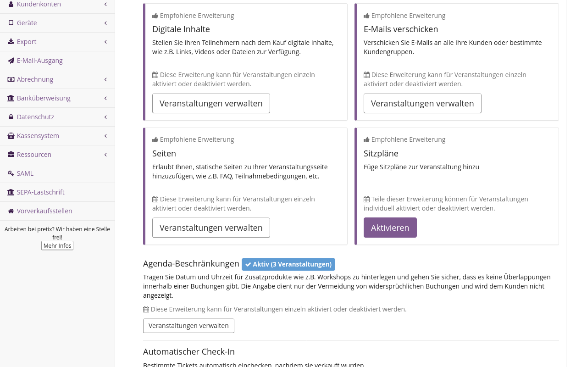
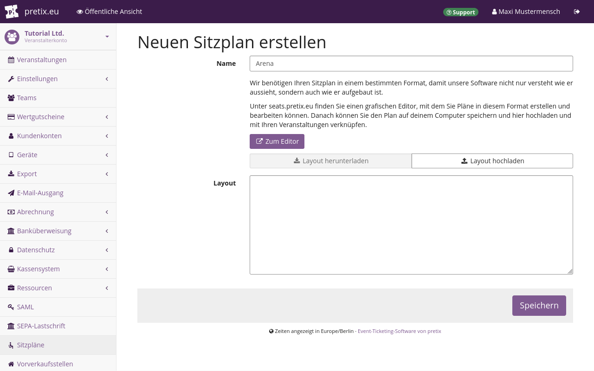
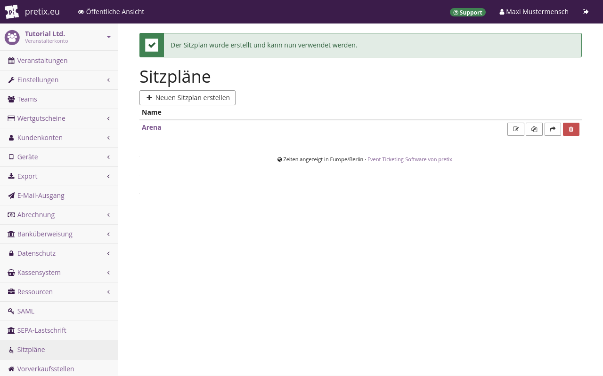
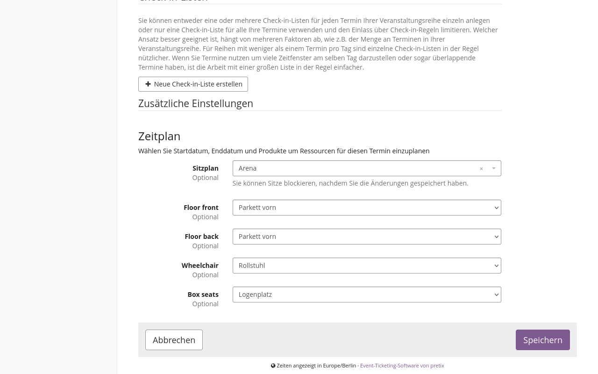
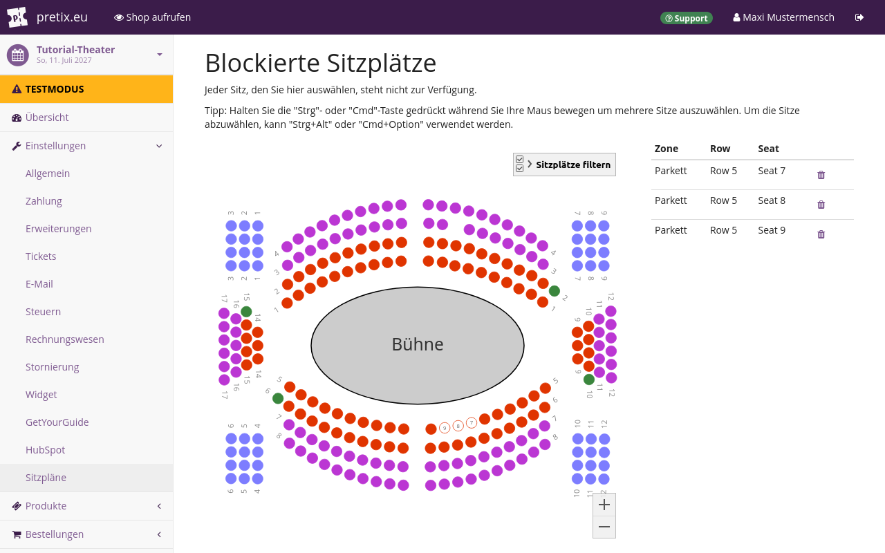

# Sitzpläne

<!-- md:hosted -->
<!-- md:enterprise -->

Dieser Artikel erklärt, wie Sie die pretix-Funktion für Sitzpläne benutzen.
Mit dieser Funktion können Sie Sitzpläne erstellen, um Tickets für einzelne Sitzplätze verkaufen zu können.
Das ist praktisch, wenn Ihre Veranstaltung beispielsweise in einem Theater, einem Stadion oder einem Speisesaal stattfindet.
Kund\*innen können sich in Ihrem Shop den Sitzplan ansehen und sich ihren Wunsch-Sitzplatz aussuchen.

Sie können Sitzplätze erstellen und in nummerierten Sitzreihen und Zonen anordnen.
Mithilfe von Zonen können Sie für Ihren Veranstaltungsort ein komplexes Layout abbilden, beispielsweise ein Theater mit Orchestergraben, Rängen, Logenplätzen und Parkett.
Die klare Aufteilung dieser unterschiedlichen Bereiche in Zonen auf dem Sitzplan hilft Ihren Kund\*innen, sich bei der Bestellung für den passenden Sitzplatz zu entscheiden.

Sie können Zone, Sitzreihe und Sitzplatz-Nummer auf dem Ticket angeben und so dafür sorgen, dass Ihre Kund\*innen ihren Sitzplatz leichter finden.

Die Sitzplan-Funktion ist aber nicht nur für Sitzplätze von Nutzen.
Sie können darüber auch beispielsweise Tische in Lesesälen reservieren oder Stellplätze auf dem Parkplatz buchen.
Sitzpläne lassen sich für jeden Raum mit festem Layout und einer begrenzten Anzahl nutzbarer Plätze erstellen.

Die Sitzplan-Funktion ist bei pretix Hosted und bei pretix Enterprise verfügbar.
Bei pretix Community ist sie nicht verfügbar.

## Voraussetzungen

Viele Aspekte von Sitzplänen werden auf Veranstaltungsebene festgelegt.
Sie müssen also zuerst eine Veranstaltung anlegen.

## Allgemeine Verwendung

Wenn Sie für Ihre Veranstaltung Tickets für einzelne Sitzplätze verkaufen möchten, gehen Sie folgendermaßen vor:

 - [Die Erweiterung aktivieren](#die-erweiterung-aktivieren)
 - Mit dem Sitzplan-Editor ein [Layout erstellen](#ein-layout-erstellen), das der Editor anschließend [validiert](#das-layout-validieren)
 - [Den Plan Ihrem Veranstalterkonto zuweisen](#einen-sitzplan-ihrem-veranstalterkonto-zuweisen)
 - [Produkte für den Sitzplan erstellen](#produkte-fur-den-sitzplan-erstellen)
 - [Den Sitzplan Ihrer Veranstaltung zuweisen](#den-sitzplan-einer-einzelveranstaltung-zuweisen) oder einem Termin in Ihrer [Veranstaltungsreihe](#den-sitzplan-einem-termin-in-einer-veranstaltungsreihe-zuweisen)
 - Entscheiden, ob [Kund\*innen ihre Sitzplätze selbst wählen können](#kundinnen-ihre-sitzplatze-selbst-wahlen-lassen)

Die folgenden Abschnitte erklären alle Schritte ausführlich.

### Die Erweiterung aktivieren

Um die Erweiterung "Sitzpläne" für Ihre Veranstaltung zu aktivieren, navigieren Sie zu :navpath:Ihr Veranstalter → :fa3-wrench: Einstellungen → Erweiterungen:.
Wechseln Sie zum Reiter :btn:Funktionen:.
Auf dieser Seite finden Sie die Erweiterung "Sitzpläne" oben bei den empfohlenen Erweiterungen.
Klicken Sie den Button :btn:Aktivieren: daneben.

Markieren Sie in der Liste "Veranstaltungen mit aktiver Erweiterung" die Veranstaltungen, für die Sie Sitzpläne verwenden möchten.
Da Sie die Erweiterung "Sitzpläne" aktiviert haben, sind nun alle Einstellungen rund um Sitzpläne für Ihren Veranstalter verfügbar.

### Ein Layout erstellen

Der Hauptbestandteil eines Sitzplans ist die JSON-Datei, die das Layout definiert.
Um ein neues Layout zu erstellen, öffnen Sie den Editor unter [https://seats.pretix.eu/](https://seats.pretix.eu/).
Sie können diesen Editor auch nutzen, wenn sie nicht bei Ihrem pretix-Konto angemeldet sind.

Alternativ navigieren Sie zu :navpath:Ihr Veranstalter → :i-seat: Sitzpläne: und klicken Sie den Button :btn-icon:fa3-plus: Neuen Sitzplan erstellen:.
Klicken Sie auf der nächsten Seite den Button :btn-icon:fa3-external-link: Zum Editor:.
Auch auf diese Weise gelangen Sie zu [https://seats.pretix.eu/](https://seats.pretix.eu/).

Wenn Sie eine **Bilddatei** mit einem Plan des Veranstaltungsorts haben, kann diese beim Erstellen des Layouts hilfreich sein.
Wenn Sie ein solches Bild als Hilfsmittel bei der Layout-Erstellung verwenden möchten, klicken Sie den Button :btn:UPLOAD IMAGE: (Bild hochladen) und wählen Sie die Bilddatei aus.
Der Layout-Editor speichert das hochgeladene Bild nicht als Teil Ihres Layouts.
Das Bild dient Ihnen lediglich als Vorlage zum Platzieren von Sitzplätzen und anderen Objekten im Layout.

Wenn Sie ein Bild hochgeladen haben, ist es sinnvoll, **Breite** ("Width") und **Höhe** ("Height") des Layouts an die Bildabmessungen anzupassen.
Wenn Sie kein Bild hochgeladen haben, dann können Sie auch zuerst Sitzplätze und weitere Objekte erstellen und dann Breite und Höhe des Layouts so anpassen, dass alle Elemente bequem Platz haben.

Wenn Ihr Veranstaltungsort mehr als eine Ebene oder mehr als einen Sitzblock hat, sollten Sie für das Layout die entsprechende Anzahl **Zonen** anlegen.
Falls bei Ihrem Veranstaltungsort die Nummern von Sitzplätzen und Sitzreihen mehrmals vorkommen und das Layout alle Nummern korrekt abbilden soll, müssen Sie die betreffenden Sitzplätze in unterschiedlichen Zonen anordnen.
Um eine neue Zone zu erstellen, klicken Sie in der Seitenleiste den Button :btn-icon:fa3-plus:: neben "Zones" (Zonen) und geben einen Namen ein.

pretix ordnet den Sitzplätzen Produkte anhand der **Sitzplatzkategorie** zu.
Sie benötigen für jedes Produkt, das Sie verkaufen möchten, eine Sitzplatzkategorie.
Wenn Sie für alle Sitzplätze des Sitzplans nur ein Produkt verkaufen möchten, benötigen Sie nur eine Sitzplatzkategorie.

Sie erstellen eine Sitzplatzkategorie, indem Sie in der Seitenleiste neben der Überschrift "Categories" (Kategorien) den Button :btn-icon:fa3-plus:: klicken.
Geben Sie einen Namen ein und wählen Sie eine Farbe für die Sitzplatzkategorie.
Sie löschen eine Sitzplatzkategorie, indem Sie daneben den Button :btn-icon:fa3-trash:: klicken.
Um Name und Farbe zu ändern, klicken Sie den Button :btn-icon:fa3-pencil::.

!!! Note
    Wenn Sie mit einem Mac-Computer arbeiten, können Sie statt der `Strg`-Taste die Taste `⌘`, auch als `Befehlstaste` oder `Cmd` bekannt, verwenden.
    Die `Strg`-Taste funktioniert ebenfalls.

Um das Layout durch **Zoomen** zu vergrößern bzw. zu verkleinern, halten Sie die `Strg`-Taste gedrückt und drehen Sie das Mausrad.
Alternativ dazu können Sie auch die Buttons :btn-icon:fa3-search-minus:: und :btn-icon:fa3-search-plus:: in der Leiste am oberen Bildschirmrand verwenden.

Um den **Layout-Ausschnitt zu verschieben**, halten Sie die `Strg`-Taste gedrückt, klicken Sie in das Layout, halten Sie die Maustaste gedrückt und bewegen Sie die Maus.

Um vorhandene **Elemente auszuwählen**, klicken Sie in der Leiste am oberen Bildschirmrand den Button :btn-icon:fa3-mouse-pointer:: "Select rows or shapes" (Sitzreihen und Formen wählen).
Wenn Sie nur einen einzelnen Sitzplatz wählen möchten, klicken Sie stattdessen den Button :btn-icon:i-tool-seatselect:: "Select seats" (Sitzplätze wählen).
Klicken Sie das Element, das Sie wählen möchten.
Sie können einen einzelnen Sitzplatz auch wählen, indem Sie den Button :btn-icon:fa3-mouse-pointer:: "Select rows or shapes" (Sitzreihen und Formen wählen) klicken und dann den Sitzplatz doppelklicken.

!!! Note
    Die Einstellung für den Optimierungshinweis "Optimizer hint" ist nur für komplexere Anwendungsfälle relevant.
    Mehr dazu erfahren Sie unter [Sitzplatz-Wahl durch Kund\*innen optimieren](#sitzplatz-wahl-durch-kundinnen-optimieren).

!!! Note
    Der Radius der Sitzplätze in Ihrem Plan sollte nah an dem Standardwert 10 liegen.
    Deutlich kleinere Sitzplätze sind möglicherweise schwer wählbar.
    Bei deutlich größeren Sitzplätzen können die Beschriftungen schlecht lesbar sein.

Wenn Sie mehrere Elemente wählen möchten, halten Sie die `Umschalttaste` gedrückt und klicken Sie die gewünschten Elemente.
Alternativ dazu können Sie auch die linke Maustaste gedrückt halten und Maus über die gewünschten Elemente ziehen, sodass sie von einem Auswahlrechteck umschlossen sind.
Nutzen Sie die Optionen der rechten Seitenleiste, um die Eigenschaften aller gewählten Elemente zu bearbeiten.

Um die gewählten Elemente zu **verschieben**, ziehen Sie sie mit der Maus an den gewünschten Ort.
Wenn die Elemente an einem Raster ausgerichtet werden sollen, halten Sie die `Umschalttaste` gedrückt, während Sie die Elemente mit der Maus verschieben.
Alternativ dazu können Sie auch die Pfeiltasten verwenden.
Wenn Sie Elemente mit den Pfeiltasten verschieben, halten Sie für größere Bewegungen die `Umschalttaste` gedrückt, für kleinere Bewegungen die `Alt`-Taste.

Wenn Sie gewählte Elemente in eine **andere Zone** verschieben möchten, klicken Sie den Button :btn-icon:fa3-cut:: "Cut" (Ausschneiden).
Drücken Sie alternativ dazu die Tastenkombination `Strg`+`X`.
Wählen Sie die Zone, in die Sie die Elemente verschieben möchten.
Klicken Sie den Button :btn-icon:fa3-paste:: "Paste" (Einfügen).
Drücken Sie alternativ dazu die Tastenkombination `Strg`+`V`.

Um das Layout zu **speichern**, klicken Sie oben links den Button :btn-icon:fa3-save:: "Save plan" (Sitzplan speichern).
Daraufhin wird ein Dialogfeld aufgerufen, in dem Sie angeben können, wo auf Ihrem Computer die JSON-Datei gespeichert wird.
Falls Ihr Plan Validierungsfehler enthält, wird die Datei beim Klick nicht gespeichert.
Stattdessen erhalten Sie eine Fehlermeldung.
Informationen zur Fehlerbehebung finden Sie unter [Das Layout validieren](#das-layout-validieren).

### Das Layout validieren

Bei der **Validierung** des Layouts prüft der Editor, ob es Duplikate von Elementen gibt, durch die das Layout nicht korrekt funktionieren würde.
Wenn die Validierung erfolgreich ist, wird dies mit einem grünen Häkchen :btn-icon:fa3-check-circle-o:: am oberen Bildschirmrand angezeigt.
Schlägt die Validierung fehl, wird stattdessen ein rotes Ausrufezeichen :btn-icon:fa3-exclamation-circle:: angezeigt.
Wenn Sie trotz einer fehlgeschlagenen Validierung den Button :btn-icon:fa3-save:: "Save plan" (Sitzplan speichern) klicken, wird im Browser eine Warnmeldung angezeigt.
Den fehlerhaften Sitzplan können Sie trotzdem herunterladen, indem Sie in der Warnmeldung den Button :btn:OK: klicken.

Eine mögliche Ursache für eine fehlgeschlagene Validierung sind **doppelt** vorhandene Kombinationen aus Zone, Sitzreihen-Nummer und Sitzplatz-Nummer.
Jede Kombination darf nur einmal vorhanden sein.
Eine weitere mögliche Ursache sind doppelte Sitzplatz-IDs.

Sitzplatz-IDs können eine der folgenden Formen annehmen:

 1. ein [UUID](https://de.wikipedia.org/wiki/Universally_Unique_Identifier) aus Buchstaben, Zahlen und Bindestrichen
 2. eine Zeichenfolge mit Zone, Sitzreihen-Nummer und Sitzplatz-Nummer, die mit Bindestrichen verbunden sind
 3. eine von Ihnen vergebene eigene Zeichenfolge

Sofern Sie nicht eine der Standardeinstellungen (Nummer von Sitzreihe bzw. Sitzplatz) ändern, vergibt der Editor beim Anlegen der Sitzplätze die erste Option (UUID).
Wenn Sie die Nummer eines Sitzplatzes oder einer Sitzreihe ändern oder den Umschalter "Reversed" (Umgekehrt) verwenden, verwendet der Editor die zweite Option (Zone, Sitzreihen-Nummer und Sitzplatz-Nummer mit Bindestrichen) als Sitzplatz-ID.
Sie können die Sitzplatz-ID ändern, indem Sie einen einzelnen Sitzplatz wählen und die Zeichenfolge im Feld "Seat ID" (Sitzplatz-ID) bearbeiten.

Wenn Sie Sitzreihen **kopieren**, werden nicht nur doppelte Sitzplatz-IDs angelegt, sondern auch doppelte Kombinationen aus Zone, Sitzreihen-Nummer und Sitzplatz-Nummer.
Ändern Sie die Nummer der kopierten Sitzreihe zu einer Nummer, die im Plan noch nicht verwendet wird.
Aktivieren Sie dann den Umschalter "Reversed" (Umgekehrt) und deaktivieren Sie ihn wieder.
Damit werden die Sitzplatz-IDs neu vergeben, sodass es in dieser Sitzreihe keine Duplikate mehr gibt.

!!! Note
    Das Aktivieren bzw. Deaktivieren des Umschalters "Reversed" (Umgekehrt) für eine Sitzreihe ersetzt alle Sitzplatz-IDs in dieser Sitzreihe mit einer Zeichenfolge aus Zone, Sitzreihen-Nummer und Sitzplatz-Nummer mit Bindestrichen.
    Das betrifft auch alle benutzerdefinierten Sitzplatz-IDs, also jene, die Sie manuell festgelegt haben.

Um das Layout zu **speichern**, klicken Sie oben links den Button :btn-icon:fa3-save:: "Save plan" (Sitzplan speichern).
Daraufhin wird ein Dialogfeld aufgerufen, über das Sie die JSON-Datei auf Ihrem Computer speichern.

### Einen Sitzplan Ihrem Veranstalterkonto zuweisen

Sitzpläne werden auf Veranstalterebene verwaltet.
Auf diese Weise können Sie Sitzpläne für verschiedene Veranstaltungen erstellen, die vom selben Veranstalter organisiert werden.

Wenn Sie das [Layout für Ihren Sitzplan](#ein-layout-erstellen) als JSON-Datei vorliegen haben, müssen Sie in Ihrem Veranstalterkonto den dazugehörigen Eintrag für den Sitzplan erstellen.
Dazu navigieren Sie zu :navpath:Ihr Veranstalter → :i-seat: Sitzpläne: und klicken Sie den Button :btn-icon:fa3-plus: Neuen Sitzplan erstellen:.

Klicken Sie auf der nächsten Seite den Button :btn-icon:fa3-upload: Layout hochladen:.
Wählen Sie die JSON-Datei mit dem Sitzplan, den Sie verwenden möchten, beispielsweise den Plan, den Sie im [vorigen Schritt](#ein-layout-erstellen) erstellt und heruntergeladen haben.
Der Inhalt der Datei ist nun im Feld "Layout" zu sehen.

Geben Sie in das Feld "Name" einen Namen für den Sitzplan ein und klicken Sie den Button :btn:Speichern:.
Sie gelangen zur Seite "Sitzpläne", die einen Button zum Erstellen eines weiteren neuen Sitzplans enthält sowie eine Liste von Plänen, in der auch Ihr Plan aufgeführt ist.

### Produkte für den Sitzplan erstellen

Wenn Sie Produkte über einen Sitzplan verkaufen möchten, dann entstehen dadurch besondere Anforderungen an die Konfiguration der Produkte in Ihrem Shop.
Allgemeine Informationen zum Anlegen von Produkten finden Sie in unserem Artikel über [Produkte](products/index.md).

Sie können einer Sitzplatzkategorie nur ein einziges Produkt zuweisen.
Wenn es möglich sein soll, für einen Sitzplatz mehr als eine Produktart zu kaufen, erstellen Sie ein Produkt mit mehreren Produktvarianten.
Weisen Sie dieses Produkt der entsprechenden Sitzplatzkategorie zu.

Erstellen Sie ein Kontingent für jede Sitzplatzkategorie, die Sie im Sitzplan anbieten.
Legen Sie die Gesamtkapazität des Kontingents über das Feld "Gesamtanzahl" auf die Anzahl der Sitzplätze in dieser Sitzplatzkategorie fest.
Ein Beispiel: Ihr Sitzplan hat 48 Sitzplätze in der Sitzplatzkategorie "Logenplätze", daher erstellen Sie ein Kontingent mit einer Gesamtkapazität von 48 Produkten.
Fügen Sie diesem Kontingent das Produkt hinzu, das Sie der Sitzplatzkategorie "Logenplätze" zugewiesen haben.

Sowohl die Anzahl der Sitzplätze im Plan als auch die Gesamtkapazität des Kontingents begrenzen die Anzahl möglicher Käufe.
Wenn das Kontingent erschöpft ist, können Kund\*innen keinen Sitzplatz mehr in der betreffenden Sitzplatzkategorie wählen.
Wenn Sie alle Sitzplätze in der Sitzplatzkategorie verkauft haben, können Kund\*innen auch keine Tickets mehr für diese Sitzplatzkategorie kaufen.

Die Funktion "Warteliste" arbeitet nur dann erwartungsgemäß, wenn die Gesamtkapazität des Kontingents gleich der Anzahl Sitzplätze in der entsprechenden Sitzplatzkategorie ist.

Sie können in Ihrem Shop sowohl Produkte für Sitzplätze als auch andere Produkte anbieten.
Oben im Shop wird der Sitzplan angezeigt, darunter die Liste der anderen erhältlichen Produkte.
Das ist sinnvoll, wenn Sie beispielsweise Tickets für die Stehplätze an Ihrem Veranstaltungsort verkaufen möchten.
Ebenso, wenn Sie auch Produkte ohne Zutrittsberechtigung anbieten, beispielsweise Catering oder Merchandise.

### Den Sitzplan einer Einzelveranstaltung zuweisen

Um einer Veranstaltung einen Sitzplan zuzuweisen, navigieren Sie zu :navpath:Ihre Veranstaltung → :fa3-wrench: Einstellungen → Sitzpläne:.
Klicken Sie auf das Feld "Sitzplan".
Wählen Sie einen Sitzplan aus der Liste.

Weisen Sie den Sitzplatzkategorien Produkte zu.
Alle Produkte, die Sie Sitzplatzkategorien zuweisen, sind über den Sitzplan verfügbar, der oben auf der Shop-Seite angezeigt wird.
Sie werden nicht in der Liste darunter aufgeführt.
Ihre Kund\*innen können diese Produkte nur über den Sitzplan wählen.
Der Shop führt alle Produkte, die Sie keiner Sitzplatzkategorie zugewiesen haben, unterhalbs des Sitzplans auf.

Wenn Sie alles wie gewünscht eingegeben haben, klicken Sie den Button :btn:Speichern:.

### Den Sitzplan einem Termin in einer Veranstaltungsreihe zuweisen

Wenn Sie Sitzpläne für eine [Veranstaltungsreihe](event-series.md) verwenden, müssen Sie nicht denselben Sitzplan für die gesamte Veranstaltungsreihe nutzen.
Sie können jedem Termin einen eigenen Sitzplan zuweisen.
Dazu navigieren Sie zu :navpath:Ihre Veranstaltung → :fa3-calendar: Termine:.
Erstellen oder bearbeiten Sie die Termine, denen Sie einen Sitzplan zuweisen möchten.

Scrollen Sie nach unten bis zum Bereich "Zusätzliche Einstellungen".
Klicken Sie das Feld "Sitzplan".
Wählen Sie einen Sitzplan aus der Liste.

Weisen Sie den Sitzplatzkategorien Produkte zu.

Im Shop wählen Kund\*innen dann zuerst den gewünschten Termin im Kalender oder in der Liste.
Anschließend wählen sie die gewünschten Produkte in Sitzplan und Liste.

Alle Produkte, die Sie Sitzplatzkategorien zuweisen, sind über den Sitzplan verfügbar, der oben auf der Shop-Seite angezeigt wird.
Sie werden nicht in der Liste darunter aufgeführt.
Ihre Kund\*innen können diese Produkte nur über den Sitzplan wählen.
Der Shop führt alle Produkte, die Sie keiner Sitzplatzkategorie zugewiesen haben, unterhalb des Sitzplans auf.

Wenn Sie alles wie gewünscht eingegeben haben, klicken Sie den Button :btn:Speichern:.

### Kund\*innen ihre Sitzplätze selbst wählen lassen

Um das Verhalten des Sitzplans für eine einzelne Veranstaltung bzw. Veranstaltungsreihe zu konfigurieren, navigieren Sie zu :navpath:Ihre Veranstaltung → :fa3-wrench: Einstellungen → Sitzpläne:.
Wenn Sie möchten, dass Ihre Kund\*innen Sitzplätze selbst wählen dürfen, markieren Sie das Kontrollkästchen bei "Kunden können ihre Sitzplätze selbst auswählen".

Wenn Sie Ihren Kund\*innen die Sitzplätze zuweisen möchten, lassen Sie das Kontrollkästchen bei "Kunden können ihre Sitzplätze selbst auswählen" leer.
Sie müssen den Kund\*innen dann vor der Veranstaltung die Sitzplätze manuell zuweisen.
Diese Zuweisung sollten Sie vornehmen, bevor Sie die Tickets für Ihre Kund\*innen ausstellen.
Anderenfalls kann pretix die Angaben zum Sitzplatz nicht auf das Ticket schreiben.

Klicken Sie den Button :btn:Speichern:.

## Fortgeschrittene Nutzung

Die folgenden Abschnitte beschreiben Einsatzmöglichkeiten, die über die grundlegende Konfiguration von Sitzplänen hinausgehen:

 - [einen bereits verwendeten Sitzplan ändern](#einen-bereits-verwendeten-sitzplan-andern)
 - [Sitzplätze sperren](#sitzplatze-sperren)
 - [die Verfügbarkeit einschränken](#die-verfugbarkeit-einschranken)
 - [die Wahl von Sitzplätzen optimieren](#sitzplatz-wahl-durch-kundinnen-optimieren)
 - für unterschiedliche Buchungen einen [Mindestabstand zwischen Sitzplätzen definieren](#mindestabstand-zwischen-sitzplatzen-definieren)

Die folgenden Abschnitte erläutern die jeweilige Vorgehensweise.

### Einen bereits verwendeten Sitzplan ändern

Sobald Sie einer Veranstaltung oder einem Termin einen Sitzplan zugewiesen haben, können Sie den Sitzplan unter dem dafür vergebenen Namen nicht mehr ändern.
Sie haben aber zwei Möglichkeiten, um den Plan dennoch zu ändern.

 1. Sie heben die Zuweisung des Sitzplans auf, bearbeiten den Plan und weisen ihn dann erneut der Veranstaltung bzw. dem Termin zu.
 2. Sie migrieren den vorhandenen Sitzplan zu einem neuen Plan.

Die **erste Methode** funktioniert nur, wenn der Sitzplan nur einer einzigen Veranstaltung bzw. einem einzigen Termin zugewiesen wurde und Sie bisher noch keine Produkte für Sitzplätze in diesem Sitzplan verkauft haben.
Um die Zuweisung des Sitzplans zu einer einzelnen Veranstaltung aufzuheben, navigieren Sie zu :navpath:Ihre Veranstaltung → :fa3-wrench: Einstellungen → Sitzpläne:.
Für einen Termin in einer Veranstaltungsreihe navigieren Sie zu :navpath:Ihre Veranstaltung → :fa3-calendar: Termine: und wählen den betreffenden Termin.
Ab hier ist die Vorgehensweise dieselbe.

Löschen Sie das gewählte Element aus dem Feld "Sitzplan" und speichern Sie Ihre Änderungen.
Nun ist es möglich, den Sitzplan zu ändern und der Veranstaltung bzw. dem Termin erneut zuzuweisen.
Sie müssen die Kategorien dann erneut Produkten zuordnen.

Die **zweite Methode** nutzt die Migrationsfunktion.
Gehen Sie nach dieser Methode vor, wenn Sie den Sitzplan mehreren Veranstaltungen bzw. Terminen zugewiesen haben oder wenn Sie bereits Produkte für die Sitzplätze in diesem Plan verkauft haben.
Auch wenn Sie nur eine kleine Änderung vornehmen wollen, müssen Sie den Sitzplan zu einem neuen Plan migrieren.

Bearbeiten Sie das Layout wie gewünscht.
Für jeden Sitzplatz im alten Layout, für den Sie bereits ein Produkt verkauft oder einen Gutschein erstellt haben, muss das neue Layout einen Sitzplatz mit derselben Sitzplatz-ID enthalten.
Speichern Sie das Layout und erstellen Sie einen neuen Eintrag für den Sitzplan in Ihrem Veranstalterkonto.

Um den alten Sitzplan zum neuen zu migrieren, navigieren Sie zu :navpath:Ihr Veranstalter → :i-seat: Sitzpläne:.
Suchen Sie in der Liste den alten Sitzplan, den Sie migrieren möchten.
Klicken Sie den Button :btn-icon:fa3-share:: "Zu neuem Sitzplan migrieren" daneben.

Wählen Sie auf der nächsten Seite alle Veranstaltungen bzw. Termine, für die Sie diesen Sitzplan migrieren möchten.
Wählen Sie bei "Neuer Sitzplan" den Plan, den Sie zukünftig verwenden möchten.
Klicken Sie den Button :btn:Speichern:.

pretix prüft, ob alle Sitzplätze, die Sie bereits verkauft haben, im neuen Plan vorhanden sind.
Es prüft ebenso, ob alle Sitzplätze, die in Gutscheinen verwendet werden, vorhanden sind.
Das entscheidende Kriterium ist hier die Sitzplatz-ID.
Wenn der neue Sitzplan diese beiden Voraussetzungen nicht erfüllt, ist die Migration nicht möglich.
Die Seite zeigt eine Fehlermeldung an.

Wenn der neue Sitzplan beide Voraussetzungen erfüllt, wird die Migration durchgeführt.

### Sitzplätze sperren

Sie können den Verkauf von Produkten für bestimmte Sitzplätze sperren.
Um dies für eine einzelne Veranstaltung zu tun, navigieren Sie zu :navpath:Ihre Veranstaltung → :fa3-wrench: Einstellungen → Sitzpläne:.
Für einen Termin in einer Veranstaltungsreihe navigieren Sie zu :navpath:Ihre Veranstaltung → :fa3-calendar: Termine: und wählen Sie den betreffenden Termin.
Ab hier ist die Vorgehensweise dieselbe.

Klicken Sie den Button :btn:Blockierte Sitzplätze ändern:.
Sie gelangen zur Seite "Blockierte Sitzplätze".

!!! Note
    Wenn Sie mit einem Mac-Computer arbeiten, können Sie statt der `Strg`-Taste die Taste `⌘`, auch als `Befehlstaste` oder `Cmd` bekannt, verwenden.
    Die `Strg`-Taste funktioniert ebenfalls.

Klicken Sie im Sitzplan die Sitzplätze, die Sie für den Verkauf sperren möchten.
Um mehrere Sitzplätze zu wählen, halten Sie die `Strg`-Taste und die linke Maustaste gedrückt und ziehen Sie ein Rechteck um die betreffenden Sitzplätze.

Wenn Sie gesperrte Sitzplätze wieder freigeben möchten, klicken Sie sie erneut.
Wenn Sie mehrere Sitzplätze freigeben möchten, halten Sie die `Strg`- und die `Alt`-Taste und die linke Maustaste gedrückt und ziehen Sie ein Rechteck um die betreffenden Sitzplätze.
Wenn Sie alles wie gewünscht eingegeben haben, klicken Sie den Button :btn:Speichern:.

### Die Verfügbarkeit einschränken

Wenn einige Sitzplätze ausschließlich einer bestimmten Personengruppe vorbehalten sein sollen, haben Sie zwei Möglichkeiten:

 1. Sie konfigurieren ein Produkt mit eingeschränkter Teilnahmeberechtigung und weisen die betreffenden Sitzplätze einer entsprechenden Kategorie zu.
 Generell sollten Sie diese Vorgehensweise wählen, weil sie flexibler ist.
 2. Sie sperren Sitzplätze und gestatten es nur einem bestimmten Verkaufskanal, diese Sperre zu umgehen.
 Diese Vorgehensweise bietet sich an, wenn Sie die Möglichkeit behalten möchten, gesperrte Sitzplätze manuell zu verkaufen.
 Sie bietet sich auch dann an, wenn Sie diese Entscheidung dem Team überlassen möchten, das einen bestimmten Verkaufskanal betreut, beispielsweise der Abendkasse oder einer Vorverkaufsstelle.

Für die **erste Methode** erstellen Sie zunächst eine Sitzplatzkategorie.
Weisen Sie dieser die Sitzplätze zu, die Sie für den eingeschränkten Personenkreis reservieren möchten.
Erstellen Sie ein Produkt, das Sie wie unter [Produkte/Eingeschränkte Teilnahmeberechtigung](products/restricted-audience.md) beschrieben nur für den eingeschränkten Personenkreis zugänglich machen.

Weisen Sie dieses Produkt der Sitzplatzkategorie zu, wie beschrieben unter [Den Sitzplan einer Einzelveranstaltung zuweisen](#den-sitzplan-einer-einzelveranstaltung-zuweisen) bzw. [Den Sitzplan einem Termin in einer Veranstaltungsreihe zuweisen](#den-sitzplan-einem-termin-in-einer-veranstaltungsreihe-zuweisen).

Für die **zweite Methode** sperren Sie die Sitzplätze, für die Sie die Verfügbarkeit einschränken möchten, wie unter [Sitzplätze sperren](#sitzplatze-sperren) beschrieben.
Navigieren Sie dann zu :navpath:Ihre Veranstaltung → :fa3-wrench: Einstellungen → Sitzpläne:.
Wählen Sie bei "Erlaube den Verkauf gesperrter Plätze über diese Kanäle" den Verkaufskanal, über den diese gesperrten Sitzplätze weiterhin erhältlich sein sollen.

### Sitzplatz-Wahl durch Kund\*innen optimieren

Wenn Kund\*innen bei ihrer Bestellung völlig frei in der Wahl der Sitzplätze sind, kann das unerwünschte Folgen haben.
So kann es sein, dass einzelne Sitzplätze frei bleiben, die dann nur noch schwer verkäuflich sind.
In diesem Abschnitt erfahren Sie, wie Sie verhindern, dass Buchungen einzelne Sitzplätze leer lassen, und wie Sie dafür sorgen, dass der Verkauf bei einem bestimmten Sitzplatz in einer Sitzreihe beginnt.

Wenn Sie **verhindern** möchten, dass **einzelne Sitzplätze leer bleiben**, navigieren Sie zu :navpath:Ihre Veranstaltung → :fa3-wrench: Einstellungen → Sitzpläne:.
Markieren Sie unter "Auswahl-Beschränkungen" das Kontrollkästchen bei "Freilassen einzelner Plätze verbieten".
Klicken Sie den Button :btn:Speichern:.

Sie können die **Reihenfolge festlegen**, in der Kund\*innen Sitzplätze in einer Sitzreihe buchen können.
Dazu [ändern Sie Ihr Layout](#ein-layout-erstellen).
Wenn Sie möchten, dass Kund\*innen zuerst die Sitzplätze an einem bestimmten Ende der Sitzreihe buchen, wählen Sie den Sitzplatz an diesem Reihenende.
Klicken Sie das Dropdown-Menü "Optimizer hint" (Optimierungshinweis).
Welche Option Sie wählen müssen, hängt von der Sitzplatz-Nummer ab und davon, ob die Reihenfolge in der Sitzreihe umgekehrt ("Reversed") ist.

 - Wenn der Sitzplatz die niedrigste Nummer der Sitzreihe hat und die Reihenfolge **nicht** umgekehrt ist, wählen Sie `>`.
 - Wenn der Sitzplatz die höchste Nummer der Sitzreihe hat und die Reihenfolge **nicht** umgekehrt ist, wählen Sie `<`.
 - Wenn der Sitzplatz die niedrigste Nummer der Sitzreihe hat und die Reihenfolge umgekehrt ist, wählen Sie `<`.
 - Wenn der Sitzplatz die höchste Nummer der Sitzreihe hat und die Reihenfolge umgekehrt ist, wählen Sie `>`.

Wenn Sie möchten, dass Kund\*innen zuerst die Sitzplätze in der Mitte der Sitzreihe buchen, wählen Sie den Sitzplatz in der Reihenmitte.
Öffnen Sie das Dropdown-Menü "Optimizer hint" (Optimierungshinweis) und wählen Sie `<>`.

Speichern Sie den Sitzplan und [weisen Sie ihn Ihrer Veranstaltung zu](#den-sitzplan-einer-einzelveranstaltung-zuweisen).
Navigieren Sie zu :navpath:Ihre Veranstaltung → :fa3-wrench: Einstellungen → Sitzpläne:.
Markieren Sie unter "Auswahl-Beschränkungen" das Kontrollkästchen bei "Verbiete die Buchung von Sitzen wenn es in der selben Reihe eine bessere Platzwahl gibt".
Klicken Sie den Button :btn:Speichern:.

### Mindestabstand zwischen Sitzplätzen definieren

Sie können einen Mindestabstand zwischen Sitzplätzen erzwingen, die in unterschiedlichen Bestellungen gebucht werden.
Dies kann beispielsweise nützlich sein, wenn Sie im Fall einer Pandemie das Infektionsrisiko für Besucher\*innen senken möchten.

Diese Funktion arbeitet mit dem Abstand vom Mittelpunkt eines Sitzplatzes zum Mittelpunkt des benachbarten Sitzplatzes in Ihrem Layout.
Sie verwendet nicht den tatsächlichen Abstand zwischen den Sitzplätzen an Ihrem Veranstaltungsort.
Ein Mindestabstand in Ihrem pretix-Sitzplan garantiert nicht, dass Sie alle behördlichen Vorschriften einhalten.

Wir empfehlen Ihnen, den Abstand zwischen den Sitzplätzen an Ihrem Veranstaltungsort vor Ort auszumessen.
Anschließend [bearbeiten Sie das Layout](#ein-layout-erstellen) so, dass der Abstand zwischen den Sitzplätzen im Sitzplan dem Abstand zwischen den Sitzplätzen am Veranstaltungsort entspricht.
Anders ausgedrückt: Ihr Sitzplan muss maßstabsgerecht sein.

Nehmen Sie beispielsweise an, dass Sie zwischen den einzelnen Buchungen einen Sitzplatz frei lassen möchten.
[Bearbeiten Sie das Layout](#ein-layout-erstellen), um den Abstand zwischen den Sitzplätzen darzustellen.
Wählen Sie eine der Sitzreihen aus und sehen Sie nach, was im Feld "Seat spacing" (Abstand zwischen Sitzen) steht.
Dieser Wert gibt den durchschnittlichen Abstand zwischen den einzelnen Sitzplätzen in dieser Sitzreihe an.

Sie können sich auch am Hintergrundraster orientieren.
Falls das Raster nicht angezeigt wird, klicken Sie in der oberen Leiste des Fensters den Button :btn-icon:fa3-table:: "Toggle grid" (Raster ein-/ausblenden).
Ein Rasterquadrat entspricht dem Abstand `10` im Maßstab des Layouts.

Navigieren Sie zu :navpath:Ihre Veranstaltung → :fa3-wrench: Einstellungen → Sitzpläne:.
Geben Sie in das Feld "Mindestabstand zwischen verschiedenen Buchungen" eine Zahl ein, die größer ist als der Abstand eines Sitzplatzes zum benachbarten Sitzplatz und kleiner als der Abstand zum übernächsten Sitzplatz.
Wenn die Sitzplätze in Ihrem Layout zum Beispiel den Abstand `25` haben, können Sie hier `30` eingeben.

Wenn mehr als ein Sitzplatz zwischen unterschiedlichen Buchungen frei bleiben soll, geben Sie eine größere Zahl ein.
Wenn Sie einen genauen Abstand festlegen möchten, hängt der benötigte Wert von den tatsächlichen Abständen am Veranstaltungsort und dem Maßstab des Layouts ab.

Wenn der Abstand nur innerhalb einer Sitzreihe gelten soll, markieren Sie das Kontrollkästchen bei "Nur Abstände in der gleichen Reihe berücksichtigen".
Wenn Sie dieses Kontrollkästchen leer lassen, gilt die Abstandsvorgabe auch für Sitzplätze in unterschiedlichen Reihen.

Klicken Sie den Button :btn:Speichern:.

## Weitere Informationen

[pretix-Tutorial: Saalplan-Editor](https://www.youtube.com/watch?v=3KRhHa58tBo) bei YouTube (in deutscher Sprache)