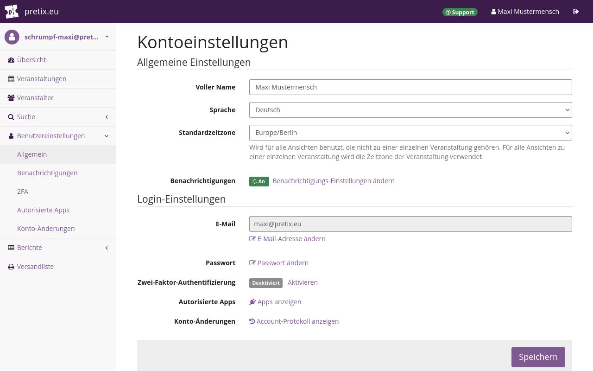
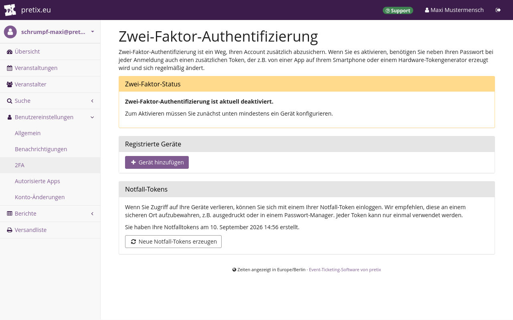
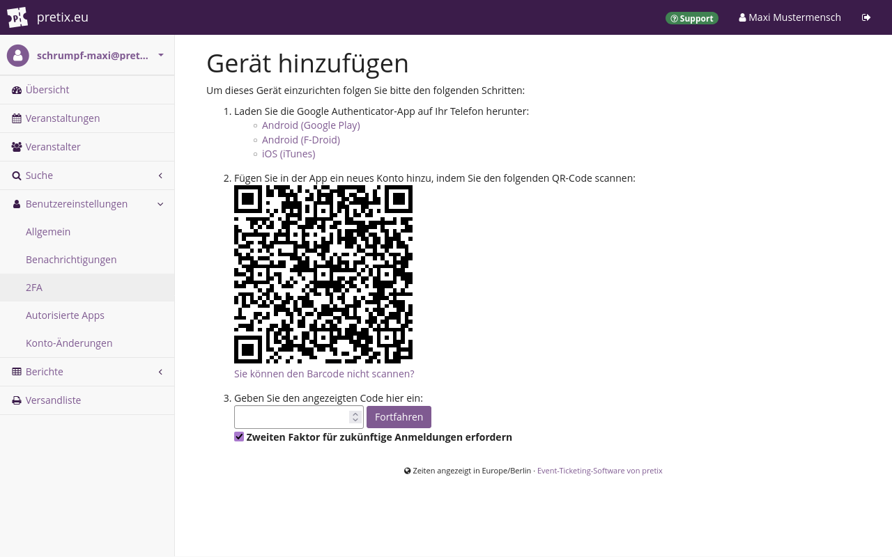
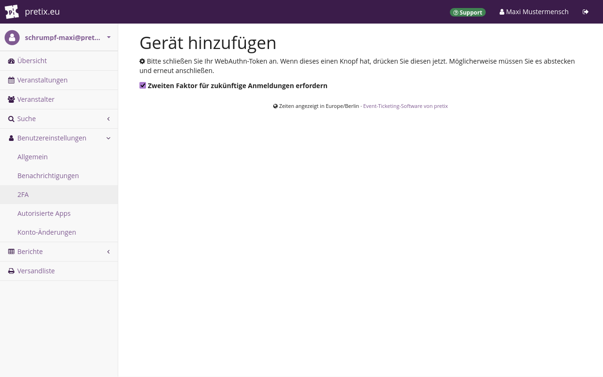

# Zwei-Faktor-Authentifizierung

Standardmäßig ist Ihr pretix-Konto nur durch einen Faktor geschützt: Ihr Passwort.
Sie können einen zweiten Faktor hinzufügen, um die Sicherheit zu erhöhen.
Diese Konfiguration nennt sich "Zwei-Faktor-Authentifizierung", kurz **2FA**.

Der zweite Sicherheitsfaktor kann ein mit WebAuthn kompatibler Hardware-Token oder eine Authenticator-App sein.
Dieser Artikel erläutert die Vorteile der Zwei-Faktor-Authentifizierung und erklärt, wie Sie die 2FA für Ihr pretix-Konto einrichten.

## Hintergrund

Je nachdem, wie Sie pretix nutzen und welche Berechtigungen Sie eingestellt haben, kann Ihr Konto Zugriff auf viele sensible Informationen bieten.
Dabei kann es sich beispielsweise um Geschäftsgeheimnisse, Zahlungsverläufe und Daten von Kund\*innen handeln.

Ein starkes Passwort bietet bereits eine gute Basissicherheit.
Aber mittels Schadsoftware, [Social Engineering](https://de.wikipedia.org/wiki/Social_Engineering_(Sicherheit)) und anderen Methoden können Angreifer\*innen Passwörter auch knacken.

Ein zweiter Authentifizierungsfaktor erschwert einen solchen Angriff deutlich.
Angreifer\*innen müssten sich dann Zugriff sowohl auf das 2FA-Gerät als auch auf Ihre Anmeldedaten verschaffen.
Wenn Sie feststellen, dass einer der beiden Sicherheitsfaktoren kompromittiert wurde, haben Sie möglicherweise noch genügend Zeit, diesen zu ändern, bevor die Angreifer\*innen auch den zweiten Schutzfaktor aushebeln.

Sie sollten in Ihrem Unternehmen eine Richtlinie zum Einsatz von 2FA einführen.
Diese Richtlinie sollte eine Liste aller genehmigten Hardware-Tokens und Anwendungen für 2FA enthalten.
Sie sollte auch ein Protokoll zum Aufbewahren von Notfall-Tokens enthalten.
Sie sollten diese Richtlinie dokumentieren und die gesamte Belegschaft darüber informieren.

Erarbeiten Sie eine solche Richtlinie neu oder prüfen Sie, ob Ihre bestehende Richtlinie die oben genannten Punkte erfüllt.
Dies ist Voraussetzung für die Nutzung von 2FA mit pretix.

Wir empfehlen, 2FA für alle pretix-Benutzerkonten in Ihrem Unternehmen einzurichten.
Die internationale Norm ISO 27001 für die Informationssicherheit erfordert eine sichere Authentifizierung und empfiehlt dafür 2FA.
Wenn Sie festlegen möchten, dass Ihre Kolleg\*innen für ihre pretix-Konten 2FA nutzen müssen, lesen Sie den Artikel über [Teams](teams.md#requiring-two-factor-authentication-2fa).
Sobald alle Teammitglieder dies eingerichtet haben, ist ein erfolgreicher Hacking-Angriff sehr unwahrscheinlich.

## Voraussetzungen

!!! Note
    Die hier aufgeführten Anwendungen und Geräte sind lediglich **Beispiele**.
    Es sind keine Empfehlungen.
    Wir empfehlen, Ihre eigenen Recherchen zu vertrauenswürdigen Hardware-Tokens bzw. Authenticator-Apps durchzuführen.
    Tun Sie das, bevor Sie sich für eine 2FA-Lösung für Ihr Team entscheiden.

Je nachdem, welches Authentifizierungsverfahren Sie einsetzen möchten, benötigen Sie:

 - einen mit WebAuthn kompatiblen Hardware-Token wie einen YubiKey **oder**
 - eine Authenticator-App, die zeitbasierte Einmalpasswörter (TOTP) generieren kann, etwa Microsoft Authenticator, Google Authenticator, Bitwarden oder FreeOTP.

## Anleitung

Melden Sie sich bei Ihrem pretix-Benutzerkonto an.
Klicken Sie oben rechts den Button :btn-icon:fa3-user:[Ihr Name]:.
Damit gelangen Sie zu den Einstellungen für Ihr Benutzerkonto.

Bevor Sie die Zwei-Faktor-Authentifizierung einrichten, sollten Sie Ihre **Notfall-Tokens** sicher außerhalb von pretix aufbewahren.
Falls der Zugriff auf Ihr 2FA-Gerät verloren geht, können Sie stattdessen diese Codes verwenden.
Kopieren Sie sie und drucken Sie sie aus oder schreiben Sie sie auf ein Blatt Papier.
Bewahren Sie dieses Blatt an einem sicheren Ort auf, beispielsweise in einer abgeschlossenen Schublade.

Alternativ dazu können Sie die Notfall-Tokens digital in einer verschlüsselten Datei oder in einem Passwort-Manager verwahren.
Speichern Sie sie **nicht** in demselben Passwort-Manager bzw. derselben Datenbank, wo Sie auch das Kontopasswort abgelegt haben.

!!! Note
    Achten Sie unbedingt darauf, dass Ihre Notfall-Tokens außerhalb von pretix abgelegt werden und dass Sie wissen, wo Sie sie finden.
    Falls der Zugriff auf Ihr 2FA-Gerät verloren geht, benötigen Sie diese Tokens.

Sehen Sie sich die Einstellung "Zwei-Faktor-Authentifizierung" an.
Wenn die 2FA deaktiviert ist, sehen Sie hier ein graues Tag "Deaktiviert".
Klicken Sie den Button :btn:Aktivieren:, um die 2FA zu aktivieren.

Klicken Sie auf der nächsten Seite den Button :btn-icon:fa3-plus:Gerät hinzufügen:.
Geben Sie einen Namen ein.
Wie Sie nun vorgehen, hängt davon ab, ob Sie eine [TOTP-App](#totp-app-verwenden) oder einen [Hardware-Token](#einen-hardware-token-verwenden) nutzen möchten.

!!! Note
    Sobald Sie die 2FA eingerichtet haben, geht mit dem Verlust des 2FA-Geräts auch der Zugriff auf Ihr pretix-Benutzerkonto verloren.
    Um dieser Situation vorzubeugen, können Sie mehrere Geräte hinzufügen.

    Allerdings eröffnet jede zusätzliche Möglichkeit zur Anmeldung an Ihrem Konto eventuellen Angreifer\*innen einen weiteren Ansatzpunkt.
    Für die größtmögliche Sicherheit sollten Sie daher nur ein einziges 2FA-Gerät hinzufügen.

Der Vorteil einer TOTP-App liegt darin, dass Sie vermutlich bereits ein Gerät besitzen, das Sie zur TOTP-Generierung verwenden können.
Das kann Ihr Arbeitshandy sein, Ihr privates Handy, ein anderes Mobilgerät oder ein anderer Computer.
In dem Fall können Sie das bereits vorhandene Gerät für die 2FA nutzen.

Wenn Sie unterschiedliche Anwendungen zum Speichern von Passwörtern und zum Generieren des TOTP verwenden, bietet das TOTP-Verfahren gute Sicherheit.
Wie jede Software auf einem mit dem Internet verbundenen Gerät ist jedoch auch eine TOTP-App anfällig für Schadsoftware.

Ein Hardware-Token ist deutlich günstiger als ein Smartphone.
Wenn Sie für die Zwei-Faktor-Authentifizierung ein neues Gerät kaufen müssen, kann dies vorteilhaft sein.
Ein weiterer Vorteil ist, dass Hardware-Tokens weniger anfällig für Hacking-Angriffe sind.

Wann immer Sie Ihren Hardware-Token gerade nicht aktiv verwenden, müssen Sie ihn vom Computer abziehen und an einem sicheren Ort aufbewahren oder bei sich tragen.
Behandeln Sie ihn mit der gleichen Umsicht wie Ihren Schlüsselbund.
Nachteilig an Hardware-Tokens ist, dass sie meist kleiner als ein Smartphone und nur zur Authentifizierung nutzbar sind.
Dadurch gehen sie leichter verloren.

### TOTP-App verwenden

Wählen Sie unter "Gerätetyp" die Option `Smartphone mit Authenticator-App`.
Klicken Sie dann den Button :btn:Fortfahren:.

Öffnen Sie Ihre TOTP-App.
Erstellen Sie einen neuen Eintrag für das TOTP-Geheimnis.
Scannen Sie den QR-Code, der im pretix-Backend angezeigt wird.
Klicken Sie alternativ die Option :btn:Sie können den Barcode nicht scannen?: und geben Sie den unter Punkt `3` angezeigten Code ein.

!!! Note
    Speichern Sie Ihr Passwort und Ihr TOTP-Geheimnis **nicht** im selben Passwort-Manager.
    Wenn es möglich ist, mit demselben Hauptpasswort auf beide Faktoren zuzugreifen, dann bietet der zweite Faktor kaum bessere Sicherheit als die Ein-Faktor-Authentifizierung.

    Verwalten Sie das TOTP-Geheimnis **nicht** mit demselben Eintrag im Passwort-Manager wie die Anmeldedaten für Ihr pretix-Benutzerkonto.
    Verwenden Sie unterschiedliche Apps für die TOTP-Generierung und das Speichern des Passworts, oder wenigstens unterschiedliche Datenbanken.

Speichern Sie den Eintrag in Ihrer TOTP-App.
Sie sollte jetzt einen sechsstelligen Code anzeigen, der sich alle 30 Sekunden ändert.
Dieser Code ist das zeitbasierte Einmalpasswort (TOTP).
Geben Sie es im pretix-Backend in das Feld "Geben Sie den angezeigten Code hier ein" ein.
Klicken Sie dann den Button :btn:Fortfahren:.

Sie gelangen zurück zur Seite "Zwei-Faktor-Authentifizierung".
Hier steht nun, dass 2FA aktiviert ist.
Unter "Registrierte Geräte" ist das Gerät mit der TOTP-App aufgeführt.

Ab jetzt brauchen Sie sowohl Ihr Passwort als auch das zeitbasierte Einmalpasswort aus der TOTP-App, um sich bei Ihrem pretix-Benutzerkonto anzumelden.

### Einen Hardware-Token verwenden

Schließen Sie den Hardware-Token an Ihren Computer an.
Wählen Sie unter "Gerätetyp" `WebAuthn-kompatibler Hardwaretoken (z.B. Yubikey)`.
Klicken Sie dann den Button :btn:Fortfahren:.

Eine neue Seite wird geöffnet und der Browser fordert Sie auf, Ihren Hardware-Token zu aktivieren.
Aktivieren Sie ihn.
Wenn Sie zum Beispiel einen YubiKey verwenden, dann berühren Sie die blinkende Sensortaste.

Sie gelangen zurück zur Seite "Zwei-Faktor-Authentifizierung".
Hier steht nun, dass 2FA aktiviert ist, und unter "Registrierte Geräte" ist der Hardware-Token aufgeführt.

Ab jetzt brauchen Sie sowohl Ihr Passwort als auch den Hardware-Token, um sich bei Ihrem pretix-Benutzerkonto anzumelden.

## Fehlerbehebung

### Sie haben keinen Zugriff mehr auf das 2FA-Gerät

Wenn Sie keinen Zugriff mehr auf das 2FA-Gerät haben, weil es defekt ist, gestohlen wurde oder verloren gegangen ist, gehen Sie folgendermaßen vor:

 - Melden Sie sich mithilfe eines Ihrer Notfall-Tokens an.
 - Entfernen Sie das 2FA-Gerät aus Ihrem Benutzerkonto.
 - Beschaffen Sie einen Ersatz für das ausgefallene 2FA-Gerät.
 - Fügen Sie das neue Gerät Ihrem Benutzerkonto hinzu.

Dazu öffnen Sie die [Anmeldeseite]((https://pretix.eu/control/login).
Geben Sie E-Mail-Adresse und Passwort ein.
Wenn die Seite Sie auffordert, Ihren Hardware-Token zu berühren oder das zeitbasierte Einmalpasswort (TOTP) einzugeben, geben Sie stattdessen einen der Notfall-Tokens ein.
Klicken Sie dann den Button :btn:Fortfahren:.

Sie können jeden Notfall-Token nur einmal verwenden.
Löschen Sie ihn aus der Liste oder streichen Sie ihn durch, wenn Sie ihn verwendet haben.

Klicken Sie oben rechts den Button :btn-icon:fa3-user:[Ihr Name]:.
Damit gelangen Sie zu den Einstellungen für Ihr Benutzerkonto.
Klicken Sie :btn:Zwei-Faktor-Einstellungen ändern:.
Suchen Sie in der Liste nach dem verlorenen Gerät und klicken Sie daneben auf den Button :btn:Entfernen:.
Wenn dies das einzige verbundene 2FA-Gerät war, wird damit die Zwei-Faktor-Authentifizierung für Ihr Konto deaktiviert.

Beschaffen Sie einen Ersatz für das ausgefallene 2FA-Gerät.
Fügen Sie das neue Gerät Ihrem Benutzerkonto hinzu, wie unter [Anleitung](#anleitung) beschrieben.

### Sie haben keinen Zugriff mehr auf das 2FA-Gerät und auf die Notfall-Tokens

Wenn Sie keinen Zugriff mehr auf das 2FA-Gerät und auf die Notfall-Tokens haben, wenden Sie sich an unseren Support: per [E-Mail](mailto:support@pretix.eu) oder [telefonisch](tel:+4962213217750).

## Siehe auch

Wenn Sie festlegen möchten, dass Ihre Kolleg\*innen für ihre pretix-Konten 2FA nutzen müssen, lesen Sie den Artikel über [Teams](teams.md#requiring-two-factor-authentication-2fa).