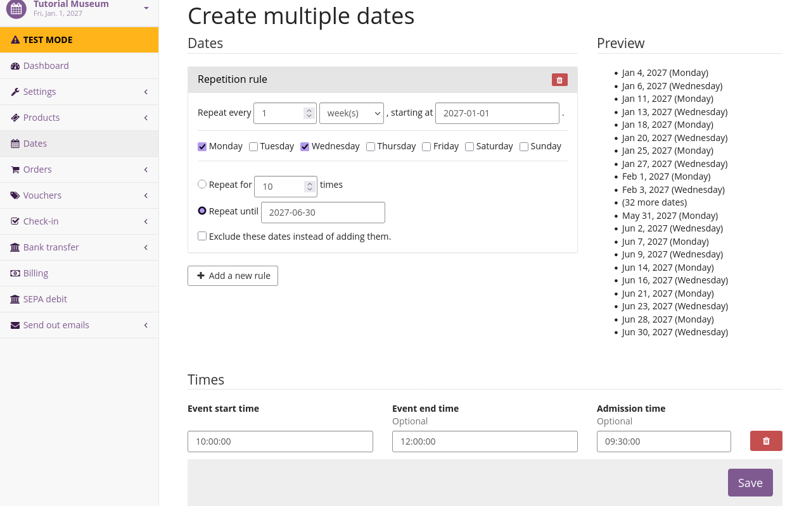

# Termine

Eine Veranstaltungsreihe enthält Termine.
Termine sind immer Teil einer übergreifenden Veranstaltungsreihe, aber jeder Termin kann einen eigenen Veranstaltungsbeginn und ein Veranstaltungsende, einen eigenen Namen, eine eigene Beschreibung, eigene Produkte (und damit Preise) usw. haben.
Dieser Artikel erklärt, wie man Termine zu einer Veranstaltungsreihe hinzufügt.

Wir navigieren zu unserer persönlichen Übersicht, indem wir oben links auf der Website :btn-icon:i-pretix: pretix.eu: klicken.
Anschließend wählen wir unsere Veranstaltung in der Liste "Ihre nächsten Veranstaltungen" aus und klicken :btn-icon:fa3-calendar: Termine: in der Seitenleiste.

In unserer Veranstaltungsreihe gibt es noch keine Termine.
Deshalb wird auf dieser Seite folgender Text angezeigt: "Sie haben bisher keine Termine für diese Veranstaltungsreihe angelegt."
Außerdem werden zwei Buttons angezeigt: einen zum Erstellen eines einzelnen neuen Termins und einen zum Erstellen mehrerer neuer Termine.

## Einen Termin für die regulären Öffnungszeiten erstellen

Als Erstes legen wir einen Termin fest, der unsere regulären Öffnungszeiten für die Saison 2027 widerspiegelt.
Dazu klicken wir den Button :btn-icon:fa3-plus:Neuen Termin erstellen:.

Wir geben im Feld "Veranstaltungstitel" `Regulärer Eintritt` ein.
Unter "Veranstaltungsbeginn" geben wir `01.01.2027` und `08:00:00` ein.
Unter "Veranstaltungsende" geben wir `31.12.2027` und `18:00:00` ein.

Im ersten Feld unter "Kontingente" geben wir "Regulärer Eintritt" ein.
Das Feld "Gesamtanzahl" lassen wir frei, da wir den Verkauf von Eintrittskarten, die die Besucher während unserer gesamten Saison nutzen können, nicht begrenzen müssen.

Unter "Produkte" wählen wir die beiden Produkte aus, für die wir während unserer regulären Öffnungszeiten Zutritt gewähren möchten.
Diese Tickets sind "Regulärer Eintritt" und "Ermäßigter Eintritt".
Dann klicken wir den Button :btn:Speichern:.

!!! Note
Wenn alle Termine einer Veranstaltungsreihe denselben Titel haben, wird dieser Titel in der Kalenderansicht des Shops nicht angezeigt.
Die in diesem Abschnitt beschriebene Einrichtung führt daher zu einer Kalenderansicht voller unspezifischer Termineinträge.
Sobald es mindestens einen Termin mit einem anderen Titel gibt, werden in der Kalenderansicht wieder alle Termintitel angezeigt.
Wenn Sie den Anweisungen im [nächsten Abschnitt](#creating-dates-for-special-events) folgen, löst sich dieses Problem von selbst.

## Sondertermine erstellen

Als Nächstes möchten wir wiederkehrende Führungen für unser Museum anbieten. 
Unsere Führung findet in der ersten Hälfte des Jahres 2027 jeden Montag und Mittwoch um 10 Uhr statt. 
Dazu werden wir mehrere neue Termine für diese Veranstaltungsreihe anlegen.
Jetzt klicken wir den Button :btn-icon:fa3-plus:Mehrere neue Termine erstellen:.

Im Feld "Regel zur Wiederholung" wählen wir Folgendes aus: "Wiederhole alle `1` `Woche(n)` mit Beginn am `01.01.2027`."
Anschließend aktivieren wir die Kontrollkästchen neben "Montag" und "Mittwoch".
Wir aktivieren den Radiobutton neben "Wiederhole bis zum" und wählen als Datum den `30.06.2027`.

Die "Vorschau" rechts auf der Seite hilft Ihnen, zu prüfen, ob unsere Wiederholungsregel die richtigen Termine erfasst.
Dort werden die ersten zehn und die letzten zehn Termine angezeigt, die wir erstellen.

Unter "Uhrzeiten" klicken wir den Button :btn-icon:fa3-plus: Einzelnes Zeitfenster hinzufügen:.
Wir wählen als Veranstaltungsbeginn `10:00:00`, als Veranstaltungsende `12:00:00` und als Einlass `09:30:00`.

Unter "Allgemeine Informationen" geben wir `Führung` als Titel für diese Termine ein.
Außerdem fügen wir unter "Text auf der Startseite" eine Beschreibung hinzu.

Unter "Kontingente" geben wir "Führungs-Tickets" ein.
Als Gesamtanzahl geben wir "30" ein.
Unter "Produkte" wählen wir die Produkte `Führung` und `Führung (ermäßigt)` aus.

Zuletzt klicken wir den Button :btn: Speichern:, der uns zurück zur Überblicks-Seite für Termine bringt.

## Abschluss

Wir haben unserer Veranstaltungsreihe Termine hinzugefügt: einen einzelnen Termin für den regulären Eintritt und mehrere Termine für einen wiederkehrenden Sondertermin.
Bei Bedarf können wir im Laufe der Saison weitere Termine hinzufügen. Bei wiederkehrenden Terminen ist es sinnvoll, die Funktion "Mehrere neue Termine erstellen" zu verwenden.
Für einmalige Termine können wir stattdessen "Neuen Termin erstellen" verwenden.

Nun können wir damit fortfahren, die [Zahlungsmethoden einzurichten](payment.md), mit denen unsere Kund\*innen die Tickets für diese Termine erwerben können.