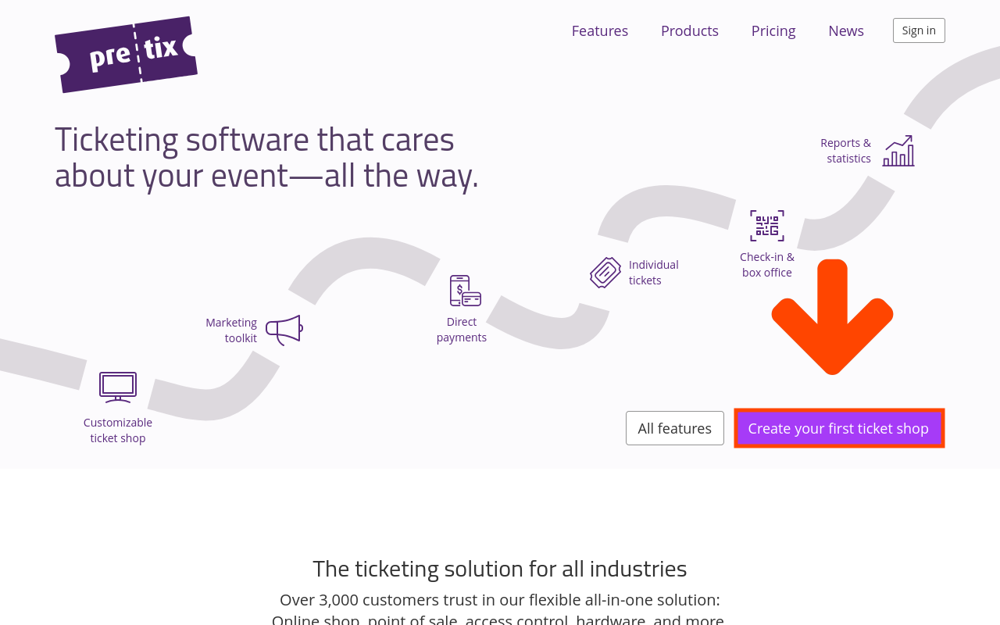
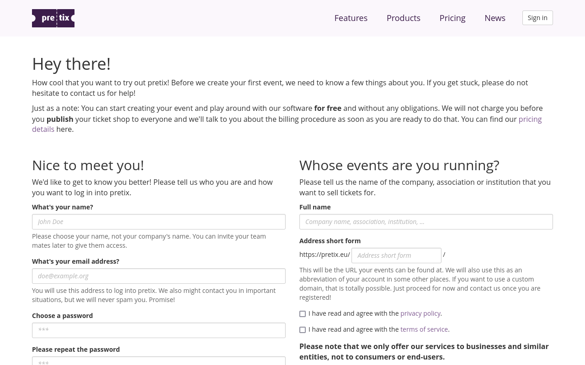

# Erste Schritte

Willkommen beim pretix-Tutorial! In diesem Tutorial durchlaufen wir alle notwendigen Schritte, um unsere allererste Veranstaltung mit pretix zu organisieren. Zur Veranschaulichung erstellen wir eine einfache Konferenz. Wir werden konkrete Beispiele für unseren Veranstalter, die Veranstaltung und die Produkte sowie deren Namen und Preise verwenden. Ersetzen Sie diese Beispiele gerne durch Ihre eigenen, wenn Sie Ihre Veranstaltung entsprechend Ihren Anforderungen erstellen.

!!! Note Dieses Tutorial erklärt die Einrichtung eines Shops für **Einzelveranstaltungen** wie Konferenzen, Conventions, Messen, Konzerte oder Festivals. Wenn Sie einen Ticket-Shop für eine Einrichtung mit Dauerbetrieb wie ein öffentliches Schwimmbad, einen Freizeitpark oder ein Museum erstellen möchten, sollten Sie sich stattdessen das Tutorial für den [fortlaufenden Betrieb](../continuous-operation/getting-started.md) ansehen.

pretix ist eine quelloffene Software. Sie können sie entweder in der Cloud oder auf Ihrem eigenen Server nutzen. Der Betrieb von pretix auf Ihrem eigenen Server erfordert einige technische Kenntnisse. Wenn Sie pretix selbst hosten möchten, lesen Sie unsere [Dokumentation zum Selbsthosten](https://docs.pretix.eu/self-hosting/). Dieses Tutorial befasst sich mit der einfacheren Methode: der Nutzung unseres cloudbasierten pretix Hosted-Angebots.

Hier ist ein kurzer Überblick über die Schritte, die wir in diesem Tutorial durchführen werden:

- ein [persönliches Konto](getting-started.md#creating-an-account) und ein Veranstalterkonto erstellen
- unser [Veranstalterkonto](organizer-account.md) einrichten
- unsere [Veranstaltung](event.md) erstellen
- [Produkte](products.md) (Tickets und Werbeartikel) für unsere Veranstaltung erstellen
- [Zahlungsmethoden](payment.md) einrichten
- unseren Shop [testen](testing.md) und finale Anpassungen vornehmen

## Ein Konto erstellen

Bevor wir mit pretix arbeiten können, müssen wir ein Konto erstellen. Gute Neuigkeiten: Ein Konto zu erstellen ist __völlig kostenlos__ und es besteht keinerlei Verpflichtung, in Zukunft für die Nutzung von pretix zu bezahlen. Wir können nach Herzenslust mit der pretix-Software experimentieren, bevor wir entscheiden, ob pretix die richtige Wahl für uns ist. Kosten entstehen erst beim Verkauf von echten Tickets.

!!! Note Falls Ihr Firma, Ihr Organisation oder Ihre Institution bereits über ein Veranstalterkonto verfügt, ist es nicht erforderlich, ein neues Konto anzulegen. Sie können stattdessen Ihre Mitveranstalter bitten, Ihnen eine Einladung zu senden und Sie zum Team hinzuzufügen. Eine Anleitung dazu, wie Sie jemanden in ein Team einladen können, finden Sie in unserem [Guide zum Thema Teams](../../guides/teams.md#inviting-someone-to-your-team).

Um ein Konto zu erstellen, klicken wir auf der [Webseite pretix.eu](https://pretix.eu/about/en/ "https://pretix.eu/about/de") auf den Button :btn:Ticketshop erstellen:. Dadurch gelangen wir zu einer Seite, auf der wir in der linken Spalte die Daten für unser persönliches pretix-Konto eingeben. In der rechten Spalte geben wir dann den Namen und die Kurzform unseres Veranstalters ein.

 

Für unser persönliches Konto geben wir unseren Namen, unsere E-Mail-Adresse und ein sicheres Passwort an. Das Feld oben links ist für den Namen der Person vorgesehen, der das Konto gehört, **nicht** für einen Firmennamen. Wir werden einen Namen auswählen, anhand dessen uns unsere Mitveranstalter erkennen und mit dem das pretix-Supportteam uns ansprechen kann. In diesem Tutorial lautet unser Name Maxi Musterperson.

Jede*r sollte einen eigenen persönlichen Login haben. Wenn auch andere Mitglieder unseres Teams Zugriff auf das System haben sollen, können wir sie im weiteren Verlauf [einladen](../../guides/teams.md#inviting-someone-to-your-team).

!!! Warning Die Kurzform ist der eindeutige Identifikator Ihrer Firma im pretix-Backend. Pretix wird sie auch in der Shop-URL verwenden. Wählen Sie die Kurzform sorgfältig aus. Senden Sie sie erst ab, wenn Sie mit Ihrer Auswahl zufrieden sind.

    If you want to use a different short form, then you will have to create a new organizer account.

Das Feld "Veranstaltername" ist für den Namen der Firma, der Organisation oder der Institution vorgesehen, für das bzw. die wir Veranstaltungen organisieren möchten. Das Feld "Kurzform/Adresse" ist für die Kurzform des Names der Organisation vorgesehen. pretix wird diese Kurzform für die URL verwenden, unter der Kunden unsere Veranstaltungen finden können.

In diesem Tutorial werden wir ein Konto für unsere Firma "Tutorial Ltd." anlegen. Dazu geben wir "Tutorial Ltd." in das Feld "Veranstaltername" und "tut" in das Feld "Kurzform/Adresse" ein. Das bedeutet, dass das Profil unseres Veranstalters und alle Veranstaltungen, die wir in Zukunft organisieren werden, ab sofort unter [https://pretix.eu/tut/](https://pretix.eu/tut/) zu finden sind.

Es ist nicht erforderlich, ein spezielles Testkonto anzulegen oder das Wort "Test" in der Kurzform oder im Namen zu verwenden. Unsere Shops bleiben so lange für die Öffentlichkeit unsichtbar, bis wir sie manuell veröffentlichen. Bis dahin haben wir trotzdem schon Zugriff auf alle Funktionen und Einstellungen.

Wenn wir von Anfang an den offiziellen Namen unserer Organisation für das Konto verwenden, können wir sicherstellen, dass wir unsere bevorzugte URL nutzen können. Außerdem vermeiden wir so, dass wir dieselben Anpassungen an zwei verschiedenen Konten vornehmen müssen. Bis wir beschließen, unsere Veranstaltungen zu veröffentlichen, sind sie für die Öffentlichkeit nicht sichtbar, und die pretix GmbH stellt uns auch keine Gebühren in Rechnung.



Sowohl die [Datenschutzerklärung](https://pretix.eu/about/en/privacy) als auch die [Nutzungsbedingungen](https://pretix.eu/about/en/terms) sind auf dieser Seite verlinkt. Um pretix nutzen zu können, müssen Sie diese sorgfältig lesen, ihnen zustimmen und die entsprechenden Kontrollkästchen aktivieren.

Wir klicken jetzt auf den Button :btn:Speichern und weiter: und machen damit den ersten Schritt zur Einrichtung unserer ersten Veranstaltung mit pretix. Als Nächstes richten wir unser [Veranstalterkonto](organizer-account.md) ein.