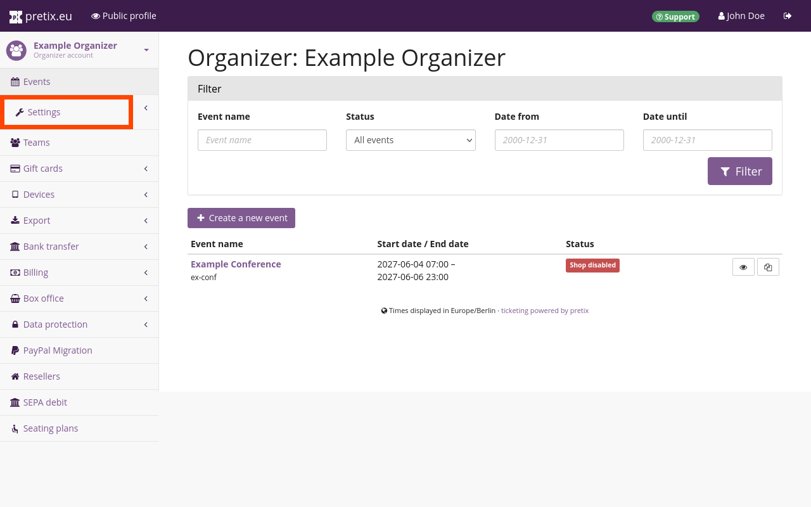

# Veranstalterkonto

Ein Veranstalterkonto steht für eine Körperschaft, die Veranstaltungen durchführt, beispielsweise eine Firma, eine Institution oder eine Person. 
Im vorherigen Schritt haben wir ein Veranstalterkonto und unser persönliches Konto angelegt. 
Es ist auch möglich, (eingeschränkten) Zugriff auf ein Veranstalterkonto zu erhalten, indem wir uns von einem Team-Mitglied einladen lassen und wir seine [Einladung annehmen](../../guides/teams.md#accepting-an-invitation-to-a-team).

In diesem Abschnitt des Tutorials werden wir unser Veranstalterkonto anpassen und die erforderlichen Informationen hinzufügen. 
Hier ist ein kurzer Überblick über die Schritte, die wir durchführen werden:

- auf dem Reiter "Allgemein" [Kontaktinformationen hinzufügen](organizer-account.md#general)
- auf dem Reiter "Lokalisierung" [Sprach- und Lokalisierungsoptionen auswählen](organizer-account.md#localization)
- auf dem Reiter "Veranstalterseite" und "Shop-Design" [die Veranstalterseite anpassen](organizer-account.md#organizer-page)
- auf dem Reiter "Datenschutz" die [Informationen zu Cookies und Datenschutz einrichten](organizer-account.md#privacy)
- unter "Abrechnungs-Einstellungen" die erforderlichen Angaben für die [Aktivierung unseres pretix-Kontos](organizer-account.md#activation) machen

Damit sind alle notwendigen Schritte abgedeckt, um unser Veranstalterkonto für die Durchführung von Veranstaltungen mit pretix vorzubereiten. 
Einige dieser Schritte sind optional, ersparen uns aber langfristig etwas Arbeit. 
So speichert pretix beispielsweise die Sprach- und Designeinstellungen auf Veranstalterebene als Standardeinstellungen für alle Veranstaltungen, die wir in Zukunft erstellen werden. 
Falls sich unsere Anforderungen ändern sollten, können wir auch später noch jederzeit die Einstellungen des Veranstalterkontos anpassen.

## Zu den Veranstalterkonto-Einstellungen navigieren

Nachdem wir die Kontoerstellung abgeschlossen und uns unter [pretix.eu/control](https://pretix.eu/control/) angemeldet haben, werden wir von pretix mit der Übersicht begrüßt. 
Wir können jederzeit zu dieser Seite zurückkehren, indem wir oben in der Leiste auf den Button :btn-icon:i-pretix:pretix.eu: klicken. 
Ein Klick auf den Button :btn:Veranstalter: in der Seitenleiste bringt uns zur Seite "Veranstalter".

 

Wenn wir in der Liste auf unser Veranstalterkonto klicken, leitet uns pretix zu einer Seite weiter, auf der alle mit diesem Veranstalter verbundenen Veranstaltungen angezeigt werden.

 

Wir klicken nun in der Seitenleiste auf :btn-icon:fa3-wrench:Settings:. 
Dadurch gelangen wir zur Seite mit den allgemeinen Einstellungen für das Veranstalterkonto.

## Allgemein

Die Felder "Name" und "Kurzform" sind bereits ausgefüllt. 
Da die Kurzform der eindeutige Identifikator des Veranstalters ist, können wir sie nicht ändern.

Da wir unseren Sitz in Deutschland haben, sind wir gesetzlich dazu verpflichtet, auf allen unseren Webseiten bestimmte rechtliche Hinweise anzugeben. 
Deshalb werden wir die URL zum Impressum unserer Webseite in das Feld "Impressum (URL)" eingeben.

!!! Note 
Auch wenn Sie in einem anderen Land als Deutschland tätig sind, verlanged wir von allen Kund\*innen von pretix Hosted die Angabe einer gültigen Impressums-URL, die auf Informationen darüber verweist, wer für den veröffentlichten Ticket-Shop verantwortlich ist.

Wir geben eine gültige E-Mail-Adresse in das Feld "Kontakt-E-Mail" ein. 
In der öffentlichen Ansicht unseres Veranstalters wird diese E-Mail-Adresse in der Fußzeile unter der Überschrift "Veranstalter kontaktieren" angezeigt. 
So können Kund*innen Kontakt mit uns aufnehmen.

Es ist nicht notwendig, alle auf dieser Seite angezeigten Einstellungen zu ändern. 
Das gilt auch für die meisten Seiten, die wir im Rahmen dieses Tutorials aufrufen werden.

pretix ist ein leistungsstarkes Tool, das viele detaillierte Anpassungsmöglichkeiten bietet. 
Dieses Tutorial behandelt alle notwendigen Schritte, um unseren Shop zu erstellen. 
Wird eine Einstellung in diesem Tutorial nicht erwähnt, ist es nicht erforderlich, diese Einstellung zu ändern.

Durch einen Klick auf den Button :btn:Speichern: werden unsere Änderungen bestätigt.

## Lokalisierung

Nachdem wir die allgemeinen Einstellungen gespeichert haben, wechseln wir jetzt zum Reiter :btn:"Lokalisierung".

Unter "Verfügbare Sprachen" können wir die Sprachen auswählen, die für unseren Ticket-Shop angeboten werden sollen. 
Die vom pretix-Team offiziell unterstützten Optionen sind "Englisch", "Deutsch" und "Deutsch (Du)". 
Bei "Deutsch" wird der Nutzer mit "Sie" angesprochen, während bei "Deutsch (Du)" "du" verwendet wird.

Wir können für unsere Veranstalterseite auch eine der Community-Übersetzungen auswählen. 
Die Liste darunter zeigt die Community-Übersetzungen zusammen mit einem Prozentsatz, der angibt, zu wie viel Prozent die Software übersetzt wurde. 
pretix verwendet Englisch als Ausweichsprache für fehlende Übersetzungen.

Diese Einstellungen legen auch die Standardsprachen fest, die beim Anlegen neuer Veranstaltungen verwendet werden. 
Wir können Sprachen jedoch für jede Veranstaltung auch einzeln aktivieren oder deaktivieren. 
Für unsere Beispielkonferenz werden wir "Englisch" und "Deutsch (Du)" aktivieren.



Wir wählen `Germany` aus dem Dropdown-Menü "Region" am unteren Rand der Seite aus. 
pretix verwendet diese Auswahl, um die Standardformate für Datumsangaben, Uhrzeiten, Adressen und Telefonnummern festzulegen. 
Wir wählen `Europe/Berlin` als "Standardzeitzone" aus dem gleichnamigen Dropdown-Menü aus.

Wir klicken auf den Button :btn:Speichern: um unsere Lokalisierungseinstellungen anzuwenden. 
Es ist sinnvoll, dies zu tun, bevor Sie Einstellungen auf den anderen Reitern ändern. 
Die Lokalisierungseinstellungen legen fest, welche Anpassungsmöglichkeiten dort verfügbar sind.

## Veranstalterseite

Wenn wir oben auf den Reiter :btn:Veranstalterseite: wechseln, können wir unser Logo hinzufügen und die Farben der Benutzeroberfläche unseres Shops anpassen.

Ein Klick auf den Button :btn-icon:fa3-eye:Öffentliche Ansicht: in der Kopfzeile bringt uns zu einer Vorschau der Veranstalterseite aus der Perspektive der Kund*innen. 
Eine mit Pretix Hosted erstellte Veranstalterseite ist standardmäßig unter https://pretix.eu/:placeholder:OrganizerShortForm:/ zu finden. 
Der Shop, den wir für dieses Tutorial erstellen, befindet sich unter [https://pretix.eu/tut/](https://pretix.eu/tut).

Standardmäßig wird in der Kopfzeile unserer Veranstalterseite der Name des Veranstalters angezeigt. 
Über die Einstellungen der Veranstalterseite können wir den Namen durch ein Header-Bild ersetzen, das unseren Kund*innen zeigt, wer die Veranstaltung ausrichtet (beispielsweise durch unseren Firmennamen, unser Logo oder ein eindeutiges Design).

Wir fügen das Header-Bild hinzu, indem wir auf den Button :btn:Durchsuchen…: neben der Option "Header-Bild" klicken. 
Dort wählen wir von unserem Computer eine PNG-Datei mit einer Auflösung von 1140 × 120 Pixel aus. 
Das Header-Bild ersetzt den Namen der Veranstaltung oben auf der Seite. 
Wir aktivieren das Kontrollkästchen neben "Benutze das Header-Bild auch für Veranstaltungen, für die kein eigenes Header-Bild hochgeladen wurde".

In den Feldern "Text auf der Startseite" können wir Text eingeben, der in unserer öffentlichen Ansicht angezeigt werden soll. 
Für jede Sprache, die wir auf dem Reiter :btn:Lokalisierung: aktiviert haben (siehe Abschnitt "[Lokalisierung](#localization)" in diesem Artikel), gibt es ein Feld – Englisch und Deutsch (Du). 
In unserer öffentlichen Ansicht können die Nutzer*innen über die Links in der oberen rechten Ecke zwischen diesen Sprachen wechseln.

## Datenschutz

Auf dem Reiter :btn:Datenschutz: können wir für jede von uns aktivierte Sprache eine URL angeben, die auf unsere Datenschutzerklärung verweist.

!!! Warnung Es liegt in Ihrer Verantwortung, die Einhaltung der geltenden Rechtsvorschriften sicherzustellen. 
Wir versuchen mit diesen Vorschlägen für Einstellungen zu helfen. 
Wir können jedoch keine Haftung übernehmen, da wir die genaue Konfiguration Ihrer pretix-Nutzung, die rechtlichen Details in Ihrer spezifischen Jurisdiktion sowie die Vereinbarungen, die Sie mit Dritten wie Zahlungs- oder Trackingdienstleistern getroffen haben, nicht kennen.

## Aktivierung

<!-- md:hosted -->

Bevor einer unserer Ticketshops veröffentlicht werden kann, muss das pretix-Team unser Veranstalterkonto aktivieren. 
Sobald wir alle erforderlichen Angaben für die Korrespondenz und die Rechnungsstellung gemacht haben, wird das pretix-Team unser Konto manuell prüfen.

Um die erforderlichen Informationen einzugeben, navigieren wir zu den Abrechnungs-Einstellungen. 
:btn:Abrechnungs-Einstellungen: ist einer der Einträge unter ":fa3-wrench: Einstellungen" in der linken Seitenleiste. 
Dies ist nicht zu verwechseln mit ":fa3-money: Abrechnung", einem eigenständigen Eintrag weiter unten in der Seitenleiste.

In den "Abrechnungs-Einstellungen" trägt das oberste Feld auf dem Reiter :btn:Allgemein: die Bezeichnung "Primäre Kontaktperson". 
Wir werden den Namen einer realen Person aus unserer Organisation eingeben, damit das Pretix-Team weiß, an wen es sich wenden kann, falls es ein Problem mit unserem Konto gibt. 
Wir werden die E-Mail-Adresse und Telefonnummer dieser Person in den Feldern darunter eingeben. 
Diese Felder sind Pflichtfelder. 
Die Angabe des Firmennamens allein reicht nicht aus, um unser Konto zu aktivieren.

Die vollständigen Kontaktdaten unserer Firma geben wir weiter unten auf der Seite ein. 
Wenn wir uns in einem anderen EU-Land als Deutschland befinden und die Umkehrung der Steuerschuldnerschaft in Anspruch nehmen möchten, geben wir zusätzlich eine "USt-ID" an. 
Sollten wir diese USt-ID nicht angeben, ist die pretix GmbH gezwungen, uns den Steuersatz des oben von uns angegebenen Landes in Rechnung zu stellen.

Das pretix-Team bietet seinen Service auf Englisch und Deutsch an. 
Wir wählen Englisch als unsere bevorzugte Sprache für die Korrespondenz.

Als "Bevorzugte Zahlungsmethode" wählen wir `Credit card`. 
Wir müssen unsere Kreditkartendaten eingeben und das Kontrollkästchen zur Autorisierung von Zahlungen aktivieren. 
Danach klicken wir auf den Button :btn:Speichern:.

Falls noch erforderliche Angaben fehlen, werden wir auf der Seite darauf hingewiesen. 
Wenn wir alle erforderlichen Angaben gemacht haben, erscheint oben auf der Seite ein grünes Häkchen mit der Meldung "Ihre Änderungen wurden gespeichert." Das bedeutet, dass wir unser Veranstalterkonto zur Überprüfung beim pretix-Team eingereicht haben. 
Das Team wird das Konto in Kürze aktivieren.

## Abschluss

Nachdem die grundlegende Einrichtung unseres Kontos abgeschlossen ist und wir auf die Aktivierung warten, können wir jetzt [unsere erste Veranstaltung erstellen](event.md).