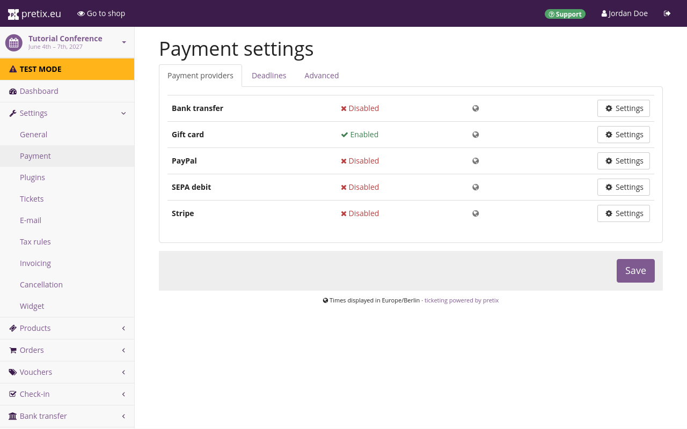
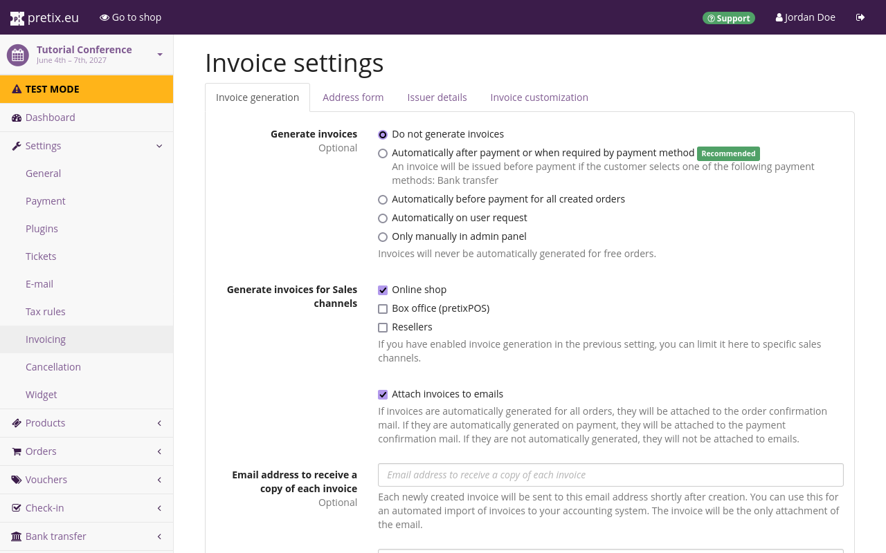

# Zahlung

Wir möchten in unserem Shop nicht nur Tickets anbieten, sondern auch dafür bezahlt werden. 
Darum kümmern wir uns in diesem Teil des Tutorials. 
Wir werden die folgenden Schritte durchführen:

- die Zahlung per Kreditkarte über [Stripe](payment.md#stripe) aktivieren
- die Zahlung per [Banküberweisung](payment.md#stripe) aktivieren
- das automatische Versenden von [Rechnungen](payment.md#bank-transfers) bei jeder Bestellung einrichten

## Zahlungsdienstleister einrichten

Pretix wickelt die Zahlungen über eine große Auswahl an Zahlungsdienstleister ab. 
Für unsere Konferenz planen wir, Zahlungen per Kreditkarte über den Zahlungsanbieter Stripe sowie per Banküberweisung entgegenzunehmen. 
Voraussetzungen hierfür sind ein aktives Stripe-Händlerkonto und ein Bankkonto.

pretix erfasst eingehende Zahlungen über die meisten Zahlungsdienstleister automatisch. 
Das gilt auch für Stripe. 
Sobald Stripe oder ein anderer Zahlungsdienstleister eine Zahlung verbucht, markiert pretix die entsprechende Bestellung in unserem Shop als bezahlt. 
Banküberweisungen bilden hierbei eine Ausnahme, da pretix dafür die eingehenden Zahlungen auf unserem Bankkonto überwachen müsste.

Bei pretix Hosted ist es möglich, eine Verbindung zu unserem Bankkonto einzurichten. 
Bei allen Versionen von pretix können wir Zahlungen per Banküberweisung überwachen, indem wir sie entweder manuell bei Eingang bestätigen oder regelmäßig digitale Kontoauszüge importieren.

 

Um Zahlungsdienstleister einzurichten, navigieren wir zu unserer persönlichen Übersicht, indem wir auf :btn-icon:i-pretix:pretix.eu: in der oberen linken Ecke der Webseite klicken. 
Anschließend wählen wir in der Liste "Ihre nächsten Veranstaltungen" unsere Veranstaltung und öffnen :btn-icon:fa3-wrench: Einstellungen: in der Seitenleiste. 
Danach klicken wir auf den Unterpunkt :btn:Zahlung:. 
Auf dieser Seite wird eine Liste der Zahlungsanbieter angezeigt. 
Die Liste sollte sowohl Banküberweisungen als auch Stripe enthalten. 
Standardmäßig sind alle Zahlungsdienstleister mit Ausnahme von Wertgutscheinen deaktiviert.

!!! Note 
Falls die Liste nicht Ihre gewünschten Zahlungsdienstleister anzeigt, dann ist die entsprechende Erweiterung nicht aktiviert. 
Um eine Erweiterung zu aktivieren, navigieren Sie zu Ihr :navpath:Veranstalter → Einstellungen → Erweiterungen: und öffnen Sie den Reiter :btn:Zahlungsdienstleister:. 
Klicken Sie auf den Button :btn:Aktivieren: neben der Erweiterung, die Sie verwenden möchten. 
Eine aktive Erweiterung erkennen Sie an dem grünen Tag ":fa3-check: Aktiv".

### Stripe

Zuerst aktivieren wir Stripe, indem wir auf den Button :btn-icon:fa3-gear:Settings: daneben klicken. 
Dadurch gelangen wir auf die Seite mit den Zahlungseinstellungen für Stripe. 
Diese Seite enthält aktuell nur den Button :btn:Mit Stripe verbinden:

Ein Klick auf diesen Button führt uns zu einem Dialog auf stripe.com. 
Auf dieser Webseite geben wir unsere E-Mail-Adresse ein und folgen den Anweisungen, um unser Stripe-Händlerkonto mit unserem pretix-Konto zu verknüpfen.

Anschließend kehren wir zu pretix.eu zurück und navigieren zu unserer Veranstaltung. 
Dort öffnen wir :btn-icon:fa3-wrench: Einstellungen: in der Seitenleiste, klicken auf den Unterpunkt :btn:Zahlung: und öffnen die Stripe-Einstellungen. 
Anstelle des einzelnen Buttons zeigt diese Seite nun zahlreiche Einstellungsmöglichkeiten an.

Wir aktivieren die Kontrollkästchen neben "Kreditkartenzahlungen" und "Aktiviere Zahlungsmethode". 
Danach scrollen wir nach unten und klicken auf den Button :btn:Speichern:. 
Jetzt können Kund\*innen in unserem Shop per Kreditkarte über Stripe bezahlen.

### Banküberweisungen

Außerdem aktivieren wir Banküberweisungen, indem wir zu :navpath:Veranstaltung → Einstellungen → Zahlung: navigieren. 
Dort öffnen wir die Einstellungen für Banküberweisungen. 
Als "Art der Bankverbindung" wählen wir "SEPA-Konto". 
Wir geben unsere Bankverbindung an: den Namen des Kontoinhabers, die IBAN, den BIC und den Namen der Bank.

Anschließend aktivieren wir das Kontrollkästchen um zu bestätigen, dass wir die besonderen Bedingungen verstanden haben, die für Banküberweisungen als Zahlungsdienstleister bei pretix gelten. 
Wir aktivieren außerdem das Kontrollkästchen neben "Aktiviere Zahlungsmethode". 
Dann klicken wir auf den Button :btn:Speichern: und kehren zu den Zahlungseinstellungen zurück. 
Neben den Optionen "Banküberweisung", "Wertgutschein" und "Stripe" sollte nun jeweils ein grüner ":fa3-check: Aktiviert"-Tag stehen.

!!! Note 
Standardmäßig kann die pretix-Software eingehende Zahlungen auf Ihrem Bankkonto nicht überwachen. 
Bei pretix Hosted können Sie automatische Bankimporte einrichten. 
Bei pretix Community und pretix Enterprise müssen Sie die pretix-Software über eingehende Zahlungen informieren. 
Dafür können Sie die Zahlungen entweder manuell als abgeschlossen markieren oder regelmäßig digitale Kontoauszüge importieren. 
Lesen Sie unseren Guide zum Thema "[Eingehende Zahlungen überwachen](../../guides/payment/bank-transfer.md#monitoring-incoming-payments-automatically)", bevor Sie Banküberweisungen als Zahlungsmethode in Ihrem Shop nutzen.

Weitere Informationen zur Nutzung von Banküberweisungen finden Sie unter "[Banküberweisungen](../../guides/payment/bank-transfer.md)".

## Rechnungen einrichten

Um zu den Rechnungseinstellungen zu gelangen, navigieren wir zu unserer Veranstaltung, öffnen :btn-icon:fa3-wrench: Einstellungen: in der Seitenleiste und klicken auf den Unterpunkt :btn:Rechnungswesen:. 
Auf dem Reiter :btn:Rechnungserstellung: setzen wir die Option "Rechnungen ausstellen" auf "Automatisch nach Zahlung oder wenn die Zahlungsmethode es erfordert".

Anschließend wechseln wir zum Reiter :btn:Rechnungsaussteller: und geben den Namen und die vollständige Adresse unserer Organisation ein. 
pretix verwendet die hier eingegebenen Daten für alle zukünftigen Rechnungen.

Wenn wir jetzt auf den Button :btn:Speichern und Vorschau anzeigen: klicken, läd unser Browser eine PDF-Vorschau der Rechnung herunter. 
Diese Rechnung enthält die Adresse unserer Organisation, die Rechnungsnummer "TUTCON27-PREVIEW" sowie eine beispielhafte Auflistung der Einkäufe mit einer Teilzahlung.

## Abschluss

Nachdem wir unseren Kund*innen jetzt zwei Zahlungsmöglichkeiten für unseren Shop zur Verfügung gestellt und den automatischen Versand von Rechnungen eingerichtet haben, können wir dazu übergehen, unseren Shop zu testen. 
Danach können wir unseren Shop endlich veröffentlichen.