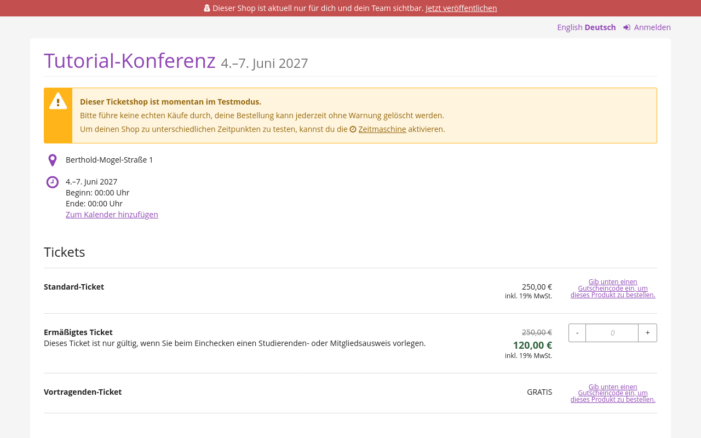

# Testen und veröffentlichen

Im letzten Teil dieses Tutorials testen wir unseren Shop, prüfen, ob alles wie vorgesehen funktioniert, und veröffentlichen ihn dann endlich.
Hier ist ein kurzer Überblick über die Schritte, die wir in diesem Abschnitt durchführen werden:

- [eine Bestellung im Testmodus aufgeben](#testen-und-bestellungen-bestätigen)
- die Bestellung im Backend überprüfen und sie als bezahlt markieren
- den Shop in allen aktivierten Sprachen testen
- [finale Verbesserungen an unserem Shop vornehmen](#finale-verbesserungen-an-unserem-shop-vornehmen), falls nötig
- [den Testmodus deaktivieren](#testmodus-deaktivieren-und-testbestellungen-löschen) und die Testbestellungen löschen
- [den Shop veröffentlichen](#abschluss)

## Testen und Bestellungen bestätigen

Wir werden jetzt eine Bestellung in unserem Shop aufgeben.
Dazu klicken wir oben in der Leiste auf den Button :btn-icon:fa3-eye:Shop aufrufen:.

Dadurch gelangen wir zur Shop-Seite.
Auf der Shop-Seite sollte derzeit oben ein roter Balken zu sehen sein, der darauf hinweist, dass die Seite nur für uns und unser Team sichtbar ist, sowie ein gelbes Feld mit dem Hinweis, dass sich die Seite im Testmodus befindet.
Wir werden jetzt ein Standard-Ticket und ein ermäßigtes Ticket bestellen und den Anweisungen auf dem Bildschirm folgen.
Wenn wir dazu aufgefordert werden, geben wir eine E-Mail-Adresse ein, auf die wir Zugriff haben.

Beim Bezahlvorgang wählen wir als Zahlungsmethode "Kreditkarte" aus.
Aktuell sollte hier ein Hinweis angezeigt werden, dass sich die Stripe-Erweiterung im Testmodus befindet.
Um eine Testzahlung durchzuführen, verwenden wir die Daten [einer der von Stripe aufgelisteten Testkarten](https://docs.stripe.com/testing#cards).

Jetzt öffnen wir pretix.eu, navigieren zu unserer Veranstaltung, und klicken in der Seitenleiste auf :btn-icon:fa3-shopping-cart: Bestellungen:.
Auf dieser Seite wird eine Liste der Bestellungen angezeigt.
Wenn unser Test erfolgreich war, enthält die Liste jetzt die Testbestellung, die wir im vorherigen Schritt aufgegeben haben.
Die Bestellung sollte den Status ":fa3-check: Bezahlt" haben.

Wir wiederholen diesen Vorgang für jede Sprache, die wir für den Shop aktiviert haben.
So können wir überprüfen, ob wir alle erforderlichen Übersetzungen bereitgestellt haben und ob unsere Lokalisierungseinstellungen korrekt sind.

## Finale Verbesserungen an unserem Shop vornehmen

Indem wir den Shop testen und ihn aus der Perspektive unserer Kund\*innen betrachten, können wir feststellen, ob wir bei der Einrichtung unserer Veranstaltung Fehler gemacht oder etwas vergessen haben.
Eventuell müssen wir noch Texte, Bilder, neue Produkte, Fragen oder Prüfungen hinzufügen oder das Erscheinungsbild des Shops anpassen.

Diese Anpassungen sind auch dann noch möglich, nachdem wir den Shop bereits veröffentlicht haben.
Wir werden unseren Shop jetzt aber so einrichten, dass er genau unseren Vorstellung entspricht.
Das machen wir, bevor wir ihn veröffentlichen.
So können wir sicherstellen, dass alle unsere Kund\*innen ein einheitliches und fehlerfreies Nutzungserlebnis haben.

## Testmodus deaktivieren und Testbestellungen löschen

Wir möchten, dass ab sofort in unserem Shop nur noch echte Bestellungen von echten Kund\*innen erscheinen.
Daher müssen wir die Bestellungen löschen, die wir im Testmodus aufgegeben haben.
Dazu navigieren wir zu unserer Veranstaltung und klicken in der Seitenleiste auf den Eintrag :btn-icon:fa3-exclamation-triangle: TESTMODUS:, der orange hervorgehoben ist.
Wir aktivieren das Kontrollkästchen "Alle im Testmodus erstellten Bestellungen unwiederruflich löschen" und klicken anschließend auf den Button :btn:Testmodus: deaktivieren.

## Abschluss

Sobald wir mit unserer Shop-Erfahrung zufrieden sind und alle anderen Punkte der obigen Liste abgehakt haben, können wir unseren Shop endlich veröffentlichen.
Dazu navigieren wir zu :navpath:Veranstaltung → Übersicht:.

Die Veranstaltungs-Übersicht zeigt folgende Meldung an: "Ihr Ticketshop ist deaktiviert. Hier klicken zum Ändern."
Dadurch gelangen wir zur Seite "Shop-Status".
Wir klicken auf den Button :btn:Shop veröffentlichen: und veröffentlichen so endlich unseren Ticket-Shop!